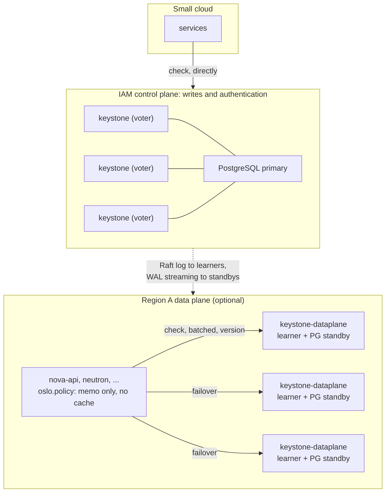

# IAM data plane and check API: design detail

**Status:** Draft for community discussion

This document holds the design detail that the
[authentication and authorization vision](vision.md) summarizes in §6.3 and §8.2
to §8.4: how the check API stays honest about the caller's chain, how it is
protected, how replicas stay fresh, and what the data plane is built from. It
was moved out of the vision so that the vision can stay a statement of what the
proposal is and why. Section numbers written as §N refer to the vision. The
order in which this is built is in the [roadmap](roadmap.md). The review that
led to the data plane split is in `doc/plans/iam-control-data-plane-split.md`.

## Part 1. The check API (vision §6.3)

### The chain facts are not the caller's to assert

Items 3 and 4 are chain facts in the sense of I1: properties of how the caller
authenticated, never of what the caller says. The request shape of §4.4 does not
preserve that on its own. An enforcement point parses `act`,
`delegation_context` and `restrictions` out of the presented credential, so a
data plane that applies items 3 and 4 to the fields it was handed is applying
them to data an enforcement point wrote, and a request with `delegation_context`
omitted asks to be decided as though the chain were not delegated. That is the
defect class behind OSSA-2026-005 and OSSA-2026-015, relocated from token scope
into the check request, where it is harder to see because the field names are
the right ones. SVID authentication does not close it: §4.2 is explicit that
mTLS identifies the service and never the user it serves, and a compromised
service that may assert its own account of a user's chain can widen every
delegation passing through it (§4.8).

So the chain must reach the data plane in a form the data plane verifies for
itself, and the proposal takes the direct route: the check request carries the
subject's credential as presented, and the data plane verifies it offline
exactly as the enforcement point did, deriving `sub`, `act`,
`delegation_context` and `restrictions` from the verified claims. Parsed fields
may still be sent for logging and a cheap pre-flight, but they are advisory —
where they disagree with the credential the credential wins, and the
disagreement is an audit event. Forwarding discloses nothing new: the callee
already holds the credential, and the data plane is internal-only.

Two consequences follow.

- **A check whose chain cannot be verified cannot be decided safely.** The data
  plane cannot differentiate an undelegated chain from a delegated one whose
  context was dropped, and the safe reading of that ambiguity denies everything.
  A deployment that cannot forward credentials — a legacy Fernet path, or a
  service in the middle that will not pass one on — therefore runs a declared
  posture on the same footing as §5.3's compatibility mode: set per caller,
  reported as a capability, and understood as a statement that those enforcement
  points are trusted to assert chain facts. It must not be the default, and a
  deployment carrying delegated chains should refuse it outright.
- **A signed chain assertion is the fallback where forwarding is unacceptable.**
  Keystone can mint at issuance an authenticated, opaque blob binding
  `(sub, act, delegation_context, restrictions, jti)` that an enforcement point
  relays without being able to alter it. It costs a claim and a key, and it says
  nothing about whether the credential is still live — so it is a fallback, not
  a preference (§10, question 10).

The request-scoped memo below is keyed by the same argument. Keyed on
`(subject, target)` alone, an answer produced for a subject's full authority
could serve a delegated or restricted call from the same subject on the same
target within one request — the escalation above, arriving one lookup later. The
key is `(subject, chain, target)`, where the chain component digests exactly the
facts items 3 and 4 consume; an undelegated, unrestricted chain digests to a
constant, so the ordinary case still shares entries. The same key is mandatory
for the opt-in client-side cache described later.

One input deliberately stays outside the evaluation. The data plane knows which
service is calling, and uses that for traffic classes and admission control
(below), but it does not fold it into the grant decision. A rule such as "only
`nova-api` may call `create_port` with `device_owner=compute:*`" (§7.4) is local
policy at the callee, where `service_credentials` is already in the input
(§6.2). Making the acting service a dimension of a grant multiplies the grant
space by the service catalog, and belongs with resource-level targets (§6.5) if
it is taken up at all. The data plane answers "may this subject do this here",
never "may this service ask".

### Answering enough questions discloses the graph

A caller that may ask about any subject, any target and any operation can
reconstruct the grant graph a batch at a time. Refusing to ship the graph in
bulk while serving an unmetered oracle over the same facts would be a
distinction without a difference, so three limits come with the API:

- **A caller asks about a subject presenting to it.** The forwarding rule above
  makes this enforceable rather than advisory: the credential is the caller's
  proof that the subject is in fact presenting. Asking about a subject whose
  credential the caller does not hold is a separate, separately granted
  capability.
- **A caller's target range is bounded where its own reach is.** A core service
  serving arbitrary projects needs no bound; a registered third-party
  integration is registered against the domains or projects it serves, and a
  check outside that set is refused rather than answered — and refused, unlike
  denied, declines to say whether the grant exists.
- **Enumeration is measured.** Distinct-subject rate and denial rate per caller
  class belong in the metrics the data plane ships (ADR 0031): a caller walking
  the graph looks like nothing else on the data plane, many distinct subjects at
  a high deny rate.

That separate capability is the oracle in administrative clothing, and operators
need it: "which of these operations may this user perform on this project" is
what an administrator asks while debugging a permission. Answering it is a
privileged read of the grant graph, audited as one and granted to tooling rather
than to anything on the data path.

### This is the new hot path; design it like one

`/v4/authz/check` replaces token validation on the data path, so its
non-functional requirements are not negotiable: batchable, answered from state
local to the replica without a per-request round trip to the write path,
versioned on terms the response states explicitly, admission-controlled per
calling SVID, accounted in decisions rather than requests, and exposed on the
internal interface only. Its latency budget is today's `keystonemiddleware`
cache _hit_ budget, not the miss budget, because it is called on every request
(§4.4). The existing assignment-layer caches stay as they are and are not
building blocks: ADR 0034 §8 caches the domain-to-driver binding rather than
resolved assignments, and ADR 0033 §9 declines to cache OpenFGA results at all.
The new work is the in-memory grant index below, which is a replica, not a
cache.

Two shapes are explicitly _not_ the answer. A pushed "entitlement snapshot" per
subject would recreate the §2.1 frozen-roles problem. Replicating the grant
graph to every evaluation point — a bundle each service's policy engine pulls
and evaluates locally — fails for two independent reasons: there is no partition
boundary to bound a bundle to, because Nova, Neutron, Cinder and Glance each
serve arbitrary projects in arbitrary domains from any node; and an OpenStack
grant graph spans mutually distrusting tenants, so "every compute node holds
every tenant's grants" is a disclosure decision, not a caching decision. Both
constrain where grant _facts_ come from and say nothing about where policy is
_evaluated_ — a per-service OPA sidecar asking this API live is unaffected
(§4.4).

### Freshness: replicas, not caches

A copy of authorization state has to answer one question: how does it know when
it is wrong? There are exactly two answers.

A **cache** is wrong until someone tells it. Its freshness depends on every
write path remembering which entries it affects, and on a lifetime for the cases
nobody remembered. Python Keystone's caching went wrong in precisely this way,
repeatedly: a role list, a project's `enabled` flag, a token's validity or a
catalog cached under whatever key the reader used; a new write path forgetting
the key; region-wide flushes added when targeted invalidation proved incomplete;
process-local caches diverging between workers; the lifetime becoming the real
safety net; and operators disabling caching to make bugs go away. The
refinements do not escape it. A per-subject invalidation counter still has to
compute which subjects a write affects — one user added to a large group bumps
every member's counter, a domain-level inherited grant bumps every subject
beneath it — which is the same fan-out relocated. A cloud-wide generation number
avoids the computation by flushing everything on every write, at the price of a
cache that never warms under churn.

A **replica** is never wrong about what it knows; it can only be behind. The
replication protocol maintains its freshness and by construction observes every
write, and the replica reports how far behind it is as a number: the Raft
applied index against the leader's commit index, a standby's replay position
against the primary's, a relation store's changelog position. No writer has to
remember anything. A new grant and a revoked grant propagate at the same speed,
which the cache schemes could never deliver for propagation. And a caller that
has just written can ask to be answered from a replica that has seen its write,
which no cache can offer.

| Property             | Cache (an `oslo.cache` entry per decision) | Replica (Raft learner, database standby)             |
| -------------------- | ------------------------------------------ | ---------------------------------------------------- |
| How it becomes fresh | Writer invalidates, or a lifetime expires  | Replication applies every write                      |
| Who must remember    | Every write path, forever                  | Nobody; the log is the invalidation                  |
| Staleness bound      | Assumed, from configuration                | Measured, against the write path                     |
| New grant visible    | After the lifetime                         | After the replication lag                            |
| Read-your-writes     | Impossible                                 | `min_version`: wait, forward, or refuse              |
| Write path down      | Serves until the lifetime, then nothing    | Serves the last applied state, up to `max_staleness` |
| Cold start           | Empty; a re-check herd                     | Full state from a snapshot or base backup            |
| Complexity lives in  | Every enforcement point and its library    | One component Keystone owns and tests                |

This proposal admits only replicas on the request path. The enforcement point
holds no cross-request copy of a decision; the data plane holds a replica of the
state and, where useful, an in-memory index derived from that replica and
invalidated by the same replication stream. A client-side cache remains possible
as an explicit opt-in for deployments that accept a stale window, and it is
described last, with the constraints it carries.

### Where the replica comes from, per driver

The data plane binary is driver-agnostic in the sense that the same code path
handles every store below without a per-driver fork — not in the sense that a
keyspace's driver can differ between the two planes.

| Store                                                                                                                                        | Replica                                                                        | Version reported                                              | Cold boot with the write path down                                               | Driver change                                                                                                                                                           |
| -------------------------------------------------------------------------------------------------------------------------------------------- | ------------------------------------------------------------------------------ | ------------------------------------------------------------- | -------------------------------------------------------------------------------- | ----------------------------------------------------------------------------------------------------------------------------------------------------------------------- |
| Raft keyspaces: mapping, OAuth2 clients and public keys, permissions, operation registry, service grants, and assignments on the Raft driver | Permanent Raft learner: added with `add_learner`, never promoted               | Applied log index, measured against the leader's commit index | Snapshot from a peer replica, or `keystone-manage storage restore` then catch-up | Storage crate: local reads on learners with version reporting (§8.3)                                                                                                    |
| SQL: assignments, roles, hierarchy, identity, catalog, revocation events                                                                     | PostgreSQL hot standby per replica or per failure domain, read-only connection | Replay LSN, measured against the primary                      | `pg_basebackup` from another standby (cascading replication)                     | No new component — `database.connection` points at the standby — but the driver reports the replay position and its lag, and the write path returns a commit LSN (§8.3) |
| OpenFGA                                                                                                                                      | An OpenFGA instance per failure domain over a standby of its database          | The store's changelog position, where exposed                 | The store's own base backup                                                      | Pass the consistency preference through; disable the store's own query cache                                                                                            |
| LDAP identity                                                                                                                                | The directory's own replica                                                    | None — see the freshness contract                             | The directory's                                                                  | None                                                                                                                                                                    |

Two consequences of that table matter more than its rows.

- **The SQL path needs no new component.** A database standby is a replica in
  the sense above, it is operationally familiar, it keeps serving with the
  primary down, and no driver has to know it is reading one to answer a check.
  That is what makes the first data-plane deliverable small — but not free:
  reporting `version` and honouring `min_version` is driver work on the SQL path
  as much as on the Raft one, and §8.3 lists it.
- **New authorization state arrives in Raft.** §9's rule that no Python-owned
  table changes and new state lives in Raft-backed drivers means permissions,
  permission sets, the operation registry and service grants are in the
  replicated log from the start, and a learner holds them for free. Assignments
  themselves are a per-domain choice, and the next subsection compares the two
  Keystone-owned options.

The replica also removes the objection that sinks every elaborate freshness
scheme. No single driver owns all five inputs of a decision (grants, group
membership, hierarchy, implied roles, the operation registry), so no composite
freshness token over them could be minted consistently, and every write path in
four crates would have to remember to bump a counter. A replica mints nothing:
within one Raft log every input the log holds is totally ordered, so a decision
at applied index N is snapshot-consistent across all of them, and within one
database the replay position gives the same guarantee. Only where inputs
straddle two stores — SQL assignments beside Raft permissions, an LDAP group
beside either — is a decision a join across two versions, and the response says
so by reporting both.

### A Raft assignment driver, compared with SQL

The existing assignment drivers are SQL (`assignment-driver-sql`, over the
Python-compatible tables) and OpenFGA. A third, Raft-backed driver is the
natural companion of the data plane, and worth designing on paper here because
its shape decides what a learner can do with it.

It stores a grant as a relation tuple, the way a Zanzibar store does, indexed
both ways in the replicated key-value store:

```text
assignment:by_target:{target}:{role}:{actor}  -> { inherited, created_at }
assignment:by_actor:{actor}:{target}:{role}   -> (same value)
```

where `target` is `system`, `domain:<id>` or `project:<id>` and `actor` is
`user:<id>` or `group:<id>`. Listing is a prefix scan on the matching index,
pagination is by key, and a direct check is a point read. Effective resolution
walks the same graph the SQL driver walks today — the actor's groups, the
target's ancestors, then implied roles — and the two inputs that walk needs from
other providers, group membership and the project hierarchy, are the crux of the
design:

- **Mirrored tuples.** The driver keeps `group:member` and `project:parent`
  tuples in its own keyspace, written by hooks on the identity and resource
  providers. Where identity and resource are themselves Raft-backed, the mirror
  is part of the same log and the graph is consistent at every index — the
  Zanzibar shape, with userset rewrites expressed as the walk. Where they are
  SQL, the mirror is a second write and needs the outbox and reconciliation
  discipline ADR 0035 already specifies for OpenFGA; the driver is then only as
  fresh as that sync, and the version reports it as a second component.
- **No mirror.** The driver stores only grants, and the walk asks the identity
  and resource providers at decision time, as the SQL driver does. On the data
  plane those providers read their own replicas (a standby for SQL identity), so
  nothing is lost on freshness; what is lost is single-log snapshot consistency
  across the join.

Against the SQL driver, benefits and costs are both concrete:

| Property                                 | SQL assignment driver                                           | Raft assignment driver                                                                                      |
| ---------------------------------------- | --------------------------------------------------------------- | ----------------------------------------------------------------------------------------------------------- |
| Replica for the data plane               | A PostgreSQL standby per replica or per failure domain          | The learner the data plane already is; no second component                                                  |
| Version and read-your-writes             | Replay LSN, per database                                        | Applied index, in total order with every other Raft-held input                                              |
| Invalidation of an in-memory grant index | Logical decoding of the standby's stream, or periodic reconcile | The apply hook: every committed entry is observed in process                                                |
| Encryption at rest                       | The database's                                                  | Keystone's own (ADR 0016-v2), keyed by Keystone                                                             |
| Python Keystone coexistence              | Full: the tables are the same                                   | None: Python Keystone cannot see these grants, so only for domains served by Rust Keystone alone (ADR 0034) |
| Group membership and hierarchy           | Joined at query time from the same database                     | Mirrored tuples, or a cross-provider walk (above)                                                           |
| Listing and pagination                   | SQL cursors                                                     | Prefix scans on two indexes; pagination by key                                                              |
| Storage volume                           | Whatever the database holds                                     | Small: one tuple per grant; millions fit an embedded LSM tree comfortably                                   |
| Operational surface                      | A database and its replication                                  | The Raft cluster the deployment already runs for other state                                                |

The recommendation follows from the coexistence row. While Python Keystone is
still in the picture, assignments stay on the SQL driver and the data plane
reads a standby. A domain that only Rust Keystone serves — a greenfield
deployment, or one moved under ADR 0034 — can adopt the Raft driver and gains a
learner-only data plane and total-order versioning. The two coexist per domain,
which is what ADR 0034 was built for, and the data plane serves both from one
process.

### The freshness contract

The contract is deliberately small, and the same wherever Keystone holds a
replica:

- **Every response carries `version`.** For a Raft-backed domain the applied log
  index; for a SQL-backed domain the replay position; for a relation store its
  changelog position. A decision whose inputs straddle stores reports each
  component. Enforcement points log it with the decision, which gives the audit
  trail "allowed against grant state N" (§5.4).
- **An input whose store reports no position is named, not hidden.** An LDAP
  directory's replica is the standing example: it contributes no version
  component, `max_staleness` cannot be enforced over it, and the response
  therefore marks the decision as resting on an input with an unbounded
  staleness term. An operator who needs a bound cannot get one from that driver,
  which is half of the capability question §10 asks (question 7).
- **A request may carry `min_version`.** A replica behind it waits, up to a
  bounded time, for its state to reach it; then forwards to a replica that has;
  then refuses — not denies. The IAM control plane returns the commit version of
  every grant write, so a client that has just created a grant can ask for a
  decision that sees it. This is Zanzibar's consistency token, and Raft provides
  it natively.
- **The operator sets `max_staleness`.** A replica whose measured lag exceeds it
  stops answering with allows: it refuses, and the caller's breaker moves to the
  next replica. This is the freshness dial. Unlike a lifetime it is measured
  against the write path rather than assumed, and unlike a lifetime it bounds
  the partition case too.
- **Refused and denied are different answers.** A refusal says the replica
  cannot vouch for an answer; a denial says the grant does not exist. Clients
  treat the first as retryable elsewhere and the second as final, and dashboards
  count them apart.
- **There is no lifetime, no per-result TTL, no mint stamp and no generation
  number.** The response is a fact about state version N. The caller uses it for
  the request that asked and discards it.
- **The data plane's decision log is complete** (§5.4). Every decision reaches a
  replica, so what the cloud decided is what the replicas logged, with the
  version each decision was made against.

What the assignment driver still changes is where the replica comes from and
whether a version exists at all:

| Property           | Keystone holds a replica (SQL, Raft)                 | Externally owned store (OpenFGA, LDAP)                                          |
| ------------------ | ---------------------------------------------------- | ------------------------------------------------------------------------------- |
| Freshness bound    | Measured replication lag, bounded by `max_staleness` | The store's own replication; measurable only where the store exposes a position |
| Read-your-writes   | `min_version`                                        | Only where the store offers a consistency token to pass through                 |
| Static stability   | The replica's own, tested by Keystone (§8.1)         | The store's, established there                                                  |
| Revocation latency | The lag                                              | The lag, plus relation-sync lag for memberships Keystone syncs (ADR 0035)       |
| Operator's dial    | `max_staleness`                                      | The same where a position is available; otherwise none                          |

The columns converge wherever the store can report a position, and that is the
payoff of not building cache invalidation: one operator-visible freshness model
across every driver, instead of a SQL feature beside an external-store
limitation.

### The in-memory grant index inside the replica

The first data-plane deliverable answers a check by running the same queries the
IAM control plane runs, against the local replica, with the request-scoped memo
below removing repeats within one batch: a few milliseconds per distinct
`(subject, target)`, and enough to ship.

The scaling step is to materialize the grant graph in memory inside each replica
— group membership, the hierarchy closure, implied roles, the role-to-permission
map — so that a check is a lookup. This is the Zanzibar closure index. What
makes it a replica and not a cache is where its invalidation comes from: the
Raft apply hook, or logical decoding of the standby's stream for SQL-backed
domains, both of which observe every write. The index carries the version it was
built to, the memo is still the only memo, and a replica can disable the index
and fall back to queries at any time — so the index is an optimization over the
replica, never a second source of truth.

### A client-side cache is an opt-in, and it carries its constraints

A deployment may still decide a stale window at the enforcement point is worth a
round trip saved — a Python service at the far end of a WAN, or an integration
that would rather act on a stale-but-correct decision than fail. That is a
client-library option (§9), off by default, and not part of the architecture.
Where it is enabled, everything a cache needs applies and none of it is
optional: the key includes the chain digest (above); allows are held for a short
lifetime and denies may be held longer, because a stale deny is an inconvenience
and a stale allow is a security failure; a decision whose chain carries `act`,
`delegation_context` or `restrictions` is never served stale; the cached
`version` is logged with the decision, so an auditor can tell "allowed on
current data" from "allowed on data N seconds old"; and the lifetime is the
bound, since no early-drop signal exists for a cache the write path cannot see.
A caller that could ask to be served stale could extend its own revocation
window on demand, so the opt-in is a property of the service's deployment
configuration, never of a request.

Two shapes stay refused whatever the freshness mechanism. The pushed
"entitlement snapshot" named above stays refused here too, for the same
frozen-roles reason. So do source-versioned freshness tokens — sealing the
counters of every source a decision consulted into an opaque token, so
revalidation is a comparison rather than a traversal: no single driver owns all
the inputs, the counter bump becomes a correctness invariant in four write paths
with nothing in the type system to enforce it, it accelerates revocation but not
propagation, and the counter table becomes the hottest row set in the
deployment. A replica gives what that scheme wanted, a version and
read-your-writes, without minting anything.

### Request-scoped deduplication is the only memo

One inbound API call can evaluate policy many times — the collection-level
decision plus one per item, per the re-check requirement below — and those
evaluations frequently ask the same `(subject, chain, target, operation)`
question. An in-memory memo scoped to the request and discarded with it removes
the repeats, and has no freshness problem to solve because it lives and dies
with a single request. It also gives a request one consistent view: a request
asking the same question twice should not get two different answers because an
assignment changed in between, which is why the data plane answers a batch
against one version too.

This is the caller-side counterpart of ADR 0030, which solves the same problem
inside Keystone. Nothing in `oslo.policy` provides it today, so it is part of
the check-type work in §9.

### Capacity is isolated per caller class, not merely rate-limited

Rate limiting caps what one caller can do to itself. It does nothing about the
problem this API creates at scale: an unrelated integration's traffic degrading
queueing and latency for the core services sharing the same data plane. Nova's
checks are not optional — one that does not complete is a user request that
fails — while a third-party reporting integration's checks are sheddable, and
the two must not compete for the same queue on equal terms.

So the data plane declares **traffic classes** with per-class concurrency limits
and admission control, shedding the lower class first, with separate deployments
as an option on top rather than as the mechanism. The isolation key costs
nothing: the data plane already authenticates every caller by SVID on the
internal interface, so the SPIFFE trust domain or path prefix is available
without inventing an identity concept for it.

Two things about the cost model:

- **Accounting is in decisions, not requests.** The API is deliberately
  batchable, so one request can carry a thousand `(target, operations)` pairs,
  and a per-request limit is bypassed by batching. ADR 0022's rate limiting is
  request-count limiting keyed on IP or username with no notion of per-request
  cost and no concurrency control, so this is new work rather than an existing
  mechanism to configure.
- **The number to size is decisions per second**, not replica count. The
  per-item re-check below amplifies one user action into a page's worth of
  decisions, so a deployment guide that documents only replica placement (§8)
  has documented the smaller half of the capacity question.

Both depend on being able to see the traffic, which makes per-trust-domain
attribution a prerequisite and not a later nicety: decisions per second, replica
lag, refusal rate, denial rate and shed count broken down by caller class belong
in the metrics (ADR 0031) that ship with the data plane. Quotas that cannot be
measured cannot be set.

### Collection reads and the per-item re-check

The security model requires list endpoints to re-enforce the per-item read
policy against each record's own identifiers (I8), and forbids replacing that
with a permissive collection filter (I8a). A cross-project list under
`system-scope="all"` therefore cannot be one decision: it is a collection-level
decision plus one per-item decision per record. Three things keep that from
being a per-record round trip:

- **Batch checks.** The API takes a list of `(target, operations)` pairs in one
  call, so a page of results is one request, not one per row.
- **Grant-shaped short-circuit.** When the collection-level decision was allowed
  through a system or domain grant that covers every project in the page, the
  per-item check is answered from that same grant rather than re-derived. This
  is a short-circuit in the _evaluation_, not a relaxation of I8: each item is
  still decided against its own owner, and an item owned outside the grant's
  reach still has to be decided on its own and dropped if denied.
- **The request-scoped memo.** Decisions within the batch are memoized per
  `(subject, chain, target)`, so a page whose rows share few owners costs few
  distinct decisions, and the whole batch is answered against one `version`.

The consequence is that cross-project listing is more expensive under this model
than a system-scoped token that services interpreted themselves, and deployments
must size the check API for it.

### Bootstrapping and Keystone's own authorization

Keystone is itself a service with authorized APIs. It evaluates its own policies
against its own assignment data in-process — it does not call `/v4/authz/check`
over the network to authorize a call to itself — and `/v4/authz/check` is itself
authorized by the caller's SVID at the internal interface, not by a recursive
check. The first grant in a new deployment comes from the existing bootstrap
path (`keystone-manage`, operating on the store directly), exactly as today. In
addition, Keystone exposes a local admin interface over a Unix domain socket: it
carries the full API, is reachable only from the host, and authenticates the
caller by SVID, so a high-security perimeter can drive administrative calls
without a bearer token and with the same policy checks the network API applies.

## Part 2. The data plane (vision §8.2 to §8.4)

### 8.2 What the data plane is, concretely

In the Rust implementation the data plane is a second binary target in the
`keystone` crate, `keystone-dataplane`, built from the same library. The two
binaries are built in separate invocations, and the data-plane build never names
the write-side router module, so the absence of a write path is a property a
reviewer checks in the build rather than a flag they trust at runtime:

- **Routes.** `/v4/authz/check`; JWKS, `.well-known` and the revocation feed;
  JWT validation against that JWKS; the catalog reads services and SDKs need on
  the request path. No token issuance, no login, no refresh, no attestation, no
  grant or lifecycle writes, no configuration, no SCIM. Legacy Fernet validation
  (`GET /v3/auth/tokens`, Mode B) stays on the IAM control plane deliberately:
  Fernet keys are a symmetric repository, so a replica able to validate a Fernet
  token is a replica able to mint one, and putting that repository in every
  failure domain would undo §8.4 before it starts. The legacy path therefore
  keeps the legacy availability, which is one more reason for a deployment
  adopting the data plane to finish the move to JWT.
- **Drivers.** The same drivers as `keystone`, each pointed at a replica (§6.3
  table). The SQL connection is to a standby, which the database makes
  read-only, and the database user has `SELECT` only, so a misconfiguration
  pointing at the primary still cannot write. Mutating provider methods are not
  compiled in; where a shared path could reach one — a hook, an audit side
  effect — the execution context carries a read-only marker that makes the call
  fail loudly.
- **Storage role.** The replica joins the Raft cluster as a permanent learner
  under a distinct SPIFFE role (`spiffe://<td>/keystone/storage/learner`). The
  leader's gRPC interceptor, which already parses the role segment and gates
  operator RPCs on it, rejects `client_write`, `change_membership` and every
  operator RPC from that role. A learner never promotes itself and cannot be
  promoted by mistake: the role decides, not the membership.
- **Configuration.** A `[dataplane]` section with `max_staleness`, the bounded
  wait for `min_version`, and the peer replicas to seed from; the
  `[distributed_storage]` section gains `role = "learner"`.



### 8.3 What the storage and SQL layers have to gain first

The Raft storage exists, and the data plane leans on it, but five things are
missing between "a learner" and "a replica that serves", and they are the
concrete content of the static-stability requirement:

1. **Local reads on learners, with the version.** Today every read on a
   non-leader node forwards to the leader after a ReadIndex round trip, and
   reads locally only as a fallback when the leader is unreachable. A node in
   the learner role serves reads from its own state machine without ReadIndex
   and returns the applied index with every result. **This needs an amendment to
   ADR 0016-v2 §3, and this document does not make one.** That section puts
   group membership in Tier 2 precisely because a stale membership read can
   allow a member who was just removed, and the argument offered here — that a
   learner is a replica by definition, so reporting its lag and refusing past
   `max_staleness` is more honest than hiding the staleness behind a forward to
   the leader — is an argument for amending it, not a substitute for doing so.
   The tier rule stands as written for voters, where a read is a live
   administrative fact. `local_reads_mode`, which the storage documentation
   already describes, is where the learner behaviour would live.
2. **Lag as a first-class metric.** Leader commit index, learner applied index
   and their difference, exported by both sides (ADR 0031), with the
   `max_staleness` refusal counted separately from denies.
3. **Seeding without the leader.** Snapshot install is leader-driven today, so a
   replacement replica cannot cold-boot during an outage of the write path.
   Either the snapshot transfer is generalized to any peer that holds a newer
   snapshot, over SVID mTLS, or the documented procedure is
   `keystone-manage storage restore` from the latest backup followed by
   catch-up. The second exists and is enough to start; the first is what makes a
   replacement replica routine rather than a runbook.
4. **A learner SPIFFE role**, as above: a small addition to the existing role
   parsing and interceptor.
5. **Version and lag on the SQL path.** the SQL driver still has to report the
   standby's replay position as `version`, export its lag against the primary as
   a metric, and the write path still has to return the commit LSN of a grant
   write so that `min_version` means anything on a SQL-backed domain. Small
   work, but the freshness contract is not met without it.

### 8.4 Keeping secrets away from replicas

A learner applies every log entry, and applying an encrypted entry needs the
data encryption key, so a learner today decrypts everything the log holds:
OAuth2 private signing keys, refresh-token families, API-key hashes and whatever
else a Raft-backed driver stores. More replicas in more places means more copies
of that material — the one place where the data plane widens the attack surface
rather than narrowing it. Two designs close it, adoptable in order.

- **Tier-keyed encryption.** ADR 0016-v2 already binds a sensitivity tier into
  every record's authenticated data and derives purpose-specific sub-keys from
  the master key. The extension is a second key hierarchy for Tier 2 and Tier 3
  payloads: the writer encrypts the payload with a tier key _before_ proposing
  it, under the existing log and state encryption, and only voters hold that
  tier key. A learner applies the entry, stores the inner ciphertext, and
  answers a read of such a key with "not readable in this role". The change is
  confined to the storage crate's encrypt and decrypt paths and to KEK
  provisioning; learners still carry the ciphertext volume, and a tier-key
  rotation becomes a voter-side re-encryption sweep.
- **A second Raft group.** Secret material — sessions and refresh families,
  API-key hashes, credential plaintexts, private signing keys — moves to a group
  the data plane is not a member of, while authorization state stays in the
  group it follows. The storage crate is already generic over keyspaces, so two
  storage instances with separate membership and paths are configuration plus a
  keyspace-to-group routing table. The cost is two clusters to operate and the
  rule that no write may span groups. It is the cleaner boundary, and the one
  that stops learners carrying secret ciphertext at all.

Tier-keyed encryption is enough for replicas inside the control-plane trust
zone; a replica in a remote region, or on a host shared with other services, is
the case for the second group. Which secrets belong in which tier is the storage
ADR's decision, not this document's (§10, question 13).
