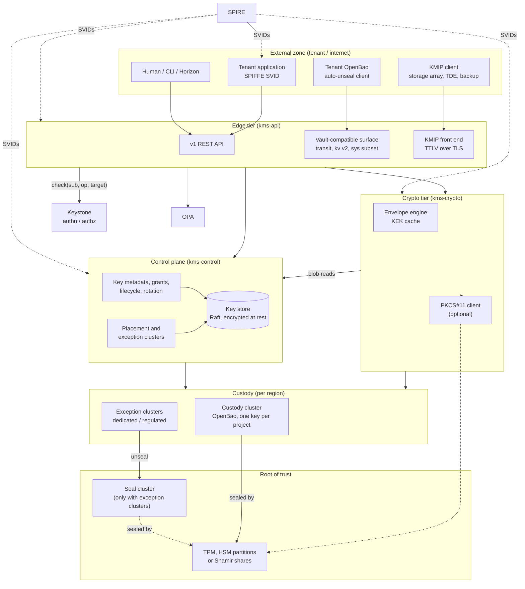
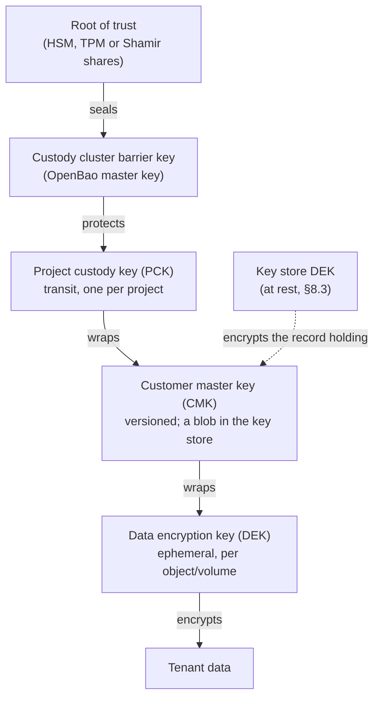
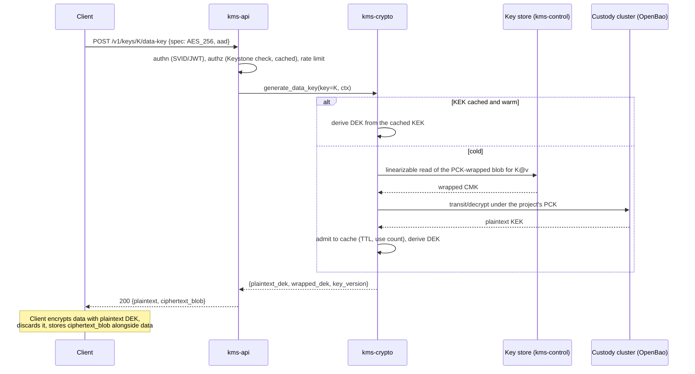
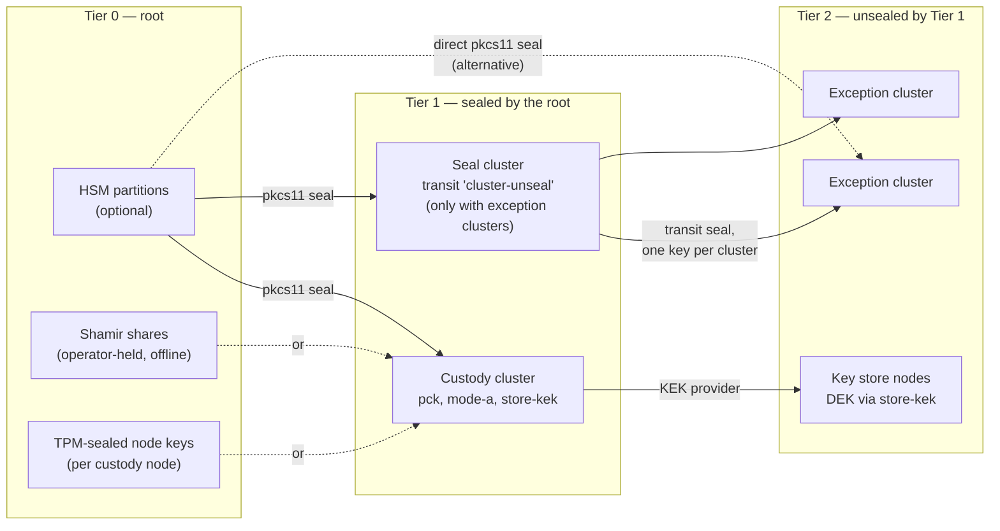
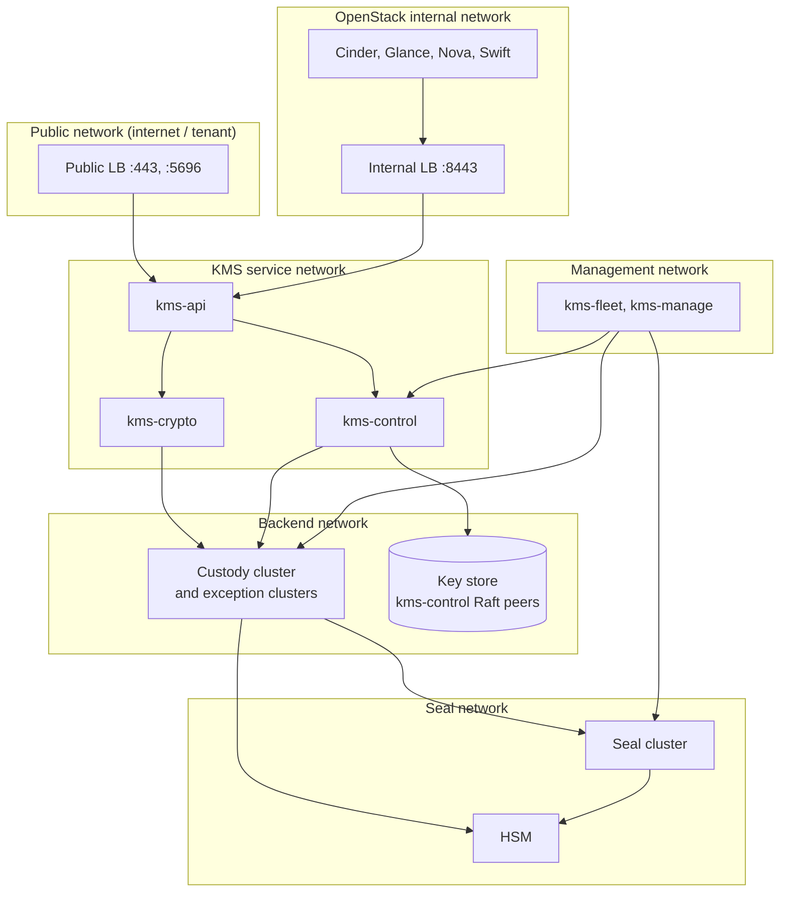

# A Public Key Management Service for OpenStack: Architecture

**Status:** Draft for community discussion

**Date:** 2026-09-13

This document specifies the architecture of a new project: a public Key
Management Service (KMS) for OpenStack-based clouds. It is a companion to the
[authentication and authorization vision](vision.md) and assumes that vision's
building blocks — SPIFFE/SPIRE workload identity, scope-less tokens with a
per-request target, a Keystone-backed authorization decision, OPA policy, CADF
audit, handler-level rate limiting — are available, because the KMS is built on
`keystone-rs` primitives and reuses its crates wherever the shape fits.

The service is deliberately _not_ a rewrite of Barbican. Barbican is a secret
store with a plugin backend; what operators of a public cloud need is a managed
key management service with the operational profile of AWS KMS or GCP Cloud KMS:
a hard multi-tenant blast-radius story, an envelope-encryption data path that
survives the loss of any single backend, standard interfaces (KMIP, the
OpenBao/Vault API) so that existing customer software works unmodified, and a
clear separation between what a tenant may reach from the internet and what only
the cloud's own services may reach.

Under the hood the service writes neither a barrier nor a new storage engine.
Key custody sits behind **one OpenBao barrier per region**, holding one custody
key per project; the key records themselves live in a Raft-replicated,
encrypted store built from the crate `keystone-rs` already uses for its own
storage; and a Rust control and data plane sits in front of both. A tenant whose
contract demands physical separation gets a custody cluster of its own. None of
this is a contract with the tenant — not even on the surface that speaks the
OpenBao API, which the KMS implements itself rather than proxying (§5.6).

Every section states its own requirements and limits. Where more than one design
is defensible the options are presented with a recommendation, because this is a
document to argue about, not a finished decision record. Section 19 gives the
phased plan; the first useful deliverable is narrow on purpose.

---

## 1. The vision in one page

A public cloud cannot ask its customers to trust a key management service that
is a thin wrapper over a single database. It has to answer four questions
concretely:

1. **Where does my key material live, and who can reach it?** Answer: inside a
   region, as records wrapped under a custody key that belongs to your project
   alone and never leaves an OpenBao barrier or an HSM, sealed by a root of
   trust the cloud holds. Tenants who need it get a custody cluster of their
   own. No operator path reads plaintext key material; no tenant network path
   reaches the storage layer at all.
2. **What happens when something breaks?** Answer: envelope-encryption
   operations — the hot path, and the one that users notice — are served by a
   stateless crypto tier that keeps working for the lifetime of its cached keys
   even when the custody cluster or the key store behind it is unavailable.
   Blast radius beyond that is chosen per tenant through placement (§8.6), not
   imposed by the topology.
3. **How do I integrate what I already run?** Answer: three interfaces. A native
   REST API, KMIP for storage arrays, databases and backup software, and an
   OpenBao/Vault-compatible surface (`transit`, `kv` v2, and the minimum of
   `sys`) so that software written against Vault works without change — most
   immediately, so that a customer's own OpenBao can auto-unseal against the
   cloud's KMS.
4. **How do my workloads authenticate?** Answer: with SPIFFE. Customer workloads
   are assumed to have SPIRE support — either the cloud's own SPIRE (VMs
   attested per [ADR 0032](adr/0032-vendor-data-jwt.md), cluster nodes via the
   same path) or a customer-run SPIRE federated with it. Long-lived secrets in
   guest images are a legacy path, not the design centre.

The shape that follows from those answers:

| Layer             | What it is                                                                                               | Reachable from                     |
| ----------------- | -------------------------------------------------------------------------------------------------------- | ---------------------------------- |
| **Edge**          | `kms-api`: axum HTTP, native v1 REST, Vault-compatible surface, KMIP front end                           | Tenant networks, internet          |
| **Crypto tier**   | `kms-crypto`: stateless envelope encryption, KEK cache, optional PKCS#11                                 | Edge and internal services only    |
| **Control plane** | `kms-control`: key metadata, placement, lifecycle, rotation; hosts the Raft key store (§8.3)             | Internal control network only      |
| **Custody**       | One OpenBao cluster per region holding per-project custody keys; exception clusters for isolated tenants | Crypto tier and control plane only |
| **Root of trust** | TPM, HSM partitions or Shamir shares sealing the custody cluster                                         | Seal path only                     |

and one rule that runs through the whole design:

> **The tenant-facing plane never talks to the storage plane, and the storage
> plane never terminates a tenant connection.** Every crossing is mediated by a
> service that holds a SPIFFE identity, is authorized per request, and is
> audited.

---

## 2. Scope, non-goals, and the relationship to what exists

### 2.1 In scope

- Symmetric key management: create, rotate, enable/disable, schedule deletion,
  encrypt/decrypt of small payloads, envelope-encryption data-key generation.
- Asymmetric key management: sign/verify, wrap/unwrap, public-key retrieval.
- Secret storage (opaque blobs) for the Barbican and `kv` use cases.
- Customer-managed keys (CMK) for OpenStack services: Cinder volume encryption,
  Glance image encryption, Swift/S3 object encryption, Manila, database and
  backup encryption.
- Bring-your-own-key import and, where policy allows, export under wrap.
- KMIP server for third-party clients (storage arrays, Oracle/MSSQL TDE, backup
  software, vSphere).
- OpenBao/Vault API compatibility for `transit` and `kv` v2, sufficient for a
  customer OpenBao to auto-unseal and for Vault-aware software to work.
- Regional HA, multi-region key policy, and disaster recovery.

### 2.2 Out of scope (at least initially)

- Being a general-purpose secret manager with dynamic secrets engines
  (databases, PKI, cloud credentials). Those are what a customer's _own_ OpenBao
  is for; the cloud KMS exists partly to make running one safe.
- Certificate authority services. A CA is a distinct product with distinct
  compliance; the KMS may hold the CA's private key, and that is the boundary.
- Replacing SPIRE's own CA or Keystone's signing keys. Those have their own
  bootstrap chain and adopting the KMS for them is a later, separate decision
  (§9.6).
- Confidential computing attestation-bound release of keys. It is an
  authorization condition on top of this architecture rather than a change to
  it, and §2.6 states what the service would and would not own if it were
  added.

### 2.3 Relationship to Barbican

Barbican defines the OpenStack contract that Cinder, Glance, Nova, Octavia and
Manila already speak (`castellan`). The KMS therefore ships a **Barbican v1
compatibility surface** (§5.8) so existing services keep working from day one,
and offers the native API for everything Barbican cannot express (grants,
envelope operations, KMIP, key policies, multi-region behaviour). Barbican's own
plugin model is not reused: a plugin inside Barbican's process cannot give the
blast-radius or network-isolation properties of §1.

### 2.4 Relationship to `keystone-rs`

The KMS is a separate project with its own repository, release cadence and
database. It depends on Keystone for identity and authorization decisions, and
it borrows Keystone's engineering: axum handlers, the Raft-replicated encrypted
storage of [ADR 0016-v2](adr/0016-v2-raft-storage.md) (§8.3), the OPA
integration ([ADR 0002](adr/0002-open-policy-agent.md)), the security context
([ADR 0017](adr/0017-security-context.md)), handler-level rate limiting
([ADR 0022](adr/0022-rate-limiting.md)), CADF audit
([ADR 0023](adr/0023-audit.md)), Prometheus metrics
([ADR 0031](adr/0031-prometheus-metrics.md)), pagination
([ADR 0029](adr/0029-pagination.md)) and the per-request cache
([ADR 0030](adr/0030-per-request-cache.md)). Shared code is extracted into
crates published from `keystone-rs` rather than vendored, so that a fix to the
audit pipeline or the rate limiter benefits both. Keystone's PKCS#11/TPM KEK
work (`doc/plans/0016-v2-pkcs11-tpm-kek.md`) is the direct ancestor of the HSM
integration in §10.

The dependency on Keystone is a runtime dependency with the same posture as the
one in [vision §8](vision.md): authentication is validated offline,
authorization is a cached live decision, and the KMS fails closed when no cached
decision applies. Because a KMS outage is a data-availability outage for
everything encrypted with it, §11.4 imposes tighter requirements on that cache
than a compute API would need.

### 2.5 Relationship to OpenBao

OpenBao is a premise of this design, and a premise deserves an argument. Four
answers to "under whose barrier does key material live" were considered:

| Option                                                                                                                                                                                                                                   | What it gives                                                                                                                                                                                                  | What it costs                                                                                                                                                                                                          |
| ---------------------------------------------------------------------------------------------------------------------------------------------------------------------------------------------------------------------------------------- | -------------------------------------------------------------------------------------------------------------------------------------------------------------------------------------------------------------- | ---------------------------------------------------------------------------------------------------------------------------------------------------------------------------------------------------------------------- |
| A fleet of OpenBao clusters, every CMK a `transit` key in its tenant's shard                                                                                                                                                             | Physical separation between tenants; blast radius bounded per shard; barrier, Raft replication and a seal protocol with an operational history                                                                 | Operating _N_ Raft clusters per region, which becomes the largest line item in the service's cost; every CMK stored twice; a namespace policy set per tenant; migration as the everyday path rather than the exception |
| HSM partitions as the custody backend                                                                                                                                                                                                    | The strongest custody story there is                                                                                                                                                                           | Fails on arithmetic: a partition holds thousands of key objects, not the 10⁵–10⁶ that a four-digit tenant count implies, at a throughput §10.2 already calls "much lower than software crypto"                         |
| No barrier product at all: wrapped blobs in a database, wrapping keys held through PKCS#11, all cryptography in `kms-crypto`                                                                                                             | One fewer distributed system; restore is an operation the operators already know                                                                                                                               | The project owns the barrier — wrapping format, rekey, crypto-shredding, the compliance narrative — and, decisively, the HSM stops being optional                                                                      |
| **One custody cluster and a key store (recommended):** one OpenBao per region holding a custody key per project, CMK records wrapped under it in a Raft store built from `keystone-rs`'s storage crate, all cryptography in `kms-crypto` | The barrier stays OpenBao, so the HSM stays optional; 10³–10⁴ custody keys, which one cluster holds easily and an HSM partition can hold too; one durable copy of every CMK; storage the team already operates | Region-wide blast radius for tenants on the shared pair, bought back per tenant through placement; the KMS owns key versioning, `rewrap` of tenant ciphertext and the blob envelope                                    |

The fourth row is the recommendation, and the reason it wins is visible in the
third row's failure. Writing a barrier is expensive, but the sharper reason not
to is this: §10 promises that an HSM "is never required for the service to
function", and an OpenBao barrier sealed by a TPM or by Shamir shares is the
_software_ root of trust that makes the promise keepable. Remove OpenBao and a
deployment must either make an HSM mandatory, pricing out every operator who
does not already have one, or grow its own software seal, which is rebuilding
the least forgiving part of OpenBao with none of its review history. **OpenBao
is what lets the HSM stay optional.**

But that argument is about the barrier, and only the barrier. It says nothing in
favour of also using OpenBao as the database of a million small records, which
is the job that forces a fleet into existence — and that job is one
`keystone-rs` already does: replicated, linearizable, encrypted-at-rest storage
of many small records is exactly what
[ADR 0016-v2](adr/0016-v2-raft-storage.md) built for identity data. The fourth
row keeps OpenBao for the part where it is irreplaceable and stops asking it to
be the part where it is merely adequate. The fleet survives in §8.6 as the
exception for tenants whose contract is physical separation, which is what it
is actually good at selling.

The secondary argument is the compliance narrative of §20. "The key material is
inside an OpenBao barrier" is a sentence an auditor already accepts. The fourth
row changes its form to "the key material is wrapped under a key that belongs to
your project alone and has never left an OpenBao barrier", which is the sentence
every public cloud KMS already says about itself, and which the project must
still back with a reviewed blob format (§6.4, §17).

What OpenBao is _not_ asked to be is the region's cryptographic engine, nor its
database. §7 makes mode B the default, under which the hot path reaches the
barrier roughly once per key version per cache lifetime, and §6.3 is explicit
that transit's non-exportability is precisely why the offload cannot be built on
transit alone. The dependency is therefore deliberately narrow, and §8.9 writes
down its exact surface so that it stays narrow.

### 2.6 Relationship to confidential computing

Two different things travel under the name "key broker", and separating them is
most of the analysis: one is functionality the service would sell, the other is
a way the service could run.

**What the end user wants.** A tenant running a confidential VM or a
confidential container wants a key released only to a workload whose
measurement it recognises. The shape the ecosystem has settled on is two
components: a key broker that runs an attestation handshake with the workload
and hands back a resource, and an attestation service that appraises the
evidence against reference values and hardware endorsements. The KMS is the
right holder of the _release decision_ — it already holds the key, it already
evaluates a per-object policy in OPA (§13.3), and a broker able to release keys
the KMS custodies without the KMS deciding would split exactly the authority
§13 exists to consolidate. The KMS is the wrong owner of the _appraisal_:
maintaining reference values, vendor endorsement chains and TCB levels across
TEE generations is a distinct product with a distinct compliance lifecycle,
which is the same reason §2.2 excludes certificate authority services.

The split that follows:

| Concern                                                    | Where it belongs                                                          |
| ---------------------------------------------------------- | ------------------------------------------------------------------------- |
| Holding the key and deciding whether to release it         | The KMS, as a condition on a grant (§13.4)                                |
| Appraising TEE evidence and issuing a result               | A verifier the operator runs, or SPIRE at SVID issuance                   |
| Reference values and appraisal policy for a tenant's image | The tenant, as a resource the KMS stores and passes to policy             |
| Speaking the attestation handshake to a workload           | A thin edge surface on its own hostname (§5.3), for clients that need one |

**What the service itself needs: nothing.** Attestation is also a candidate
root of trust for the KMS's own processes — a custody cluster that unseals only
on nodes that have proved their measurement (§9.3), or a
`kms-crypto` running inside a TEE so that the plaintext KEK cache of §7.3 sits
in memory the host cannot read. Both are attractive and neither may become
required: principle 6 makes the HSM optional, and a service that could not
start without attested hardware would be that promise broken in the other
direction. On the service's own path, attestation is therefore an _additional_
Tier-0 option ranked alongside TPM and HSM sealing, never a prerequisite. The
distinction also decides when each may be considered: a tenant-facing broker is
a feature that can wait for demand, whereas anything the service needs in order
to start has to be settled before Phase 1.

Adding the broker is cheaper than it first looks, because each piece is already
present in some other guise:

- The release primitive exists. Fetching a brokered resource is a read of an
  opaque secret (§5.4); releasing a key is `unwrap` or `data-key`.
- Wrapping the released material to a public key the caller has proved it holds
  is the BYOK import-token machinery of §5.4 run backwards, with the ephemeral
  public key taken from the evidence instead of minted by the KMS.
- The AAD of §6.4 already carries `caller_scope_digest`; a digest of the
  appraised claims goes there with no format change. That buys a property worth
  having on its own — a DEK minted for an attested workload cannot be replayed
  into an unattested context, even by the same project.
- Appraisal policy and KMS policy are both Rego, evaluated by the engine the
  project already runs.

What is not cheap is precisely what the recommendation above declines to own.
Appraisal needs endorsement material fetched from a hardware vendor outside the
region, which principle 7 does not forbid but does not welcome. A firmware
update that moves a measurement is a fleet-wide availability event with a cause
the KMS cannot see coming. And reference values describe the tenant's image, so
the tenant owns them — a tenant who gets them wrong loses access to its own
data with nothing broken to repair, which is a support burden of a kind the
rest of this design works hard to avoid.

Three consequences are carried into the rest of the document: an identity track
that is not really a new one (§4.4), a condition on grants (§13.4), and a
freshness rule the caches must not quietly undo (§7.3). None of them is a
Phase 1–5 concern; §21, question 12 says what would make it one.

---

## 3. Principles

1. **Blast radius is a design parameter, not an outcome.** Every tenant is
   assigned a placement class, and the class decides what it shares: `standard`
   tenants share the region's custody cluster and key store, and a tenant whose
   risk the shared pair is not sized for buys a custody cluster of its own
   (§8.6). The shared pair is sized so that its loss is an incident the crypto
   tier's cache can ride through, not a catastrophe.
2. **Plaintext key material exists in exactly two places:** inside an OpenBao
   barrier (or HSM), and transiently in the memory of a crypto-tier process that
   is currently performing an operation. It is never written to the KMS's own
   store, never logged, never returned by an API except where the tenant
   explicitly asked for a data key or an authorized export.
3. **The hot path must not be the fragile path.** Envelope operations are orders
   of magnitude more frequent than key-management operations and are served by a
   tier that can be scaled and degraded independently of the custody backend.
4. **Internal and external are different services that happen to share code.**
   They bind different addresses, on different networks, with different
   authentication, different policy, different rate limits and different audit
   streams. A handler is reachable from exactly one of them unless a deliberate
   decision says otherwise.
5. **Standards where customers already stand.** KMIP and the Vault API are not
   nice-to-haves; they are the reason an enterprise can adopt the service
   without rewriting software.
6. **The HSM is an option, never a prerequisite.** A deployment without an HSM
   must be fully functional and honestly documented as to what it does and does
   not guarantee. A deployment with an HSM must not have to re-architect.
7. **No dependency on any external public KMS.** The service is the root of
   trust for the cloud it serves. Everything it needs to bootstrap must be
   derivable from operator-held material, a local HSM, or its own custody
   cluster.
8. **Region is a hard boundary by default.** Key material does not leave its
   region unless the key was explicitly created as a multi-region key and the
   tenant asked for it.
9. **Crypto-agility from the first line.** Algorithms, key sizes and wrapping
   formats are versioned in the wire format and in storage, so that post-quantum
   wrapping (ML-KEM) and signing (ML-DSA) are additions, not migrations.
10. **Everything is recorded.** Every administrative action and every custody
    or placement operation emits its own CADF event. Every _key use_ is recorded too, but at
    data-plane volumes the unit of record is allowed to be an aggregate (§14):
    what may never be lost is the identity, the key version and the outcome of
    any failed, denied, key-material or management operation. A KMS that cannot
    prove what it did is not usable for compliance; a KMS that emits one event
    per object write is not affordable, and the design says which is which
    rather than pretending the tension does not exist.

---

## 4. Target architecture

### 4.1 Component overview



### 4.2 The five processes

| Process       | Role                                                                                                                                                                        | Network         | Scaling                                              |
| ------------- | --------------------------------------------------------------------------------------------------------------------------------------------------------------------------- | --------------- | ---------------------------------------------------- |
| `kms-api`     | Terminates tenant TLS, authn/authz, rate limits, translates every protocol into one internal call set                                                                       | Edge + internal | Stateless, horizontal, per-region                    |
| `kms-crypto`  | Performs envelope and transit operations, holds the KEK cache, drives PKCS#11                                                                                               | Internal only   | Stateless, horizontal, cache-warm affinity           |
| `kms-control` | Owns key metadata, lifecycle state machine, rotation schedules, grants, placement decisions, custody metering snapshots (§15.2); hosts the key store as a Raft voter (§8.3) | Internal only   | A Raft group of 3 or 5; schedulers follow the leader |
| `kms-fleet`   | Operates the OpenBao clusters — the custody cluster and any exception clusters: provisioning, unseal, upgrade, rekey, health, migration                                     | Management only | Singleton per region with standby                    |
| `kms-manage`  | Operator CLI: bootstrap, cluster operations, DR drills, key recovery ceremonies                                                                                             | Management only | Invoked, not served                                  |

One piece of shared infrastructure is load-bearing enough to name here rather
than leave implied: the **invalidation bus**, the path by which `kms-control`
tells every `kms-crypto` replica that a key has been disabled, a grant revoked
or a deletion scheduled (§7.3). It is what makes those operations take effect in
seconds rather than at the end of a cache TTL, so it is on the critical path for
a security property, not for throughput. It is regional, it carries no key
material (only key identifiers and a monotonic epoch), and its failure mode is
explicit: a `kms-crypto` replica that loses the bus for longer than one TTL
stops admitting new cache entries and drains, rather than serving from a cache
it can no longer trust. Implementation options — a message broker, a Raft watch
on the control plane, or direct fan-out over the internal mTLS mesh with
`kms-control` holding the replica list — trade operational surface against
delivery guarantees; direct fan-out is the recommendation, because the replica
count is small, the fencing decision has to be synchronous anyway, and it adds
no new system to the trust boundary.

`kms-api` and `kms-crypto` are separate processes even in a small deployment.
That split is what makes the network isolation of §12 expressible, and it is
what lets the crypto tier be given a different hardening profile (no inbound
tenant traffic, memory locking, core dumps disabled, optional HSM session
ownership).

### 4.3 Deployment topology

Per **region**:

- ≥3 `kms-api` replicas behind the public and internal load balancers, in
  distinct availability zones.
- ≥3 `kms-crypto` replicas, AZ-distributed, no tenant-facing address.
- 3 or 5 `kms-control` replicas, AZ-distributed, which are also the voters of
  the key store's Raft group (§8.3); schedulers follow the Raft leader.
- One **custody cluster**: OpenBao, 3 or 5 nodes spread across AZs, integrated
  (Raft) storage, sealed directly by the root of trust (§8.2, §9).
- Per `dedicated` or `regulated` tenant, an **exception cluster** of the same
  shape (§8.6), and — only once the first exists — a small **seal cluster** to
  unseal them.
- Optional HSM partitions, at least two, in different failure domains.

Per **cloud** (across regions): the control plane's metadata is regional. There
is no global write path. Cross-region concerns — multi-region keys, global key
identifiers, replication policy — are handled by explicit, auditable
replication, never by a globally shared database (§11).

### 4.4 Identity tracks

| Caller                              | Authenticates with                                                                    | Seen by the KMS as                                           |
| ----------------------------------- | ------------------------------------------------------------------------------------- | ------------------------------------------------------------ |
| Tenant workload on the cloud        | X.509 SVID (mTLS) or JWT-SVID from cloud SPIRE                                        | Principal mapped from `spiffe.project_id`, per ADR 0008/0020 |
| Tenant workload off the cloud       | JWT-SVID from a **federated** SPIRE trust domain                                      | Principal mapped from the federated trust domain's rules     |
| Tenant OpenBao (auto-unseal)        | SVID (preferred) or a scoped, rotatable app credential                                | Principal bound to one transit key                           |
| Human / CLI / Horizon               | Keystone-issued JWT (passkey or OIDC behind it)                                       | User principal, `amr` available to policy                    |
| Confidential-computing workload     | SVID whose issuance appraised TEE evidence, or an attestation result token (§2.6)     | Principal as above, plus appraised claims in policy input    |
| KMIP client                         | Client certificate: SVID, or a KMS-registered tenant CA                               | Principal from SPIFFE ID or certificate mapping              |
| OpenStack service (Cinder, Glance…) | X.509 SVID at the internal interface, plus the user's JWT or an on-behalf-of exchange | Service principal **and** the user it acts for               |
| KMS's own tiers                     | X.509 SVID                                                                            | Peer identity; no bearer token anywhere internally           |

The last two rows are the important ones. When Cinder attaches an encrypted
volume it is acting for a user; per [ADR 0036](adr/0036-service-delegation.md)
the delegation is a fact of the authentication chain, and the KMS policy keys on
`input.credentials.delegated_project_id`, never on a scope the caller supplied.
A service that has an SVID but no delegation may not unwrap a tenant's key; this
is precisely the invariant the [security model](contributor/security-model.md)
already states, applied to the one service where violating it is catastrophic.
The confidential-computing row is deliberately not a new mechanism. The
appraisal happens before the KMS sees the caller — at SVID issuance, or in a
verifier whose signed result the caller presents — so what reaches policy is
the principal the KMS already understands, with claims attached (§2.6).

---

## 5. API surfaces and the external/internal split

### 5.1 Zones

Four zones, with distinct listeners, certificates, policy bundles and audit
streams. "Zone" here is an architectural term; §12 maps it onto networks.

| Zone            | Listener            | Peer authentication                       | Typical caller                       |
| --------------- | ------------------- | ----------------------------------------- | ------------------------------------ |
| **Public**      | `kms-api` :443      | Bearer JWT, or mTLS with a tenant SVID    | Tenant apps, tenant OpenBao, Horizon |
| **Tenant-KMIP** | `kms-api` :5696     | mTLS only (client certificate)            | Storage arrays, TDE, backup software |
| **Internal**    | `kms-api` :8443     | SPIFFE mTLS, plus delegated user identity | Cinder, Glance, Nova, Swift, Octavia |
| **Management**  | `kms-control` :9443 | SPIFFE mTLS, operator role required       | `kms-manage`, cluster automation, CI |

The same handler is never mounted in more than one zone by accident: the router
is built per zone from an explicit list, and a test asserts that the public
router does not contain any handler tagged `internal` or `management`. That test
is the enforcement mechanism; a code review is not.

### 5.2 What is public and what is not

| Capability                                          | Public | Tenant-KMIP | Internal | Management |
| --------------------------------------------------- | :----: | :---------: | :------: | :--------: |
| Create / list / describe keys                       |   ✓    |      ✓      |    ✓     |     ✓      |
| Encrypt / decrypt / sign / verify                   |   ✓    |      ✓      |    ✓     |     –      |
| Generate data key (envelope)                        |   ✓    |      ✓      |    ✓     |     –      |
| Rotate, enable/disable, schedule deletion           |   ✓    |      –      |    ✓     |     ✓      |
| Import key material (BYOK)                          |   ✓    |      –      |    –     |     ✓      |
| Export key material under wrap                      |   ✓¹   |     ✓¹      |    –     |     ✓      |
| Grants on a key                                     |   ✓    |      –      |    –     |     ✓      |
| Vault `transit` compatibility                       |   ✓    |      –      |    ✓     |     –      |
| Vault `kv` v2 compatibility                         |   ✓    |      –      |    –     |     –      |
| Barbican v1 compatibility                           |   ✓    |      –      |    ✓     |     –      |
| Auto-unseal for a **tenant's** OpenBao              |   ✓    |      –      |    –     |     –      |
| Auto-unseal for a KMS-operated cluster              |   –    |      –      |    –     |     –²     |
| Placement, migration, rekey, seal rotation          |   –    |      –      |    –     |     ✓      |
| Cross-tenant listing, cluster health, key inventory |   –    |      –      |    –     |     ✓      |
| Direct OpenBao access of any kind                   |   –    |      –      |    –     |     ✓³     |

¹ Only for keys created with `exportable = true`, only under an approved
wrapping key, and only when policy allows; the flag is immutable after creation
and is recorded in every audit event for that key.

² The unseal path of the KMS's own clusters is not an API the KMS serves in any
zone — the custody cluster is sealed by the root of trust directly, and an
exception cluster's node speaks to the seal cluster over the seal network (§9).
The row exists to say so. What the management zone offers is its
_configuration_ (which cluster has which unseal key, and rotating them), which
is the "seal rotation" row below.

³ Break-glass only, through `kms-manage`, with quorum approval and an audit
record, along the lines of
[ADR 0028](adr/0028-oauth2-quorum-bypass-emergency-rotation.md).

### 5.3 Three surfaces, three base paths

The native API, the Vault-compatible surface and the Barbican-compatible surface
each want to own `/v1/`, and two of them want `/v1/secret(s)`. That collision
has to be resolved in the routing layer before any of the three is written, and
the resolution is visible to clients, so it belongs here rather than in an
implementation note.

| Option                                     | Native              | Vault-compatible          | Barbican-compatible      | Cost                                                                                              |
| ------------------------------------------ | ------------------- | ------------------------- | ------------------------ | ------------------------------------------------------------------------------------------------- |
| **Distinct hostnames (recommended)**       | `kms.<region>…/v1/` | `vault.kms.<region>…/v1/` | `barbican.<region>…/v1/` | Three certificates and three service-catalog entries; every client works unmodified               |
| Distinct base paths on one host            | `/v1/`              | `/vault/v1/`              | `/barbican/v1/`          | Free, but relies on each client preserving a base path in its configured address                  |
| One namespace with disambiguating prefixes | `/v1/keys`          | `/v1/transit`             | —                        | Cheapest, and unworkable: Barbican's `/v1/secrets` and the native `/v1/secrets` cannot both exist |

Distinct hostnames are recommended. They keep every compatibility surface
byte-identical to the API it imitates, they let the KMIP and Vault surfaces be
withdrawn from a deployment without touching the native one, and they give the
network layer (§12) a natural place to apply different exposure per surface.
Distinct base paths are a workable fallback where certificate management is the
binding constraint — the Vault client preserves the path component of its
configured address, so `address = "https://kms.<region>.<cloud>/vault"` reaches
`/vault/v1/transit/…` — but it has to be verified per client rather than
assumed, and KMIP has no equivalent (it is a separate port regardless).

The catalog entries are distinct service types (`key-manager` for the Barbican
surface, so that `castellan` finds it unchanged), which also means an operator
can decline to register a surface they do not want to offer.

### 5.4 Native v1 REST API

Resource shapes, with the OpenStack conventions of the v4 Keystone API
([ADR 0004](adr/0004-v4-api.md)) — cursor pagination
([ADR 0029](adr/0029-pagination.md)), problem+json errors, `OpenStack-Target`
for scope where the target is not implied by the addressed resource.

```text
POST   /v1/keys                       create a key
GET    /v1/keys                       list keys in the target project
GET    /v1/keys/{key_id}              describe (metadata only, never material)
PATCH  /v1/keys/{key_id}              enable, disable, rename, retag
DELETE /v1/keys/{key_id}              schedule deletion (waiting period)
POST   /v1/keys/{key_id}/cancel-deletion
POST   /v1/keys/{key_id}/rotate       new version, old versions kept
GET    /v1/keys/{key_id}/versions
POST   /v1/keys/{key_id}/import       BYOK, material wrapped to an import token
GET    /v1/keys/{key_id}/import-token get wrapping key + nonce for BYOK
GET    /v1/keys/{key_id}/public       public key (asymmetric only)

POST   /v1/keys/{key_id}/encrypt      small payload, <= 8 KiB
POST   /v1/keys/{key_id}/decrypt
POST   /v1/keys/{key_id}/rewrap       re-encrypt ciphertext to latest version
POST   /v1/keys/{key_id}/sign
POST   /v1/keys/{key_id}/verify
POST   /v1/keys/{key_id}/data-key     envelope: plaintext + wrapped DEK
POST   /v1/keys/{key_id}/data-key/wrapped-only
POST   /v1/keys/{key_id}/unwrap       wrapped DEK -> plaintext DEK
POST   /v1/keys/{key_id}/hmac
POST   /v1/random                     randomness from the region's CSPRNG

POST   /v1/keys/{key_id}/grants       delegate specific operations
GET    /v1/keys/{key_id}/grants
DELETE /v1/keys/{key_id}/grants/{grant_id}

POST   /v1/secrets                    opaque secret store (Barbican-shaped)
GET    /v1/secrets/{secret_id}

GET    /v1/quotas                     per-project limits and usage
GET    /v1/usage                      current billing period, per key and class
GET    /v1/regions                    regions this deployment can replicate to
GET    /v1/keys/{key_id}/regions      where this key exists today
```

Batch variants of `encrypt`, `decrypt` and `data-key` exist from the start. A
storage service encrypting a thousand objects should make one request, and the
per-item results carry per-item errors. Batching is the single most effective
lever on backend load (§7).

### 5.5 KMIP

KMIP is how the enterprise storage world talks to a KMS, and shipping it is a
large part of why this service exists rather than a Barbican plugin.

- **Protocol versions:** KMIP 1.4 and 2.1, TTLV encoding over TLS. JSON and XML
  encodings are deferred; almost nothing in the field uses them.
- **Profiles:** target the KMIP 2.1 _Baseline Server_ profile plus _Symmetric
  Key Lifecycle_, _Basic Cryptographic_ and _Opaque Managed Object_ server
  conformance, and their 1.4-era equivalents where the profile names differ.
  Between them these cover the common clients (VMware, NetApp, Dell, Oracle TDE,
  Veeam, Commvault) — but "covers" is a claim to be proven by the
  interoperability matrix of Phase 5, not by reading the specification.
- **Operations:** `Create`, `CreateKeyPair`, `Register`, `Get`, `GetAttributes`,
  `GetAttributeList`, `AddAttribute`, `ModifyAttribute`, `DeleteAttribute`,
  `Activate`, `Revoke`, `Destroy`, `Locate`, `Check`, `Query`,
  `DiscoverVersions`, `Encrypt`, `Decrypt`, `Sign`, `SignatureVerify`, `MAC`,
  `RNG Retrieve`. `Get` with a `KeyWrappingSpecification` is how KMIP clients do
  envelope encryption, and the KMS maps it onto the same data-key path as §5.4.
- **Identity:** mTLS client certificate only. Two mappings are supported: a
  SPIFFE ID in the SAN (preferred; the client is a workload with an SVID), or a
  certificate issued by a **tenant-registered CA** with a subject pattern the
  tenant mapped to a principal. The second exists because a storage array cannot
  run a SPIRE agent. Certificate-to-principal mapping reuses the mapping engine
  ([ADR 0020](adr/0020-mapping-engine.md)) — the same rule language that maps an
  OIDC assertion maps a certificate's subject.
- **Tenancy:** a KMIP connection is bound to exactly one project, derived from
  the client identity at handshake time. `Locate` never crosses that boundary.
  There is no KMIP operation that can name another tenant's object, and object
  identifiers are opaque per-tenant handles, not global key IDs.

**Implementation options.**

| Option                                                        | Pros                                                                  | Cons                                                                      | Verdict                  |
| ------------------------------------------------------------- | --------------------------------------------------------------------- | ------------------------------------------------------------------------- | ------------------------ |
| A. Own TTLV codec crate (`kmip-ttlv`) + server in `kms-api`   | No unmaintained dependency; full control over conformance and fuzzing | Real work: TTLV, the attribute model, profile conformance testing         | **Recommended**          |
| B. Wrap an existing Rust KMIP crate                           | Faster start                                                          | Ecosystem is thin and the crates are partial; conformance is on us anyway | Evaluate, fall back to A |
| C. Front a third-party KMIP server (e.g. PyKMIP) as a sidecar | Fastest to a demo                                                     | Another runtime, another auth model, no path to the internal call set     | Prototype only           |

Option A with the codec in a separate crate, `no_std`-friendly and fuzzed (the
repository already runs `cargo-fuzz`), is the recommendation. TTLV parsing is a
hostile-input surface reached over the network and deserves that treatment.

### 5.6 The OpenBao/Vault-compatible surface

A deliberate, bounded subset — presented as an API the KMS implements, not as a
transparent pass-through to a backend cluster. Requests are parsed, authorized,
rate-limited, audited, and then executed by the KMS. The tenant never holds an
OpenBao token for any cluster the KMS operates.

| Vault path                                    | Supported | Notes                                                   |
| --------------------------------------------- | :-------: | ------------------------------------------------------- |
| `POST /v1/transit/encrypt/{name}`             |     ✓     | Maps to key encrypt; batch input supported              |
| `POST /v1/transit/decrypt/{name}`             |     ✓     | The auto-unseal path                                    |
| `POST /v1/transit/rewrap/{name}`              |     ✓     |                                                         |
| `POST /v1/transit/datakey/{type}/{name}`      |     ✓     | Maps to §5.4 data-key                                   |
| `GET /v1/transit/keys/{name}`                 |     ✓     | Metadata only                                           |
| `POST /v1/transit/keys/{name}/rotate`         |     ✓     |                                                         |
| `POST /v1/transit/sign\|verify\|hmac`         |     ✓     |                                                         |
| `GET\|POST\|DELETE /v1/secret/data/{p}`       |     ✓     | `kv` v2, versioned; held in the key store (§8.3)        |
| `GET /v1/sys/health`, `/sys/seal-status`      |     ✓     | Synthesized; describes the KMS, never a backend cluster |
| `POST /v1/auth/cert/login`, `/auth/jwt/login` |     ✓     | Issues a KMS-scoped token that looks like a Vault token |
| `sys/mounts`, `sys/policy`, dynamic engines   |     –     | Not a Vault; use the native API                         |

The **auto-unseal use case** needs only four of these (`transit/encrypt`,
`transit/decrypt`, `auth/*/login`, `sys/health`), which is why it is Phase 1
(§19). A customer configures their own OpenBao with:

```hcl
seal "transit" {
  address         = "https://kms.<region>.<cloud>/"
  mount_path      = "transit/"
  key_name        = "unseal-prod"
  tls_ca_cert     = "/etc/ssl/cloud-ca.pem"
  tls_client_cert = "/run/spire/certs/svid.pem"
  tls_client_key  = "/run/spire/certs/svid.key"
}
```

and never handles an unseal key again. Because customer workloads are assumed to
have SPIRE support, the client certificate is an SVID and the credential is
rotated by the SPIRE agent; no secret is written into the customer's config
management.

One detail decides whether that last sentence is true. The upstream `transit`
seal stanza carries a `token` field and treats it as required, because it was
written against a Vault that authenticates with tokens rather than with client
certificates. The KMS is not a Vault: it authenticates the **mTLS peer**, and
the token is advisory. Three ways to close the gap, in preference order:

1. **Accept the SVID and ignore the token.** The seal stanza carries a
   placeholder; authorization comes entirely from the client certificate. This
   is the recommended path and is why `tls_client_cert` is the load-bearing line
   in the configuration above.
2. **Issue a token to a certificate.** A short-lived, single-key token from
   `auth/cert/login`, renewed by a sidecar that writes it where the seal stanza
   reads it. Needed if the client refuses to start without a syntactically valid
   token.
3. **A Keystone application credential** scoped to exactly one transit key, for
   a customer whose OpenBao predates their SPIRE rollout.

The KMS records which of the three was used on every unseal, and an operator can
require (1) per project so that a fallback cannot be silently adopted.

**Design decision — synthesize, do not proxy.** A transparent reverse proxy to
the custody cluster would be less code and is tempting. It is rejected: it leaks
backend identity and version, makes the tenant's blast radius the cluster's
blast radius, defeats per-request authorization against Keystone, and makes
placement migration a customer-visible event. The compatibility surface is an
implementation of the Vault wire contract, and that contract is version-pinned
and covered by contract tests against a real OpenBao client.

### 5.7 Internal service API

The internal zone carries what OpenStack services need and tenants must not
reach:

- Envelope operations at scale, batched, with service-level rate limits and a
  distinct quota pool, so that a Cinder mass-attach cannot starve tenant API
  traffic.
- The delegated-unwrap path: "unwrap this DEK for volume V of project P, on
  behalf of user U", authorized against the user's grant on the key, with the
  acting service recorded (`act`).
- Key-usage attestation: a service can ask "is key K usable right now for
  project P", which is what a scheduler needs before it places a workload that
  will require the key.
- Bulk re-wrap notification: when a tenant rotates a CMK, services that hold
  ciphertext under the old version subscribe to an event stream and re-wrap
  lazily.

### 5.8 Barbican compatibility

A Barbican-shaped surface (secrets, containers, orders, ACLs, consumers) on its
own hostname or base path per §5.3, sufficient for `castellan` and the existing
OpenStack integrations. It is a translation layer over the native model: a
Barbican "secret" is a KMS secret or a key, a Barbican ACL becomes a KMS grant,
an "order" for a symmetric key becomes a key creation. Not everything maps —
Barbican's certificate orders do not, and return `501`. Compatibility is scoped
by an explicit conformance test suite run against `castellan`'s own tests, not
by best effort.

---

## 6. Key hierarchy and cryptographic model

### 6.1 Hierarchy



Without an HSM the top node changes and nothing below it does: the custody
cluster is sealed by a TPM-backed key on each of its nodes (the mechanism
Keystone's PKCS#11/TPM KEK plan already describes), or by operator-held Shamir
shares. This is the concrete meaning of "the HSM is optional". The dotted edge
is the second layer of §8.4: the record holding a CMK blob is also encrypted at
rest by the key store. An exception tenant's chain is the same, with its own
cluster in place of the shared one.

### 6.2 Key states

A key moves through a state machine modelled on NIST SP 800-57 and on KMIP's
object lifecycle. The names below are the KMS's own; the KMIP surface maps them
onto the states its clients expect (`enabled` to _Active_, `disabled` and
`pending_deletion` to _Deactivated_, `deleted` to _Destroyed_, `compromised` to
_Compromised_), and that mapping is part of the KMIP conformance suite rather
than an assumption:

| State              | Encrypt | Decrypt | Sign | Verify | Notes                                                                                                   |
| ------------------ | :-----: | :-----: | :--: | :----: | ------------------------------------------------------------------------------------------------------- |
| `pending_import`   |    –    |    –    |  –   |   –    | Created, awaiting BYOK material                                                                         |
| `enabled`          |    ✓    |    ✓    |  ✓   |   ✓    | Normal                                                                                                  |
| `disabled`         |    –    |    –    |  –   |   –    | Tenant-initiated pause; metadata intact                                                                 |
| `pending_deletion` |    –    |    –    |  –   |   –    | Waiting period, 7–30 days, tenant-chosen                                                                |
| `deleted`          |    –    |    –    |  –   |   –    | Material destroyed; metadata tombstone kept                                                             |
| `unavailable`      |    –    |    –    |  –   |   –    | Custody cluster or key store unreachable, HSM partition unreachable, or a representation missing (§6.3) |
| `compromised`      |    –    |   ✓¹    |  –   |   ✓¹   | Operator/tenant declared; decrypt for recovery only                                                     |

¹ Only under an explicit recovery grant, and every use is a high-severity audit
event.

Key _versions_ are independent of key _state_: rotation adds a version, the
previous versions stay decrypt-capable until the tenant explicitly retires them,
and `min_decryption_version` (the same concept OpenBao's transit engine uses)
lets a tenant close off old ciphertext deliberately.

The waiting period on deletion is non-negotiable and non-shortenable by any API.
Immediate destruction is a `kms-manage` operation with quorum approval, because
"delete the key" is the one KMS operation that destroys customer data
irreversibly and is therefore the prime target of a compromised tenant account.
What `deleted` does to the material — a rotation of the project's custody key,
not a delete — is §8.5.

### 6.3 How a CMK is stored, and how it is used

OpenBao's `transit` engine deliberately does not let a key leave the barrier —
that is its whole value, and it is also why the offload of §7 cannot be built on
`transit` alone. The design therefore stores almost every CMK as a blob wrapped
under its project's custody key, and only the opt-out minority as a `transit`
key:

| Representation                        | Where                                                                 | Used for                                                                                                                         |
| ------------------------------------- | --------------------------------------------------------------------- | -------------------------------------------------------------------------------------------------------------------------------- |
| A **PCK-wrapped CMK blob**            | A key store record, tier 3 (§8.3); ciphertext under the project's PCK | Offload modes B and C: `kms-crypto` reads the blob and calls `transit/decrypt` **once per cache fill**, then serves DEKs locally |
| A `transit` key in the `mode-a` mount | Custody cluster, inside the barrier, never exportable                 | Offload mode A: every operation executes in OpenBao                                                                              |
| An HSM object handle                  | HSM partition                                                         | `hsm-resident` keys in modes A or D (§10)                                                                                        |

A key has exactly one of these, chosen at creation. Symmetric CMKs in modes B
and C are generated **inside the barrier** with `transit/datakey/wrapped`, which
returns only the PCK ciphertext, so their plaintext first exists in a
`kms-crypto` cache fill. Asymmetric CMKs and imported material are generated or
received in `kms-crypto` and wrapped under the PCK at once, from a zeroizing
buffer. A mode-A key cannot be promoted to mode B without a rotation, which is
what makes "this key never leaves the barrier" a statement the KMS can keep.

A mode-B key has one durable representation, so its record is the authority by
construction: metadata, versions and blobs are committed together in one Raft
proposal, and a version can neither be `enabled` with its blob missing nor exist
with no record naming it. The divergence that storing a CMK twice would invite
does not arise.

It survives in one place, by design: a mode-A key, whose material is a `transit`
key in the custody cluster and whose metadata is a record in the key store.
There the record is the authority, and divergence is repaired toward it in one
direction only:

- A `transit` key the store does not know about is the debris of a failed
  creation or rotation, and is destroyed.
- A record whose `transit` key cannot be found puts the version in
  `unavailable` (§6.2). That is an incident, not a self-healing condition: the
  key cannot be regenerated, so the only repair is a restore of the custody
  cluster's backup.

Each project's PCK falls under the same rule, since it too is a `transit` key
named by a store record. The custody snapshot of §15.2 walks this inventory
every hour, which makes it the right place to detect a discrepancy — rather
than discovering it on the next cache fill, in front of a tenant.

This is the mechanism the rest of the document assumes; it is spelled out here
because "cache the KEK" is otherwise an instruction that cannot be carried out
against `transit`.

### 6.4 Envelope encryption

The contract, identical in the native API, the Vault surface, and KMIP:



Three properties that matter:

- **The AAD is mandatory and structured.** Every wrap binds
  `(project_id, key_id, key_version, purpose, caller_scope_digest)` as
  additional authenticated data. A wrapped DEK for project A's volume cannot be
  unwrapped in project B's context even if the blob leaks, and a DEK minted for
  volume encryption cannot be replayed into an object-storage context.
- **The ciphertext blob is self-describing and versioned:** a header with format
  version, algorithm, key ID, key version, region, and the wrapping mode.
  Crypto-agility lives here.
- **Nothing about custody placement appears in the blob.** Which custody domain
  holds a project's PCK is a record the key store owns, so that moving a tenant
  between domains (§8.7) does not invalidate a single stored ciphertext.

### 6.5 Algorithms

| Purpose           | Default                                | Also offered                                            | In FIPS mode (§20.1)                                                     |
| ----------------- | -------------------------------------- | ------------------------------------------------------- | ------------------------------------------------------------------------ |
| Symmetric AEAD    | AES-256-GCM                            | ChaCha20-Poly1305, AES-256-GCM-SIV                      | AES-256-GCM only                                                         |
| Key wrapping      | AES-256-GCM (KWP for KMIP/HSM interop) | RSA-OAEP-SHA256, ECDH-ES+A256KW                         | All                                                                      |
| Signing           | ECDSA P-256 / P-384                    | Ed25519, RSA-PSS 2048/3072/4096                         | All; Ed25519 only where the module's certificate covers FIPS 186-5 EdDSA |
| MAC               | HMAC-SHA-256                           | HMAC-SHA-384/512, KMAC                                  | All                                                                      |
| KDF               | HKDF-SHA-256                           | —                                                       | Each use mapped to SP 800-56C or SP 800-108                              |
| Post-quantum wrap | — (reserved)                           | ML-KEM-768 hybrid, when the custody backends support it | ML-KEM (FIPS 203) once the module's certificate covers it                |
| Post-quantum sign | — (reserved)                           | ML-DSA-65                                               | ML-DSA (FIPS 204) once the module's certificate covers it                |

The KMS never invents cryptography. Symmetric and AEAD primitives come from
`aws-lc-rs`, built against AWS-LC's FIPS-validated module where the deployment
needs it, and asymmetric operations run in `kms-crypto` in the same way, except
for mode-A keys, which OpenBao's transit engine executes, and `hsm-resident`
keys, which the HSM does. Which of those three performs a given operation is a
property recorded per key, not a code path the tenant can select. `ring` is
deliberately not on the list: it has no validated module, and key material it
generated can never be counted as approved (§20.1). A deployment that started on
it could reach approved mode only by rotating every key it had ever created,
with its tenants' older ciphertext left under unapproved versions until each
tenant rewrapped it — a cost better avoided on the first day than paid on the
last.

---

## 7. Offloading envelope encryption from the custody cluster

This is the part of the design that decides whether the service scales.

### 7.1 The problem

A naive implementation forwards every `encrypt`/`decrypt`/`data-key` call to the
custody cluster. Then:

- Every object write in an encrypted Swift container, every Cinder attach, every
  TDE page-key fetch, every customer application call is an OpenBao request.
  OpenBao's transit engine is fast, but it is also the thing that must stay up
  for key _management_, it serves from one active node, and it is backed by
  Raft — read-heavy load and leader elections do not mix well under stress.
- The custody cluster becomes both the availability bottleneck and the latency
  floor for the entire region's data path.
- There is one per region, so the problem cannot be scaled away, and a fleet
  that could scale it away is the cost §8.1 exists to avoid.

### 7.2 The options

| Option                                                                                                                                                                                                                               | Backend load                    | Security posture                                                  | Complexity  |
| ------------------------------------------------------------------------------------------------------------------------------------------------------------------------------------------------------------------------------------ | ------------------------------- | ----------------------------------------------------------------- | ----------- |
| **A. Pass-through.** Every operation hits the custody cluster.                                                                                                                                                                       | 1 backend call per operation    | Best: key material never leaves the barrier                       | Lowest      |
| **B. KEK cache.** `kms-crypto` reads the PCK-wrapped CMK blob from the key store (§6.3), unwraps it with one `transit/decrypt`, and keeps the **plaintext** KEK in memory for a bounded TTL; DEK derivation happens in `kms-crypto`. | ~1 backend call per KEK per TTL | Plaintext KEK exists in `kms-crypto` memory for the TTL           | Medium      |
| **C. Derived-DEK mode.** A per-`(project, purpose, epoch)` _derivation key_ is stored and wrapped like a CMK; `kms-crypto` derives DEKs with HKDF and never needs the CMK.                                                           | ~1 backend call per epoch       | Compromise of `kms-crypto` exposes one purpose/epoch, not the CMK | Medium-high |
| **D. HSM-side offload.** DEK generation happens in an HSM partition via PKCS#11.                                                                                                                                                     | 0 backend calls on the hot path | Strongest; bounded by HSM throughput and cost                     | High        |

**Recommendation: B as the default, C for high-volume service integrations, D
where an HSM is present and the tenant pays for it, A always available as a
per-key opt-out.** The choice is a property of the key (`offload_mode`), visible
in the key's metadata, chosen at creation, and changeable only through a
rotation. A tenant with a compliance requirement that key material never leave
the barrier selects A and accepts the latency.

### 7.3 How the cache is made safe

The cache holds **plaintext** key-encryption keys — calling it anything softer
would be dishonest, and it is the single most security-sensitive component in
the design. Its rules are therefore explicit:

1. **Bounded lifetime.** A cache entry has a hard TTL (default 300 s) and a hard
   use count. Both are per-key configurable downward, never upward.
2. **Memory hygiene.** Plaintext key material lives in a zeroizing, `mlock`-ed
   allocation. The process disables core dumps and `ptrace` attachment, and runs
   with swap disabled or encrypted.
3. **No persistence.** The cache is never written to disk, never included in a
   heap profile, and does not survive a restart. A `kms-crypto` restart is a
   cache flush and a self-healing action.
4. **Revocation is push, not poll.** Disabling a key, revoking a grant,
   scheduling deletion, or a tenant's "panic" call publishes an invalidation to
   every `kms-crypto` replica over the internal event bus, and the operation
   does not return success until every live replica has acknowledged or been
   fenced. This is what makes "disable my key" mean something within seconds
   rather than within a TTL.
5. **Per-key opt-out is honoured end to end.** A key in mode A is never admitted
   to the cache; the admission check happens in one function, and that function
   is unit-tested against every mode.
6. **Isolation by custody domain.** Cache partitions are keyed by custody
   domain and by project, so that a compromised or misbehaving domain's entries
   — or a single project's, after a panic call — can be evicted wholesale, and
   so that cache capacity planning follows placement.
7. **An attestation is never cached by proxy.** The cache holds key _material_,
   keyed by key and custody domain, and never an authorization decision. That
   separation is what lets attestation-bound release (§2.6) cost nothing on the
   hot path, and it is also what forbids the shortcut: a cached authorization
   decision may not outlive the attestation result it was based on, and an
   attestation-bound operation is re-decided when that result expires, whatever
   the KEK entry's TTL says.

The degraded-mode consequence is deliberate and is the answer to §1's second
question: if the custody cluster or the key store becomes unavailable,
`kms-crypto` keeps serving envelope operations for keys whose entries are warm,
for the remainder of their TTL, while key _management_ fails. A storage system
stays readable through a short backend incident. This is a considered trade — a
longer TTL buys availability and costs revocation latency — and it is an
operator-tunable number with a documented meaning, not a hidden default. With
one custody cluster per region it acquires a third meaning: it is the window
inside which a rolling upgrade of that cluster has to complete without a tenant
noticing (§8.1, open question 2).

### 7.4 Reducing load further

- **Batch everything.** One request, _N_ operations, one authorization decision,
  one audit event with _N_ sub-records.
- **Per-request cache** ([ADR 0030](adr/0030-per-request-cache.md)) for
  authorization decisions and key metadata within a batch.
- **Cache ciphertext-to-version mapping** so that `rewrap` storms after a
  rotation are spread over time rather than stampeding.
- **Admission control before the backend, not after.** Rate limiting
  ([ADR 0022](adr/0022-rate-limiting.md)) is evaluated in `kms-api` handlers; a
  rejected request never reaches the crypto tier, let alone the custody
  cluster.

---

## 8. Custody: one cluster and one key store per region

### 8.1 Why not a fleet by default

The design that first suggests itself is a fleet: _N_ OpenBao clusters per
region, tenants sharded across them, every CMK a `transit` key inside its
tenant's shard. Its case against a single cluster is four claims — that one
cluster makes every tenant's availability depend on every other tenant's load,
makes upgrades a region-wide risk, makes a data-corruption incident unbounded,
and caps scalability at one Raft group's write throughput.

Three of the four are claims about a cluster that **holds all the key
material**. Split the two jobs that a fleet shard does — being a barrier, and
being a database of many small records — and they stop holding:

- **Load.** The barrier is consulted only when the crypto tier's cache fills
  (§7), never on the hot path, and the records it no longer stores are not read
  through it at all.
- **Corruption.** The barrier holds a few thousand keys, and its snapshot is
  small enough to restore in minutes. The store that holds the many records is a
  separate system with its own backup and its own integrity checks (§8.3).
- **Write throughput.** Key-management writes — create, rotate, change state —
  are a few per second at the busiest, and the data plane writes nothing.

The fourth claim survives: one cluster is one upgrade window for the region.
The crypto tier's cache is the mitigation (§7.3), and it is a real one, but it
is a mitigation and the document does not pretend otherwise.

So the recommended shape is two systems per region, each doing the job it is
good at. The **custody cluster** is one OpenBao: the barrier, and nothing else.
The **key store** is a Raft-replicated, encrypted store built from the crate
`keystone-rs` already ships for its own storage, holding every key record as a
blob that only the custody cluster can unwrap. Tenants whose contract demands
physical separation get a custody cluster of their own (§8.6) — the fleet
survives, as the exception it should be rather than the default.

### 8.2 The custody cluster

One OpenBao cluster per region: 3 or 5 nodes across availability zones,
integrated Raft storage, one barrier, sealed directly by the root of trust
(§9). It holds keys in three `transit` mounts, and nothing in `kv`:

| Mount       | Holds                                                                         | Cardinality                            |
| ----------- | ----------------------------------------------------------------------------- | -------------------------------------- |
| `pck`       | One **project custody key** (PCK) per project, non-exportable and versioned   | One per project: 10³–10⁴               |
| `mode-a`    | One `transit` key per mode-A key (§7.2), for tenants who opt out of the cache | Bounded by quota and by mode A's price |
| `store-kek` | The key store's KEK, where §8.3's recommended provider is used                | One                                    |

A PCK wraps every CMK version and every secret of its project, and nothing of
any other project. That single rule carries most of the isolation the fleet used
to provide physically: a blob copied into another project's record cannot be
unwrapped under that project's key, and destroying one project's PCK destroys
that project's material and nothing else (§8.5).

Policy inside the cluster is generated, and it splits the two halves of custody
between the two components that need them:

- `kms-control` may create, rotate, `rewrap`, trim and delete PCKs, and may
  create keys through `datakey/wrapped`, which returns only ciphertext. It holds
  no policy that returns plaintext.
- `kms-crypto` may `decrypt` and `encrypt` under PCKs and use `mode-a` keys. It
  holds no policy that rotates, trims or destroys anything.

The component that manages keys therefore cannot read them, and the component
that reads them cannot destroy them — the same separation §17 draws between
`KeyCustody` and `CryptoEngine`, enforced inside the barrier rather than only in
code.

**Load.** Mode B consults the cluster once per CMK version per cache fill: at
10⁵ warm versions and §7.3's 300 s default TTL that is roughly 330
`transit/decrypt` calls per second, and a full crypto-tier restart asks for all
10⁵ at once. The planning number is the budget of one OpenBao node — the active
node serves, with standbys forwarding to it, unless the deployed release can
answer such reads from standbys — and it must be measured in Phase 1 rather
than assumed. §7.4's admission control exists to protect it from the restart
stampede. Mode-A keys spend that budget per operation; that is why mode A is
priced and quota'd separately (§15.6).

### 8.3 The key store

The key store is the distributed storage of
[ADR 0016-v2](adr/0016-v2-raft-storage.md) — OpenRaft for consensus, Fjall as
the state machine and log, SPIFFE mTLS between nodes — consumed as a crate from
`keystone-rs` with a KMS-specific state machine on top. It is embedded in
`kms-control`: the 3 or 5 `kms-control` replicas are the voters of the region's
Raft group, so the store adds no process to operate.

It holds everything the KMS knows durably, mapped onto the ADR's read tiers so
that anything an authorization decision depends on is read linearizably:

| Record                                                        | Tier          | Why                                                                    |
| ------------------------------------------------------------- | ------------- | ---------------------------------------------------------------------- |
| PCK-wrapped CMK versions, secrets and derivation keys         | 3 `SECRET`    | Key material, under two layers (§8.4)                                  |
| Key state, versions, `min_decryption_version`, grants, quotas | 2 `SENSITIVE` | Direct inputs to authorization; a stale read would serve a revoked key |
| Placement directory, invalidation epochs, cluster topology    | 2 `SENSITIVE` | A stale placement read would route to the wrong custody domain         |
| Display metadata: names, tags, descriptions                   | 1 `INTERNAL`  | Never an authorization input, so it may be read locally (below)        |

"Linearizable only" governs reads of the store, not the caches in front of it.
`kms-api` and `kms-crypto` still serve from cached key metadata and decisions
(§7.4, §11.4), which is what keeps warm keys working when the store has lost
quorum (§18). That is safe for the same reason the KEK cache is: a change of
state is a write, a write cannot commit without quorum, and no committed write
returns success until it has pushed an invalidation to every replica (§7.3).

The store is chosen over a separate database for four reasons, in decreasing
order of weight:

- **It is a barrier already.** Every value is AES-256-GCM-encrypted before it
  touches the log or the disk, bound to its primary key by associated data, and
  its backups are sealed in an envelope bound to a DEK epoch. A separate
  database would have to be made into this; the crate is this.
- **Linearizable reads are the revocation semantics.** "A disabled key is never
  observable as enabled by any node" is the ADR's consistency requirement for
  identity, restated, and it is precisely what §7.3's revocation rule needs from
  the store behind the cache.
- **One fewer system in the trust boundary.** No database server, no database
  credentials, no database network path — and a crate whose security review
  `keystone-rs` has already paid for and whose fixes both projects receive.
- **It is the engineering the team already operates.** Restore, quarantine, DEK
  rotation and node replacement have runbooks.

What it costs, plainly:

- **One write leader.** Management writes funnel through one node. At a few
  writes per second this is not a constraint; it would become one only if
  metering or audit were ever written to the store, which is why neither is
  (§15.3, §14).
- **Index keys are plaintext.** The ADR's known limitation (§2.4 there) applies:
  a disk thief learns how many keys exist and their identifiers. Key and secret
  identifiers are therefore UUIDv4, never derived from tenant-chosen names.
- **Local reads help only off the hot path.** The crate serves a stale local
  read only when the operator sets `local_reads_mode = "local_for_public"` and
  the caller asks for `ReadConsistency::Local`, and even then only for tier 0/1
  records: a tier 2/3 record falls back to `ReadIndex`, and `prefix_index` is
  always linearizable. Everything on the KMS's authorization and cache-fill
  path is tier 2 or 3, so a cache miss always pays a linearizable read. Local
  reads are worth taking for display metadata — listing names and tags — and
  nowhere a decision depends on the answer.
- **Restore needs the source cluster's KEK.** The ADR's restore path re-wraps
  under the new cluster's KEK only after unwrapping with the old one, which the
  provider choice below makes easy or hard.
- **Size.** 10⁶ key versions at under a kilobyte each is under a gigabyte of
  state: comfortably within snapshot and `InstallSnapshot` budgets, but the
  number to watch.
- **A new KEK provider.** The crate ships `env`, `pkcs11` and `tpm` providers;
  the recommended `store-kek` below is a fourth, an OpenBao `transit` provider,
  to be written once in the shared crate. It fills the slot the ADR names "Cloud
  KMS", which `keystone-rs` could then use as well — though pointing it at this
  KMS is the reflexive dependency §9.6 already defers.

The store's **KEK provider** is the one real choice:

| Provider                                             | What it gives                                                                                                                                                                    | What it costs                                                                                                                   |
| ---------------------------------------------------- | -------------------------------------------------------------------------------------------------------------------------------------------------------------------------------- | ------------------------------------------------------------------------------------------------------------------------------- |
| **`store-kek` in the custody cluster (recommended)** | Every node unwraps through the same `transit` key, so key material is byte-identical across nodes by construction — which closes the ADR's open provisioning gap for TPM/PKCS#11 | The store cannot start while the custody cluster is down, and an attacker holding the custody cluster holds both layers of §8.4 |
| TPM or PKCS#11 per node                              | Two independent roots: the store's disk and the custody cluster must both be compromised                                                                                         | Identical key material must be provisioned into every node's token out of band, which the ADR does not yet automate             |

**Recommendation:** `store-kek` for the default deployment, because it removes
an out-of-band ceremony from every node replacement; the TPM or PKCS#11 provider
for deployments whose threat model includes the custody cluster's operators.
Open question 3 records the choice.

### 8.4 Two layers, two attackers

A CMK version in the key store is encrypted twice, and the two layers answer
different attackers:

| Layer   | Key                               | Defeats                                                                                           |
| ------- | --------------------------------- | ------------------------------------------------------------------------------------------------- |
| Custody | The project's PCK, in the barrier | Anyone holding the store — its disks, its backups, a full dump through its API                    |
| At rest | The store's DEK, via its KEK      | Anyone holding the store's disks or backups: they learn identifiers and counts, not values (§8.3) |

Neither layer alone yields a CMK. A full dump of the store through a
compromised `kms-control` yields PCK ciphertext, which is noise without the
custody cluster; the custody cluster alone holds no mode-B CMK at all. With the
recommended `store-kek` provider an attacker who owns the custody cluster and
steals the store's disks has both — and the TPM provider of §8.3 is exactly
what makes those two independent.

### 8.5 Crypto-shredding by rotation

In a fleet, destroying one key is a `transit` delete inside the barrier. Here a
CMK version is a blob in the store, and deleting the record leaves its
ciphertext in every store backup taken since, under a PCK that still exists.
Deletion is therefore performed **through the PCK**, when a version reaches
`deleted` (§6.2):

1. The version's record is removed from the store, in one Raft commit.
2. `kms-control` rotates the project's PCK.
3. Every surviving blob of the project is moved to the new PCK version with
   `transit/rewrap`, which re-encrypts inside the barrier: no plaintext leaves
   it, and the project's keys stay usable throughout, because the old PCK
   version still decrypts until step 4.
4. The PCK's `min_decryption_version` is raised to the new version and older
   versions are trimmed.

After step 4 the deleted version's blob is undecryptable wherever it survives,
including in every store backup. The residual is custody-cluster snapshots taken
before the trim, which age out on the backup retention schedule (§11.5) — the
same residual a fleet's `transit` delete leaves in shard snapshots, so per-key
crypto-shredding is preserved, not weakened.

The cost is one `rewrap` per surviving blob of the project: seconds for a
project of a thousand keys. Deletions already wait 7–30 days, so they are
batched per project per day, and the procedure is resumable because each blob
records the PCK version that wraps it and the trim runs only after every rewrap
has committed.

Deleting a whole **project** is simpler and stronger: its PCK is destroyed, and
every blob it ever wrapped is noise from that moment. A mode-A key is deleted as
it would be in a fleet — its `transit` key is destroyed — and needs none of
this.

The same procedure without step 1 is scheduled PCK rotation (§9.5).

### 8.6 Placement and exception clusters

Placement classes, as an initial vocabulary: `standard` (shared), `dedicated`
(one tenant per custody cluster), `regulated` (dedicated, with an HSM-backed
root and restricted operator access), `internal` (the cloud's own services).
`standard` and `internal` place a project's PCK in the region's custody cluster.
`dedicated` and `regulated` place it in an **exception cluster**: an OpenBao
cluster of the same shape as the custody cluster, serving one tenant.

The key store stays shared by default even for exception tenants: it holds only
blobs that their own cluster alone can unwrap, so sharing it costs them
availability isolation, not custody isolation. A tenant who must buy
availability isolation too gets a dedicated store — a second instance of the
same crate, as a second Raft group — and that is the most expensive thing the
placement vocabulary can express.

| Option                                | Description                                                                              | Trade-off                                                                                |
| ------------------------------------- | ---------------------------------------------------------------------------------------- | ---------------------------------------------------------------------------------------- |
| Hash placement                        | `cluster = H(project_id) mod N`                                                          | Trivial, but rebalancing on _N_ change moves everyone                                    |
| **Directory placement (recommended)** | The key store holds an explicit `project -> custody domain` mapping, chosen at first use | Any policy: tier, isolation request, regulation; migration is a row change plus a rewrap |

Directory placement is recommended because every interesting requirement is a
property of a tenant rather than of a hash, and with one shared domain and a
handful of exceptions there is nothing for hashing to balance. The directory is
on the path of every cache miss, alongside the key's record and the
authorization decision, so it is read from the same linearizable store and
cached with them.

Placement class also decides the **custody kind**, and that is what makes the
custody backend pluggable without a second mechanism. A `regulated` tenant's PCK
may be held in an HSM partition rather than an OpenBao cluster — something the
fleet could not offer, because a partition holds thousands of objects and a
fleet needed millions, whereas a few thousand PCKs fit. Custody kind constrains
what may be created — an HSM-resident key supports only modes A or D — and
`kms-control` rejects an impossible request at creation, in the same validation
that enforces the `(protection_level, offload_mode)` pairing of §10.3.

Exception clusters are never unsealed by the custody cluster. They are sealed by
an HSM directly, or by a small separate seal cluster that exists only once the
first exception cluster does (§9.2), because the custody cluster is reachable
from the crypto tier and a seal authority must not be (§12.1).

### 8.7 Migration between custody domains

Migration must exist from the start, or a tenant who outgrows `standard` has
nowhere to go. Because every blob already lives in the shared key store, nothing
moves between stores; only the wrapping changes:

1. The key store marks the project `migrating` and freezes key-management
   operations; data-plane operations continue.
2. A PCK is created in the destination. `kms-crypto` unwraps each blob under the
   source PCK and wraps it under the destination's, in memory, never writing
   plaintext anywhere in between. `transit/rewrap` cannot cross clusters, which
   is why this step is the crypto tier's rather than the barrier's.
3. Verification: every version is unwrapped under the destination PCK and
   compared by digest of a deterministic test vector, not by comparing key
   material.
4. Directory flip and cache invalidation in one Raft commit; the source PCK is
   destroyed after a retention period.

A mode-A key has no exportable representation by construction. It is migrated
by re-creating the `transit` key at the destination from material held for that
purpose or — where the tenant chose mode A precisely to forbid that — it is not
migrated, and moving the tenant requires its participation. That asymmetry is
the price of mode A and is documented to the tenant at key creation.

Because no ciphertext blob names a custody domain (§6.4), no tenant data is
re-encrypted. That property is bought in §6.4 and spent here.

### 8.8 The clusters as a control loop

`kms-fleet` is a reconciler, not a script collection, even though in the default
deployment it reconciles one cluster. Desired state — cluster count, version,
seal configuration, PCK placement — is declarative; the reconciler creates
clusters, initializes them, configures seals, applies the generated policy of
§8.2, runs upgrades one node at a time with quorum checks and a TTL-sized window
(§7.3), takes and verifies paired backups (§11.5), and reports drift. Every
action is an audit event with the same schema as an API call, because "what did
the reconciler do at 3 a.m." is an audit question.

### 8.9 The OpenBao contract, deliberately narrow

The service depends on a stated subset of OpenBao and nothing else. This table
is the contract; anything outside it is a feature the KMS may use but must be
able to lose:

| Depended on                                                            | Used for                                                 |
| ---------------------------------------------------------------------- | -------------------------------------------------------- |
| The barrier and its seal/unseal lifecycle                              | The custody guarantee of §3, principle 2                 |
| Integrated Raft storage, snapshots, restore                            | Custody durability and the paired backups of §11.5       |
| `transit` keys with rotation, `rewrap`, `min_decryption_version`, trim | PCKs, and crypto-shredding by rotation (§8.5)            |
| `transit/datakey/wrapped`                                              | Symmetric CMKs generated inside the barrier (§6.3)       |
| The full `transit` engine                                              | Mode-A keys only                                         |
| The transit seal protocol                                              | Exception clusters only, against the seal cluster (§9.2) |
| `sys/health`, `sys/seal-status`                                        | Reconciliation (§8.8) and readiness (§9.4)               |

Two things a fleet needed are absent: `kv` and namespaces. Blobs and secrets
live in the key store, and isolation between projects is a PCK per project with
generated policy, not a namespace per tenant — so open question 5's `kv` surface
is a product decision with no architectural weight left, and the namespace
question that a fleet would have to settle does not arise.

Two rules keep the contract from eroding by accretion, which is how such
contracts normally die:

1. **The dependency lives in one crate.** No code outside `kms-bao` (§17)
   constructs an OpenBao path, parses an OpenBao response, or knows which mount
   a PCK lives in. A leak of OpenBao vocabulary into `kms-api` or `kms-control`
   is a review failure, not a shortcut.
2. **The only durable state OpenBao generates is PCK ciphertext, and it is
   enveloped.** Each blob carries a KMS-versioned header naming the custody
   _kind_ and the PCK version, never the cluster — the rule §6.4 already applies
   to tenant ciphertext — so that an HSM can hold a PCK in OpenBao's place
   without a format change. OpenBao token and lease lifetimes are never the
   basis of an authorization decision (§13), and every mapping that must outlive
   a cluster is a record in the key store (§16).

---

## 9. Sealing, unsealing and the root of trust

### 9.1 The requirement

The custody cluster, every exception cluster and every key-store node must come
up unattended — after a node reboot, an AZ failure, a rolling upgrade, or a full
region cold start — without a human typing unseal keys, and without depending on
any KMS outside this cloud.

### 9.2 The seal hierarchy



Tier 1 is normally a single cluster. The custody cluster is sealed by the root
directly: a seal cluster exists in a fleet to save _N_ HSM client configurations
and to give one place where "which cluster may unseal" is authorized, and with
one cluster there is nothing to save. The seal cluster returns only with the
first exception cluster, and it stays separate from the custody cluster for a
network reason rather than a cryptographic one — the custody cluster is reached
by the crypto tier (§12), and a seal authority must not be (§12.1, rule 2). Each
exception cluster has its own transit key in the seal cluster and may unseal
only against it.

The key-store nodes are not OpenBao and have no seal stanza. Each unwraps its
DEK through `store-kek` with its own SVID at start-up, exactly as §5.6's
recommended path authenticates any other KMS-written client, or — under the
alternative provider of §8.3 — through its own TPM, in which case the store sits
in Tier 1 beside the custody cluster rather than beneath it.

The same authentication question as §5.6 arises here and has to be answered
differently, because here the seal _client_ is a stock OpenBao node, not
something the KMS wrote: an exception-cluster node's seal stanza needs a
credential for the seal cluster at boot, before anything else on that node is
running. The options,
and why the last one wins:

| How an exception-cluster node authenticates to the seal cluster | Problem                                                                                                                                                                               |
| --------------------------------------------------------------- | ------------------------------------------------------------------------------------------------------------------------------------------------------------------------------------- |
| A long-lived seal-cluster token in the node's config            | A durable secret on disk whose theft is a cluster compromise; rotation is manual                                                                                                      |
| The node's X.509 SVID via `auth/cert`                           | The SPIRE agent must be up and attested before OpenBao starts, which inverts the cold-start order of §9.4                                                                             |
| A short-lived token written by a local agent (recommended)      | The node runs a small credential helper that attests to SPIRE, logs into the seal cluster with the resulting SVID, writes a short-lived token, and renews it; OpenBao starts after it |

With the third, the material on an exception-cluster node's disk is a SPIRE
agent configuration rather than a seal credential, so a stolen backup of its
storage is useless without an identity the seal cluster accepts — but the
property is bought by the credential helper, not by the seal stanza, and the
cold-start order in §9.4 has to place SPIRE before the exception clusters for
exactly this reason. The custody cluster needs none of this, since its seal is
the root itself.

### 9.3 Options for the root

| Option                                        | Unattended restart | Root protection               | Cost   | Notes                                                                                  |
| --------------------------------------------- | :----------------: | ----------------------------- | ------ | -------------------------------------------------------------------------------------- |
| Shamir shares, operators present              |         No         | Human custody                 | None   | Acceptable only for the custody and seal clusters, and only with a documented ceremony |
| TPM-sealed key per custody node               |        Yes         | Hardware-bound per node       | Low    | Node replacement is a ceremony; quorum of nodes needed                                 |
| HSM partition (PKCS#11), two+ failure domains |        Yes         | FIPS 140-3 L3 possible        | High   | The compliance answer                                                                  |
| Attested TEE nodes, evidence appraised        |        Yes         | Hardware-bound, host excluded | Medium | An option and never a prerequisite: the service must start on ordinary hardware (§2.6) |
| Custody cluster sealed by another cluster     |        Yes         | Recursion                     | —      | Rejected: moves the problem, does not solve it                                         |

**Recommendation:** TPM-sealed custody-cluster nodes as the no-HSM baseline (it
reuses the mechanism Keystone's PKCS#11/TPM plan already builds), with an HSM
seal as a configuration change for deployments that need it. Shamir shares
remain as the offline recovery path, held under split custody, exercised in
drills. Attested nodes are listed because a deployment that already runs
confidential compute has the mechanism to hand and may prefer it to TPM
sealing; it competes on operational cost rather than on capability, and
principle 6 forbids it becoming the only way to start a region.

### 9.4 Bootstrap: the chicken and the egg

Cold start of an entire region has a strict order, and it must be written down
because it is the procedure nobody practises until they need it:

1. HSM partitions online, or a quorum of custody-cluster nodes with intact TPM
   state, or operators with Shamir shares.
2. The custody cluster unseals. It depends on no _running_ service — in
   particular **not** on Keystone, not on a live SPIRE server, and not on the
   key store. It does hold a static copy of the SPIRE trust bundle so that it
   can verify the credentials of steps 4 and 6 once they appear; a static trust
   anchor on disk is not a runtime dependency, and keeping it to that is a hard
   constraint on the custody cluster's configuration.
3. SPIRE server comes up. Its own CA key may be KMS-held only if the KMS can
   serve it without SPIRE — which it cannot in the general case, so in Phase 1
   SPIRE keeps its own root and the dependency is left uninverted (§9.6).
4. Key-store nodes start inside `kms-control`: each unwraps its DEK through
   `store-kek` with its SVID (or its TPM, §8.3), and the Raft group elects a
   leader.
5. Where they exist, the seal cluster unseals from the root and the exception
   clusters unseal against it.
6. `kms-crypto` starts with a cold cache; `kms-api` starts last and only reports
   ready when a canary key round-trips end to end.

The readiness probe of `kms-api` performing a real cryptographic round trip
against a canary key in each custody domain — rather than returning `200`
because the process is alive — is what keeps a half-initialized region out of
the load balancer. Step 4 is the new dependency this design introduces, and it
is ordered rather than circular: the store depends on the barrier for its KEK,
and the barrier depends on nothing the store holds.

### 9.5 Seal rotation and rekey

Rotating the custody cluster's root, rekeying its barrier (`rekey`), rotating a
project's custody key (§8.5), rotating the key store's DEK ([ADR
0016-v2](adr/0016-v2-raft-storage.md) §6), rotating an exception cluster's
transit unseal key, and rotating the HSM's root are six distinct operations with
six distinct runbooks, all driven by `kms-fleet` or `kms-control`, all
quorum-approved, all rehearsed on a schedule. A KMS that cannot rotate its root
of trust has no answer to a compromise.

### 9.6 Reflexive dependencies

The KMS must be careful about becoming the keeper of the keys that it itself
needs. Three cases:

- **SPIRE's CA key.** Tempting, and circular: SPIRE issues the SVIDs that the
  KMS uses to authenticate its own tiers. Phase 1 keeps SPIRE's root separate
  (HSM or TPM). A later phase may invert this if the KMS's seal path is proven
  to work with certificate-less bootstrap for its own tiers.
- **Keystone's signing keys** ([ADR 0026](adr/0026-oauth2-oidc-provider.md)).
  Also circular, since the KMS authorizes against Keystone. Same resolution:
  keep separate initially; revisit once the KMS has a "break-glass, no external
  authorization" internal mode that is itself safe.
- **The KMS's own storage encryption.** Solved without recursion: the key
  store's at-rest DEK is wrapped by `store-kek` in the custody cluster or by a
  TPM — the tier that seals the custody cluster — so the store depends on the
  barrier and the barrier depends on nothing in the store (§9.4, step 4).

---

## 10. HSM integration

HSM support is a capability of a deployment, expressed per key and per
placement class,
and it is never required for the service to function.

### 10.1 Three integration points

| Integration point   | What the HSM does                                                      | When to use                                                                                      |
| ------------------- | ---------------------------------------------------------------------- | ------------------------------------------------------------------------------------------------ |
| **Seal**            | Protects the custody cluster's (or an exception cluster's) barrier key | Any deployment with a compliance story (§9)                                                      |
| **Project custody** | Holds a project's PCK in place of the custody cluster (§8.6)           | `regulated` tenants for whom the barrier is not enough but `hsm-resident` is more than they need |
| **CMK custody**     | The customer master key is generated in and never leaves the HSM       | `regulated` placement class; premium tier                                                        |
| **Crypto offload**  | DEK generation, wrapping, signing performed in the HSM                 | Very high assurance; the §7 option D                                                             |

### 10.2 Mechanism

PKCS#11 via a vetted Rust binding, loaded as a dynamic module configured per
deployment; no HSM vendor SDK is linked into the binary. The same abstraction
carries a TPM (`tpm2-pkcs11`) and a software HSM (`SoftHSM`) so that CI and
development exercise the same code path as production. This is exactly the
approach Keystone's PKCS#11/TPM KEK plan takes, and the crate is shared.

Sessions are owned by `kms-crypto` (never by `kms-api`), pooled, health-checked
and re-established on partition failover. HSM throughput is finite and much
lower than software crypto, so an HSM-backed key is rate-limited on its own
budget and the limit is a property of the key, visible to the tenant, rather
than an opaque cause of tail latency.

### 10.3 The honest documentation requirement

Whatever the deployment does, the key's metadata states its protection level and
the API returns it:

| `protection_level` | Meaning                                                                        |
| ------------------ | ------------------------------------------------------------------------------ |
| `software`         | Key material wrapped under a PCK in the custody barrier; barrier sealed per §9 |
| `hsm-sealed`       | As above, and the seal chain terminates in an HSM                              |
| `hsm-resident`     | Key material generated in, and never leaving, an HSM partition                 |

`protection_level` and `offload_mode` (§7.2) are not independent: an
`hsm-resident` key has no representation outside the HSM, so it is restricted to
mode A (every operation in the HSM) or mode D (DEK generation in the HSM), and
the API rejects any other combination at creation rather than silently weakening
one of the two. `hsm-sealed` places no constraint on the offload mode, because
the seal chain is about how the barrier is protected, not about where the key is
used.

A customer choosing a key's protection level and being able to verify it later
is a requirement, not a feature. So is refusing to let `protection_level` be
downgraded by any API.

---

## 11. Regions, high availability and disaster recovery

### 11.1 Regions are hard boundaries

A key belongs to a region. Its identifier carries the region. Its material never
leaves the region unless it is a multi-region key and the tenant requested
replication. There is no global control plane, no global database, and no
cross-region synchronous call on any data path. This mirrors the region model
OpenStack already has and avoids the failure mode where a WAN partition takes
out key operations in a healthy region.

### 11.2 Multi-region keys

| Option                             | Description                                                                                                                                          | Use case                                         |
| ---------------------------------- | ---------------------------------------------------------------------------------------------------------------------------------------------------- | ------------------------------------------------ |
| **Independent keys** (default)     | A key per region; the application decides                                                                                                            | Most workloads                                   |
| **Replicated key**                 | Same key material, same ID suffix, distinct regional key objects; replication is an explicit, audited, one-directional operation between two regions | Cross-region backup and DR of encrypted data     |
| **Primary/replica with promotion** | One region is authoritative for rotation; replicas are decrypt-capable and can be promoted                                                           | Cross-region DR with a single rotation authority |

Replication moves key material between regions, so it happens between
`kms-crypto` tiers over mutually authenticated SPIFFE mTLS with a federated
trust domain, wrapped under a region-pair wrapping key, with both regions
recording the transfer. A tenant must opt in per key, and the key's metadata
permanently records every region it has ever been replicated to — you cannot
un-replicate material, and pretending otherwise would be dishonest.

### 11.3 In-region HA

- `kms-api`, `kms-crypto`: stateless, N+2 across AZs, drained on deploy.
- `kms-control`: 3 or 5 replicas across AZs forming the key store's Raft group;
  loss of one AZ leaves quorum, and schedulers follow the leader.
- Custody cluster: 3 or 5 nodes across AZs; loss of one AZ leaves quorum. It is
  the first thing recovered, because the key store cannot restart a node without
  it (§9.4) and every cold key in the region waits on it.
- Load balancing: `kms-crypto` prefers the replica whose cache is warm for the
  requested key (consistent hashing on key ID with bounded load), falling back
  to any replica. Cache warmth is a performance property; correctness never
  depends on hitting a particular replica.

### 11.4 The Keystone dependency

Authorization is a live decision. That is right for a KMS — a revoked grant must
stop working — but a Keystone brown-out must not become a data outage. The
posture:

- Decisions are cached per `(subject, key, operation)` with a short TTL (default
  60 s for management operations, configurable up to a few minutes for data
  operations).
- The check API is served from a region-local Keystone read path (Raft learners
  or read replicas, per [vision §8](vision.md)).
- **Fail closed by default.** When no cached decision applies and Keystone is
  unreachable, the request is denied.
- A narrowly scoped, explicitly enabled, time-boxed and loudly audited "extended
  cache" mode lets an operator raise the data-path TTL during a Keystone
  incident. It is an incident action with an expiry, not a configuration
  default, and while it is active every served request carries a header saying
  so and every audit event records it.

### 11.5 Backup and disaster recovery

- Backups are **pairs**: a key-store backup in the envelope of
  [ADR 0016-v2](adr/0016-v2-raft-storage.md) §7, and a custody-cluster snapshot
  taken _after_ it, with no PCK trim (§8.5) allowed between the two. The order
  matters: a store backup restored against an older custody snapshot can hold
  blobs rewrapped to a PCK version that snapshot has never seen, and those blobs
  would be lost. A pair is the unit of restore, and custody is restored first.
- Both halves are encrypted under a **backup key** held outside the custody
  cluster (in the HSM where present, otherwise under split custody), stored in
  at least two failure domains, and **restore-tested on a schedule** into an
  isolated environment. A backup that has never been restored is not a backup.
- The custody snapshot is small — a few thousand PCKs — so the restore-time
  budget is dominated by the key store, whose size (§8.3) is the number that
  open question 4 turns on.
- Retention is a security parameter as well as a recovery one: it is the time
  for which a deleted key survives in pre-trim custody snapshots (§8.5).
- The recovery objectives are stated per component and published to tenants,
  because the recovery time of a KMS is the recovery time of everything
  encrypted with it.
- A documented, rehearsed **region cold-start drill** (§9.4) at least annually.

---

## 12. Network isolation

The zones of §5.1 map onto networks. This is where the "public versus internal"
requirement becomes enforceable rather than aspirational.



### 12.1 Rules

1. **No tenant-routable path to the backend network.** The custody cluster, the
   exception clusters and the key store's Raft peer listener have no route to,
   and no listener reachable from, any tenant network. This is enforced by
   routing and by firewall/NetworkPolicy, and verified by an automated
   reachability test that runs in CI against the deployment, not by a diagram.
2. **The seal network is the most restricted.** It carries exactly two traffic
   patterns: exception-cluster nodes to the seal cluster, and the seal and
   custody clusters to their HSM seal partition. `kms-api` has no route to it.
   Neither does `kms-control`, except through `kms-fleet` on the management
   network. The HSM used for _crypto offload_ (§7 option D, §10.1) is a
   **different partition reached over a different path** from the KMS service
   network, and the two must not be collapsed into one client configuration just
   because they are the same appliance: the seal partition is reachable only by
   the seal and custody clusters, and a compromise of `kms-crypto` must not
   yield a seal credential. This rule is also why the custody cluster never
   doubles as the seal cluster (§9.2): `kms-crypto` reaches the custody
   cluster's API, and must reach no seal authority's. Where only one HSM exists,
   this is enforced by separate partitions with separate credentials, and it is
   a deployment review item.
3. **Each hop is mutually authenticated.** SPIFFE mTLS everywhere inside;
   network controls are defence in depth, not the primary control. A compromise
   of a network boundary should not by itself yield key material.
4. **Egress is default-deny, and the allowed list is exhaustive.** `kms-crypto`
   may reach the custody and exception clusters, `kms-control`'s blob-read API,
   its HSM crypto partition, the invalidation bus and the audit pipeline.
   `kms-api` may reach `kms-crypto`, `kms-control`, Keystone, OPA and the audit
   pipeline. `kms-control` may reach the custody and exception clusters, its
   Raft peers, the invalidation bus and the audit pipeline. Nothing else, in
   either direction, for any of them. A KMS with unrestricted egress is a KMS
   with an exfiltration path.
5. **Separate listeners, separate certificates, separate CAs.** The public
   listener uses a public CA; internal listeners use the SPIFFE trust domain. No
   certificate is valid in two zones.
6. **KMIP gets its own address and its own budget.** KMIP clients are long-lived
   connections with different failure behaviour from HTTP; sharing a process is
   fine, sharing a connection budget is not.
7. **Administrative interfaces are never on the public LB.** No exceptions, no
   "temporarily", no IP allowlist as a substitute.

### 12.2 Multi-tenant traffic hygiene

- Per-project connection and request budgets at the edge, so one tenant cannot
  exhaust the shared front end.
- Separate rate-limit governors per zone
  ([ADR 0022](adr/0022-rate-limiting.md)): a tenant burst and a Cinder
  mass-attach draw on different budgets.
- Request and response size caps on every endpoint, enforced before parsing.
- The KMIP front end drops connections that do not complete a TLS handshake with
  an acceptable client certificate within a short deadline; unauthenticated TTLV
  is never parsed.

---

## 13. Authentication and authorization

### 13.1 External callers

Exactly as in [vision §4.3 and §5](vision.md): a scope-less JWT (or an SVID at
the TLS layer) says _who_, the addressed key says _where_, and the operation
says _what_. Ownership is never read out of the credential: the key's owning
project comes from the KMS's own metadata, which is the authoritative statement,
and a credential that names a project does not thereby gain access to it.

KMIP is the one surface where that has to be qualified, and the qualification
matters enough to state rather than bury. KMIP has no field in which a client
can name a target, so the connection is bound to a project derived from the
client identity at handshake time (§5.5). That derived project is a **default
target**, not an authorization: the KMS still evaluates the same per-object
policy it would for a REST call, and an object the principal may not read is
invisible to `Locate` and denied to `Get`. The binding chooses which target the
request is about; it never decides whether the request is allowed.

### 13.2 Internal callers

SPIFFE mTLS peer identity, plus — when acting for a user — the user's JWT or an
on-behalf-of exchange. The KMS refuses a service-only identity for any operation
on a tenant key unless the tenant has granted that service a standing grant (for
example "Cinder may unwrap DEKs for key K"), because a service identity that can
unwrap any tenant key is precisely the design flaw this architecture exists to
avoid.

### 13.3 Policy

OPA, with the bundle layout the repository already uses:
`policy/kms/<resource>/<action>.rego` — `policy/kms/key/create.rego`,
`policy/kms/key/decrypt.rego`, `policy/kms/grant/create.rego`, and so on. The
policy input carries the authentication chain, the operation, the key's metadata
(owner, state, protection level, offload mode), the grant set, and the request's
context — and **never** key material, wrapped or otherwise. That exclusion is a
test, not a convention.

Rules that follow directly from the security model:

- Decisions key on the authentication chain, never on a caller-supplied scope.
- Delegated operations compare against `input.credentials.delegated_project_id`.
- The scope-drift tripwire applies unchanged.
- Every list endpoint re-checks each key individually with the per-item read
  policy.
- Sensitive operations (deletion scheduling, export, grant creation, protection
  downgrade attempts) may require `amr` containing a phishing-resistant method,
  expressed as a policy rule rather than a separate credential type.

### 13.4 Grants

A grant is the KMS's unit of delegation: "principal P may perform operations O
on key K, optionally constrained by encryption context, optionally expiring". It
is deliberately the same shape as the permission grants of
[vision §6](vision.md), and where Keystone gains resource-level targets (vision
§6.5) the KMS is the first consumer: a grant on a key _is_ a resource-level
grant, and modelling it in Keystone rather than in the KMS's own database is the
preferred end state.

The condition slot is where attestation-bound release lands (§2.6): _principal P
may unwrap key K if it presents an attestation result satisfying appraisal
policy A_. The KMS verifies the result's signature against a verifier it has
been configured to trust and evaluates its claims in Rego; it does not appraise
raw evidence. Attaching the condition to the grant rather than to the key is the
deliberate part. A caller that cannot produce a result finds the grant unusable,
which is the intended failure mode, while the key itself stays usable by the
tenant's ordinary tooling — so a tenant who mis-specifies an appraisal policy
has a broken workload, not a key it can no longer reach.

Two implementation options:

| Option                                   | Pros                                                 | Cons                                                      |
| ---------------------------------------- | ---------------------------------------------------- | --------------------------------------------------------- |
| Grants stored in the KMS                 | Ships now; no Keystone change; fast local evaluation | A second authorization store to audit and keep consistent |
| Grants as Keystone resource-level grants | One authority, one audit trail, one revocation path  | Requires vision §6.5 to land; adds a hot dependency       |

**Recommendation:** store grants in the KMS initially with a schema that maps
one-to-one onto the Keystone model, and migrate when vision §6.5 lands. The
migration is a data move, not a redesign, precisely because the schema was
chosen for it.

### 13.5 Quotas

Per project: number of keys, key versions, grants, secrets, operations per
second by operation class, HSM-backed key count. Quota enforcement happens at
the edge, is visible through `/v1/quotas`, and is a first-class defence against
a compromised tenant account driving cost or backend load.

---

## 14. Audit, metrics and transparency

- **CADF events** ([ADR 0023](adr/0023-audit.md)) naming the initiator, the
  acting service if any, the key, the key version, the operation, the outcome,
  the encryption context digest (never the context's secret parts), and the
  protection level. Three tiers, per principle 10: **(a)** management
  operations, every failure, every denial and every operation that touches key
  material — one event each, never aggregated, never sampled; **(b)** successful
  data-plane operations — recorded as per-`(principal, key, operation, minute)`
  aggregates carrying a count, so that "who used this key and when" stays
  answerable at a resolution of a minute without one event per object write;
  **(c)** a per-batch event for a batched request, with the item count and any
  per-item failures enumerated. An operator can promote a key or a project to
  tier (a) for everything, which is what an investigation needs and what a
  regulated tenant may pay for.
- **Tenant-visible audit.** A tenant can read the audit events for their own
  keys. This is not a convenience feature: "who decrypted my data, and when" is
  the question a KMS exists to answer, and a KMS that only answers it to the
  operator is not usable for a regulated customer.
- **Metrics** ([ADR 0031](adr/0031-prometheus-metrics.md)): operation rate and
  latency by class and key, cache hit ratio and age distribution, custody call
  rate per domain, custody-cluster and key-store health, Raft leadership and
  seal status, HSM session health and
  saturation, authorization decision latency and cache hit ratio, rate-limit
  rejections. Per-tenant cardinality is bounded deliberately; a tenant label on
  a high-cardinality metric is a monitoring outage waiting to happen.
- **No key material in any telemetry, ever.** Enforced by a redaction layer with
  its own tests, and by the same discipline the audit pipeline already applies
  to PII.

---

## 15. Metering and billing

### 15.1 Why this belongs in the architecture

Metering is in this document, and not deferred to a commercial annex, for one
reason: two of its requirements cannot be retrofitted. The **billable party**
(§15.4) has to be derivable from the authentication chain, which means it is
decided by the same model as authorization; and **custody metering** (§15.2)
needs an inventory of key versions that only the control plane can produce.
Everything else about pricing can change quarterly. These two cannot change at
all once keys exist and invoices have been sent.

The second reason is a correction: **audit is not a billing source.** §14
deliberately aggregates successful data-plane events per minute and samples
nothing else; that is right for answering "who used this key", and wrong for an
invoice, which needs completeness, deduplication and a retention period set by
the tax authority rather than by the security team. The two streams share a
vocabulary and nothing else.

### 15.2 What is metered

Three meters, because the service has three genuinely different cost drivers:

| Meter                  | Unit                                           | Emitted by                       | Cost it tracks                                                                                |
| ---------------------- | ---------------------------------------------- | -------------------------------- | --------------------------------------------------------------------------------------------- |
| **Custody**            | Active key _version_-hour, by protection level | `kms-control` inventory snapshot | Key-store volume, backup volume, HSM key slots                                                |
| **Operations**         | One record per operation, by operation class   | `kms-api`                        | Marginal compute; mostly an abuse signal (§15.6)                                              |
| **Dedicated capacity** | Exception-cluster-hour, by placement class     | `kms-fleet`                      | The `dedicated` and `regulated` classes of §8.6, which cost a full quorum whether used or not |

Custody is metered per key **version**, not per key, because a version is what
occupies the key store and a backup. Rotation therefore has a visible price,
which is the honest signal: a tenant rotating hourly is buying something real.

The three meters are emitted by three different components on purpose. A
discrepancy between the operation stream and the custody snapshot is the
cheapest available detector for a metering pipeline that has silently stopped,
and reconciliation between them should be a scheduled job, not an incident
response.

### 15.3 Where metering happens, and what it may never do

Operation metering happens at **`kms-api`**. That is the only point where the
native, Vault-compatible, Barbican-compatible and KMIP surfaces converge, and —
more importantly — it is the only point that sees operations served from the
`kms-crypto` KEK cache. An operation satisfied entirely from cache performs no
backend work and must still be billed; metering at the crypto tier or at the
custody cluster would make the §7 offload look like a discount. The KMIP handler
is the one that needs care: a KMIP session is long-lived and multiplexes many
operations, so records are emitted per operation, never per connection.

Two rules constrain the implementation:

1. **A metering failure never fails a cryptographic operation.** A KMS that
   refuses to decrypt because the rating pipeline is unavailable has converted a
   billing outage into a data outage. Records are written to a durable local
   queue and drained asynchronously; when the queue fills, the oldest records
   are spilled to disk and, past that, revenue is lost in preference to
   availability. This is a deliberate trade and it is the reason for the
   reconciliation job above.
2. **At-least-once, with an idempotency key.** Every record carries
   `(region, emitter_id, monotonic_sequence)`; the rating system deduplicates.
   Retried requests, batch items and re-driven queues must not double-bill, and
   exactly-once delivery is not available to us.

A batch request emits one record per item, with the batch identifier retained —
consistent with the per-batch audit event of §14, which already carries the item
count.

### 15.4 The billable party

The authenticated principal is not always who pays. The rule, keyed on the
authentication chain exactly as authorization is:

| Situation                                                  | Pays                                                                                |
| ---------------------------------------------------------- | ----------------------------------------------------------------------------------- |
| A tenant workload using its own project's key              | That project                                                                        |
| A tenant using another project's key under a grant (§13.4) | **The key's owning project**, unless the grant was created with `billing = grantee` |
| An OpenStack service acting for a user (§4.4)              | The `internal` placement class — **not** the tenant. See below                      |
| A tenant's OpenBao auto-unsealing                          | The project owning the transit key                                                  |
| `kms-fleet` and the KMS's own tiers                        | Nothing; internal traffic is not a meter                                            |

The third row is a product decision with an architectural consequence, so it is
stated here rather than left to a price list. When Cinder unwraps a volume key
on every attach, that traffic is the cloud's, generated by the cloud's own
scheduler at a rate the tenant does not control. Billing it as tenant KMS
operations charges a customer for an implementation detail and makes encrypted
volumes look arbitrarily expensive; the cost belongs in the volume price. What
_is_ billed to the tenant is the custody of the customer-managed key itself.

Grants default to the key owner paying because the alternative — a project being
billed for a key it does not control and cannot delete — produces disputes that
no amount of usage data resolves. The `billing = grantee` option exists because
the opposite arrangement is what a service-provider tenant actually wants.

### 15.5 Billing semantics of key state

The state machine of §6.2 needs a billing column, and the answers are not
self-evident:

| State                                   | Billed for custody | Reasoning                                                                                                          |
| --------------------------------------- | ------------------ | ------------------------------------------------------------------------------------------------------------------ |
| `enabled`                               | Yes                |                                                                                                                    |
| `disabled`                              | Yes                | The material still occupies the key store and a backup; free storage of disabled keys is an accumulation incentive |
| `pending_deletion`                      | Yes                | Same, and the waiting period is a service the tenant is receiving                                                  |
| `pending_import`                        | No                 | No material exists yet                                                                                             |
| `deleted`                               | No                 |                                                                                                                    |
| Versions below `min_decryption_version` | No                 | Archived versions are not retrievable, so charging for them sells nothing                                          |

Custody is metered hourly and prorated. A key created and destroyed within an
hour is billed for an hour — a minimum charge that removes any incentive to
churn keys in order to defeat the meter.

### 15.6 A reasonable tariff

The architecture argues for a specific weighting, and the argument is worth
recording even though the numbers are not the architecture's to set. §7 exists
to make a data-plane operation cost approximately nothing at the margin: a cache
hit performs no backend call and no storage I/O. Meanwhile the cost the service
actually incurs is the one laid out in §4.3: two quorums per region — the
custody cluster and the key store — which exist whether one tenant uses them or
a thousand, plus a full quorum for every exception cluster. The shared part is
close to a fixed cost and the custody records are its only marginal driver. A
tariff weighted toward per-operation charging would therefore tax the one
resource the design deliberately made free, and would reward a customer for
defeating the cache the security model already constrains (§7.3).

So: **custody dominates, operations are priced as a fairness and abuse signal,
dedicated capacity is a flat charge.** Indicative anchors, benchmarked against
the public clouds this service is a substitute for, and not a price list:

| Line                                | Indicative                                     |
| ----------------------------------- | ---------------------------------------------- |
| Software-protected key version      | ~$0.50–1 / month                               |
| `hsm-sealed` key version            | ~$2–3 / month                                  |
| `hsm-resident` key version (§10)    | ~$5+ / month                                   |
| Data-plane operations               | ~$0.03 / 10k                                   |
| Mode-A operations (§7.2)            | as asymmetric                                  |
| Asymmetric and HSM-bound operations | ~$0.15 / 10k                                   |
| Key management operations           | free                                           |
| `dedicated` / `regulated` cluster   | monthly platform fee                           |
| Free allowance                      | first ~5 key versions, ~20k operations / month |

The free allowance is not marketing; it is the same decision as a free-tier
placement class would be (§8.6), and the two should be defined once. Mode-A
operations are priced with the asymmetric ones because each spends the one
active node's budget of the custody cluster (§8.2).

**The Phase 1 economics do not close on this tariff, and that is worth stating
plainly.** An auto-unseal customer needs exactly one key and performs on the
order of ten operations a month. A thousand such customers, priced per key and
per operation, do not pay for one region's two quorums, let alone the
engineering — though without a fleet the gap is a fixed cost, not one that
grows with every shard the tenant count forces into existence.
Phase 1 is therefore priced either as a flat per-project subscription for the
capability, or — more honestly — is not a profit centre at all, but the
capability that makes customer-managed encryption for Cinder, Swift and Manila
possible and regulated workloads onboardable. Which of the two it is should be
decided before Phase 1 ships, because it determines whether usage-based billing
is needed in Phase 2 or can wait for Phase 3.

### 15.7 Regions, rollup and replicated keys

§4.3 forbids a global write path, so metering is regional and there is no
transactional global view of a tenant's usage. The consequences:

- Each region emits to its own durable queue and is drained into a rating system
  outside the KMS's trust boundary; late and out-of-order arrival is normal and
  the rating system, not the KMS, closes the billing period.
- A **replicated key** (§11.2) exists in more than one region and is metered in
  each, because it occupies custody in each. The rating system must
  deduplicate on the _logical_ key identifier for display while summing the
  per-region custody records for charge — a tenant reading their bill should see
  one key charged twice with the regions named, not two keys.
- A region that is isolated continues to serve and continues to meter. Its
  records arrive when the partition heals. Nothing about billing may become a
  reason to fail closed.

### 15.8 Quotas are not entitlements

§13.5's quotas exist to stop a compromised tenant account from driving cost and
backend load. They are a defence, and they are enforced at the edge where that
defence is cheap. A billing plan is a different thing, and the two are linked by
exactly one rule: **a plan may raise a quota, and a quota may never be the
enforcement point for a payment decision.** Suspension for non-payment is a
lifecycle action on the project, taken by the cloud's billing system through the
management zone, audited as a management operation, and — critically — never
expressed as a silent quota of zero, which would be indistinguishable to the
tenant from an outage of the service they are disputing the bill for.

### 15.9 What the tenant can see

A `GET /v1/usage` endpoint on the public zone, returning the current billing
period's custody and operation counts per key and per operation class, from the
same records that produce the invoice. The tenant-visible audit of §14 answers
"who used my key"; this answers "why is my bill this number", and a customer who
cannot answer the second question without a support ticket will not adopt a KMS
for anything that matters.

---

## 16. What lives where: storage model

| Data                                                      | Stored in                                                        | Encrypted by                                    |
| --------------------------------------------------------- | ---------------------------------------------------------------- | ----------------------------------------------- |
| Project custody keys (PCKs)                               | Custody cluster (`transit`), or an HSM partition for `regulated` | Custody barrier, or the HSM                     |
| CMK versions and derivation keys (modes B, C)             | Key store, tier 3                                                | The project's PCK, then the store's at-rest DEK |
| CMK versions (mode A)                                     | Custody cluster (`transit`, `mode-a` mount)                      | Custody barrier                                 |
| CMK versions (`hsm-resident`)                             | HSM partition                                                    | The HSM                                         |
| Tenant secrets / `kv`                                     | Key store, tier 3                                                | The project's PCK, then the store's at-rest DEK |
| Key metadata, state, versions, grants, quotas             | Key store, tier 2                                                | The store's at-rest DEK                         |
| Placement directory, cluster topology, seal configuration | Key store, tier 2, + `kms-fleet` state                           | The store's at-rest DEK                         |
| Cache-invalidation epochs                                 | Key store, fanned out on the bus                                 | The store's at-rest DEK                         |
| Audit events                                              | Audit pipeline / SIEM                                            | Pipeline's own protection                       |
| Metering records (custody, operations, capacity)          | Durable local queue, drained to the rating system                | Queue's own protection; transport encryption    |
| KEK cache entries (plaintext)                             | `kms-crypto` memory only                                         | Never persisted; `mlock`-ed, zeroized           |

The invariant worth restating has changed shape, and it is worth stating in its
new form rather than the old one. The KMS's own store now **does** hold key
material, but **only under a key it cannot use by itself**: every CMK in the key
store is PCK ciphertext, and a PCK never leaves the barrier. A full dump of the
store — through its API, or of its disks with the at-rest DEK — discloses what
keys exist, who owns them and how they are used, which is serious and a reason
to encrypt and restrict it. It does not disclose a single byte that decrypts
customer data without the custody cluster as well (§8.4).

---

## 17. Implementation shape

A Rust workspace mirroring `keystone-rs` conventions, so that a contributor
moving between the two projects finds the same structure. The five processes of
§4.2 are five binaries in it; the rest are libraries:

| Crate            | Contents                                                                                                          |
| ---------------- | ----------------------------------------------------------------------------------------------------------------- |
| `kms-api`        | Binary: axum routers per zone, handlers (one per module), protocol translation                                    |
| `kms-control`    | Binary: metadata service, lifecycle state machine, schedulers, placement                                          |
| `kms-crypto-svc` | Binary: the crypto tier process; owns the KEK cache and the HSM sessions                                          |
| `kms-core`       | Domain providers and the backend traits: `KeyCustody`, `CryptoEngine`, CRUD providers                             |
| `kms-core-types` | Shared types: key identifiers, states, algorithms, ciphertext blobs                                               |
| `kms-api-types`  | Request/response models and conversions for all surfaces                                                          |
| `kms-crypto`     | Library: envelope engine, cache, zeroizing key handling, algorithm registry                                       |
| `kms-bao`        | OpenBao client: transit, sys, seal operations — the only crate that knows OpenBao exists (§8.9)                   |
| `kms-fleet`      | Binary: cluster reconciler, migration, paired backup orchestration (§8.8, §11.5)                                  |
| `kms-kmip`       | TTLV codec and KMIP server state machine (fuzzed)                                                                 |
| `kms-vault-api`  | Vault/OpenBao-compatible surface                                                                                  |
| `kms-barbican`   | Barbican v1 compatibility surface                                                                                 |
| `kms-pkcs11`     | PKCS#11/HSM abstraction (shared with `keystone-rs`); implements `CryptoEngine` and a low-cardinality `KeyCustody` |
| `kms-attest`     | Attestation-result verification and claim extraction for policy input (§2.6); never on the data path              |
| `kms-meter`      | Metering record model, durable emit queue, custody snapshot job (§15)                                             |
| `kms-store`      | The key store's state machine, records and tier mapping on `keystone-rs`'s distributed storage crate (§8.3)       |
| `kms-manage`     | Binary: operator CLI                                                                                              |
| `test_api`       | Live-server API tests against SPIRE + OPA + OpenBao + the service                                                 |

**The backend seam.** Custody and cryptography are two traits, not one backend.
`KeyCustody` answers "who holds this project's custody key, and who may destroy
it"; `CryptoEngine` answers "who performs this operation". They are kept apart
because their implementations differ in throughput and failure mode — the
custody side is a few thousand PCKs consulted once per cache fill, the engine
side is every operation in the region — and because they are held by different
components: §8.2's generated policy gives `kms-control` the custody verbs and
`kms-crypto` the engine verbs, and one trait spanning both would put the two
halves back into one process's hands. With PCKs instead of per-key objects, the
custody side is also small enough for an HSM partition to hold, which is what
makes the second implementation below a real one rather than a notional one:

| Crate        | `KeyCustody`                                                 | `CryptoEngine`                                |
| ------------ | ------------------------------------------------------------ | --------------------------------------------- |
| `kms-bao`    | Custody or exception cluster: PCKs in `transit`              | `transit` — mode A                            |
| `kms-pkcs11` | HSM partition: PCKs for `regulated`, and `hsm-resident` keys | PKCS#11 — modes A and D                       |
| `kms-crypto` | —                                                            | In-process `aws-lc-rs`/`ring` — modes B and C |

Capability negotiation is **not** done with runtime flags. The permitted
combinations are exactly the `(protection_level, offload_mode)` matrix of §10.3
crossed with the custody kind of §8.6, validated by `kms-control` when the key
is created. An unsupported combination is a rejection at creation time, never an
`Unsupported` error surfacing on the data path with a DEK request already in
flight.

Engineering rules carried over unchanged: no `unwrap`/`expect`/`println!`/
`unsafe`; `thiserror` error types; async on tokio; Apache-2.0 headers; CRUD
naming on backend traits; at least three tests per CRUD handler (valid auth plus
positive and negative policy, invalid auth). Additions specific to this
project:

- **Every cryptographic format has a test vector file** committed to the
  repository, and a test that decrypts a blob produced by an older format
  version. Wire-format compatibility for ciphertext is forever.
- **The crypto tier is fuzzed and the KMIP codec is fuzzed**, in CI, with a
  corpus that grows from every parsing bug found.
- **One door for cryptography.** Every cryptographic primitive the KMS's own
  crates use — cipher, KDF, signature, random-number generator — is called
  through `kms-crypto`'s algorithm registry, and a direct call anywhere else is
  a review failure. That is what makes approved mode (§20.1) a property of one
  crate's build rather than of the whole workspace. The shared storage crate is
  the one exception: it routes its own primitives through its own FIPS backend
  (§20.1).
- **The custody seam is proven by a second implementation, in CI.** The
  `KeyCustody` contract suite runs against `kms-bao` and against `kms-pkcs11` on
  SoftHSM (§10.2), from the phase that introduces the trait onward. A seam with
  one implementation behind it is a guess, and it is always discovered to be the
  wrong guess at the moment a second backend becomes urgent.

---

## 18. Failure modes

| Failure                                                   | Data plane                                                                                      | Management plane                       | Recovery                                                                       |
| --------------------------------------------------------- | ----------------------------------------------------------------------------------------------- | -------------------------------------- | ------------------------------------------------------------------------------ |
| One `kms-api` replica                                     | None (LB)                                                                                       | None                                   | Automatic                                                                      |
| All `kms-api` in an AZ                                    | None if N+2                                                                                     | None                                   | Automatic                                                                      |
| One `kms-crypto` replica                                  | Cache miss storm on its keys, brief latency rise                                                | None                                   | Automatic; cache re-warms                                                      |
| Custody cluster loses one node                            | None                                                                                            | None                                   | Raft heals                                                                     |
| Custody cluster loses quorum                              | Warm keys keep working for the cache TTL; cold keys fail **region-wide** for `standard` tenants | Fails region-wide                      | Restore the custody half of the latest pair (§11.5); minutes                   |
| Key store loses one node                                  | None                                                                                            | None                                   | Raft heals                                                                     |
| Key store loses quorum                                    | Warm keys keep working for the cache TTL; cold keys fail region-wide                            | Fails region-wide                      | Restore the store half of the pair; the restore-time budget of open question 4 |
| Key-store node restarts while the custody cluster is down | That node cannot unwrap its DEK and stays out of the Raft group                                 | Degraded if quorum is at risk          | Recover the custody cluster first                                              |
| Exception cluster loses quorum                            | As the custody cluster, for that tenant only                                                    | Fails for that tenant                  | Restore from snapshot                                                          |
| Seal cluster down (with exception clusters)               | None while exception clusters stay unsealed                                                     | No new exception clusters, no restarts | Recover before any exception-cluster restart                                   |
| HSM partition down                                        | `hsm-resident` keys fail; others unaffected                                                     | Degraded                               | Failover to the second partition                                               |
| Keystone unreachable                                      | Cached decisions serve; new ones fail closed (§11.4)                                            | Fails closed                           | Region-local read path; incident TTL mode                                      |
| Whole region down                                         | Multi-region keys serve elsewhere; single-region keys do not                                    | Fails                                  | Region cold start (§9.4)                                                       |

The rows that deserve attention are the two "loses quorum" rows for the shared
pair, because they are where this design is honestly worse than a fleet: what a
fleet confines to one shard's tenants reaches every `standard` tenant in the
region. The difference between a short incident and a customer-visible data
outage is exactly the crypto tier's cache, which is why §7.3 treats the TTL as
an availability control as well as a security control, and why the tenants who
cannot accept a region-wide cold-key outage are the ones §8.6 sells a custody
cluster to.

---

## 19. Phased delivery

The guiding rule: each phase ends with something an operator can deploy and a
customer can use. No phase is a refactor of the previous one.

### Phase 1 — Auto-unseal for customer OpenBao (the first useful thing)

**Goal:** a customer's OpenBao auto-unseals against the cloud KMS, using
OpenBao's own native transit seal, with no custom client software.

- `kms-api` with the public zone only, and only `transit/encrypt`,
  `transit/decrypt`, `auth/cert/login`, `auth/jwt/login`, `sys/health`,
  `sys/seal-status`.
- `kms-crypto` and `kms-control` as separate processes from the start, even
  though Phase 1 has no cache for them to hold and no exception clusters for
  them to place onto. Collapsing them into `kms-api` for one phase would put the
  network split of §12 — the thing that makes the isolation claims true — on the
  wrong side of a later refactor, and the isolation is the part a first customer
  is actually buying.
- SVID (mTLS) and Keystone-JWT authentication; OPA policy; per-project rate
  limits; CADF audit; Prometheus metrics.
- The custody cluster, sealed by the TPM baseline (§9), and the key store inside
  `kms-control` on `keystone-rs`'s storage crate, with the `store-kek` provider
  (§8.3). Both are the production shape from the first day; the placement
  directory exists from day one too, holding one domain, so that Phase 3 is a
  configuration change rather than a migration of the data model.
- Phase 1 keys are mode-A `transit` keys, since there is no cache yet. The
  budget measurement of §8.2 is taken here, before mode B depends on it.
- Native `POST /v1/keys` (create, list, describe, rotate, disable) so that the
  transit key has a lifecycle in the KMS's own model rather than only in
  OpenBao's.
- `kms-manage bootstrap`, region cold-start runbook, restore-tested backups.

The choice of use case is deliberate: it is high-value (customers running
OpenBao today either use a public cloud KMS, which is exactly what this cloud
cannot offer them, or hold unseal keys by hand), it exercises the whole identity
and audit stack, and the client side is already written by someone else.

### Phase 2 — Envelope encryption and the crypto tier

- The KEK cache and the invalidation bus (§7.3) in the `kms-crypto` process that
  Phase 1 already deployed.
- Project custody keys and the PCK-wrapped blob representation of §6.3; mode B
  keys generated inside the barrier with `transit/datakey/wrapped`.
- `data-key`, `unwrap`, `rewrap`, batch variants.
- Offload modes A and B per key; mode A default for any key created before this
  phase.
- Key state machine complete: scheduled deletion with waiting period, versions,
  `min_decryption_version`, and crypto-shredding by PCK rotation (§8.5). Paired
  backups (§11.5) land with the first PCK rotation, not after it.
- Grants, with the `billing` attribute of §15.4 decided at grant creation.
- All cryptography behind `kms-crypto`'s algorithm registry on `aws-lc-rs`
  (§17), with module-generated GCM IVs from the first wrap, so that approved
  mode is a build switch in Phase 6 rather than a search for call sites.
- The `KeyCustody`/`CryptoEngine` split of §17, with the contract suite running
  against both `kms-bao` and SoftHSM in CI. The seam is introduced here, with
  the arrival of the crypto tier as its second consumer, rather than retrofitted
  later once three API surfaces have grown into the first implementation.
- **Metering (§15):** operation records emitted at `kms-api` — including cache
  hits — with idempotency keys and a durable local queue that never fails an
  operation; the hourly custody snapshot in `kms-control`; the reconciliation
  job between the two. The billable-party rule and the per-state billing
  semantics land here because they are properties of the grant and key-state
  models this phase completes, not of the rating system. Exception-cluster-hours
  follow in Phase 3 with the clusters that emit them, and `GET /v1/usage` can
  follow whenever the rating system is ready to answer it.

### Phase 3 — Placement and exception clusters

- Placement classes, with `dedicated` and `regulated` tenants on exception
  clusters (§8.6) and the seal cluster that arrives with the first of them.
- `kms-fleet` reconciler over the custody cluster and every exception cluster:
  provisioning, rolling upgrade inside a TTL window, paired backup, health.
- Migration between custody domains by rewrap (§8.7).
- A dedicated key store as a second Raft group, for a tenant that buys
  availability isolation as well as custody isolation.

This phase shrank more than any other when the default stopped being a fleet:
it now serves the tenants who ask for isolation rather than every tenant in the
region, and it can slip without blocking Phases 4 and 5.

### Phase 4 — OpenStack integration

- Internal zone, SPIFFE-authenticated, with delegated user identity.
- Barbican v1 compatibility surface and `castellan` conformance.
- Cinder, Glance, Swift and Manila integration with customer-managed keys.
- Key-usage attestation and the re-wrap event stream.

### Phase 5 — KMIP

- TTLV codec, Baseline + Symmetric Key Lifecycle + Basic Cryptographic profiles.
- Tenant CA registration and certificate-to-principal mapping.
- Interoperability testing against the clients that matter to the cloud's
  customers, published as a support matrix.

### Phase 6 — HSM and assurance

- PKCS#11 seal, `hsm-sealed` and `hsm-resident` protection levels.
- Offload mode D, per-key HSM budgets.
- `regulated` placement class.
- FIPS 140-3 approved mode (§20.1): the `fips_mode` switch, HSM-held PCKs as
  the FIPS custody kind, the shared storage crate built with its `fips` feature
  and its nonce gap closed (open question 14), the OpenBao decision of open
  question 13; conformance evidence collection.

### Phase 7 — Multi-region and the long tail

- Replicated and primary/replica keys, cross-region replication path.
- BYOK import and authorized export.
- Asymmetric key types and signing at scale.
- Tenant-visible audit API.
- Post-quantum wrapping and signing as the custody backends and the ecosystem
  allow.
- Attestation-bound release for confidential workloads: the grant condition of
  §13.4, `kms-attest`, and — only if clients require it — a key-broker surface
  that speaks the attestation handshake (§2.6).

### What could be dropped or reordered

Phases 4 and 5 are independent and can be swapped according to whether the
cloud's near-term demand is OpenStack-internal encryption or enterprise
customers with existing KMIP estates. Phase 6 can start earlier if an HSM is
already deployed for another purpose; nothing in Phases 1–5 has to change to
accommodate it, which is the point of §10.

---

## 20. Compliance considerations

Not a compliance plan, but the architectural hooks that a compliance plan will
need, so that they are not retrofitted:

- Separation of duties: key custody (custody-cluster and key-store operators) is
  separate from key use (tenants) and from policy administration, and inside the
  KMS the component that manages keys cannot read them (§8.2). `kms-manage`
  operations that touch key material require quorum approval.
- Dual control and split knowledge for the Shamir recovery path.
- Key lifecycle states and cryptoperiods aligned with NIST SP 800-57.
- Complete, tamper-evident audit — the HMAC chain the audit ADR already
  specifies — with tenant-visible export.
- FIPS 140-3: validated modules used in approved mode, with the HSM as the
  Level 3 boundary where one is required (§20.1).
- PCI-DSS and eIDAS-adjacent requirements are deployment questions, but they all
  reduce to: where is the boundary, who can cross it, and can you prove what
  crossed it. §12, §13 and §14 are the answers.

### 20.1 FIPS 140-3

FIPS 140-3 validates a _cryptographic module_ — a defined boundary of code or
hardware, tested by an accredited laboratory and approved by NIST's
Cryptographic Module Validation Program — not a service. "A FIPS 140-3 KMS"
therefore means one of two claims, at very different cost:

| Claim                                                             | What it takes                                                                                                                                                                  | Fit                                                                                                                                                                                                                      |
| ----------------------------------------------------------------- | ------------------------------------------------------------------------------------------------------------------------------------------------------------------------------ | ------------------------------------------------------------------------------------------------------------------------------------------------------------------------------------------------------------------------ |
| **The KMS uses validated modules in approved mode (recommended)** | Every cryptographic operation runs inside a module that already holds a certificate, configured and called as that module's security policy allows                             | What a requirement for validated cryptography, FedRAMP's included, asks for; reachable by engineering alone                                                                                                              |
| The KMS's own module is validated                                 | A boundary drawn around KMS code — realistically `kms-crypto`, as a Level 1 software module — documented, tested by a laboratory and submitted, and the certified build frozen | Laboratory fees, a review queue measured in months to years, and a change process for every edit inside the boundary: a poor fit for an open-source release cadence, and better owned by a vendor shipping a fixed build |

Software modules are validated at Level 1 in practice. Level 3 is a property of
hardware, and in this design it is reached through the HSM.

**Where cryptography runs, and what has to change:**

| Component                                                      | Today                                                                                                                                                                                             | For approved mode                                                                                                                                                                                                                      |
| -------------------------------------------------------------- | ------------------------------------------------------------------------------------------------------------------------------------------------------------------------------------------------- | -------------------------------------------------------------------------------------------------------------------------------------------------------------------------------------------------------------------------------------- |
| `kms-crypto`: envelope, signing, MAC                           | `aws-lc-rs` (§6.5)                                                                                                                                                                                | Its FIPS build, from the first line of code                                                                                                                                                                                            |
| Key store at rest: `storage-crypto`, shared with `keystone-rs` | A backend module: RustCrypto by default; the `fips` feature routes AES-256-GCM, HKDF, HMAC and random generation through AWS-LC's validated module, and `assert_fips()` fails start-up without it | Built with `--no-default-features --features fips`; the nonce gap of rule 1 remains                                                                                                                                                    |
| TLS: edge, internal mesh, Raft peers                           | `rustls` over `aws-lc-rs`'s default build                                                                                                                                                         | The same stack over the FIPS build                                                                                                                                                                                                     |
| Custody cluster                                                | OpenBao, on Go's cryptography                                                                                                                                                                     | Unresolved: depends on OpenBao running on a validated module (open question 13)                                                                                                                                                        |
| HSM                                                            | Vendor firmware                                                                                                                                                                                   | Used in approved mode, per the vendor's security policy. The storage crate's `pkcs11_token_generated_iv` lets the token generate the KEK-wrap IV, as FIPS 140-3 HSMs require; it is opt-in and not yet exercised against real hardware |
| TPM KEK provider                                               | The TPM, plus a software MAC in process (ADR 0016-v2 invariant 15)                                                                                                                                | A validated TPM part, and the software half inside the validated module                                                                                                                                                                |

If OpenBao cannot run on a validated module, a FIPS deployment holds every PCK
in an HSM partition — the custody kind §8.6 already offers `regulated` tenants —
and takes the key store's KEK through the PKCS#11 provider rather than
`store-kek` (§8.3). OpenBao is then left with mode-A keys only, and mode A is
unavailable in FIPS mode. That is a coherent deployment, and it is the reason
the HSM-held PCK is worth building before a `regulated` customer asks for it.

**What approved mode forces on the design.** Most of the work is not swapping a
library but obeying the rules for how a validated module may be used:

1. **AES-GCM IVs.** A validated module counts AES-GCM encryption as an
   approved service only when it generates the IV itself (implementation
   guidance IG C.H). The storage crate's `fips` build runs on the validated
   module but passes its IVs in, and
   [ADR 0016-v2](adr/0016-v2-raft-storage.md) §2.2 states the consequence
   exactly: `assert_fips()` proves the module is in use, not that every
   encryption is an approved service. The ADR's invariant 10 now prohibits
   _application-generated_ random nonces, allows an IV generated inside an HSM
   that mandates one, and holds that deterministic IVs are compliant with
   SP 800-38D §8.2.1 — stricter than FIPS rather than in conflict with it. The
   KEK wrap already fits: its nonce is a deterministic HMAC of the DEK, or is
   generated by the token under PKCS#11. The gap that remains is the state and
   backup nonces. They are HKDF-derived — pseudorandom rather than the
   fixed-field-and-counter construction §8.2.1 describes — and they must stay a
   pure function of `(StateDek, pk, version)`, because every node applies each
   Raft entry independently and has to produce byte-identical ciphertext. That
   replicated determinism is what makes the gap hard, since a module-generated
   IV, random or counted, differs from node to node by construction. Closing it
   is a storage format change the ADR tracks separately (open question 14).
   `kms-crypto` has no such constraint — a DEK wrap is made once, by one
   process — so its wraps use module-generated IVs from the start.
2. **Only approved algorithms are reachable.** The FIPS column of §6.5 is
   enforced at key creation, in the same validation that pairs
   `protection_level` with `offload_mode` (§10.3). An unapproved key spec is a
   rejection, never a key that quietly falls out of approved mode.
3. **Key derivation maps onto an approved KDF.** HKDF in its extract-and-expand
   form is an SP 800-56C construction. HKDF-Expand alone over an already-random
   key, which the storage ADR uses to derive its sub-keys and its state nonces,
   has to be argued as an SP 800-108 key-based KDF, and the laboratory has to
   agree before anything relies on it.
4. **All randomness comes from the module's DRBG.** Key generation everywhere,
   and `POST /v1/random` (§5.4), draw from the validated module; no crate calls
   `rand` or the operating system's generator directly. The entropy source is
   then the module's, with its own SP 800-90B validation behind it. The storage
   crate already draws its randomness through its backend (`random_bytes`), so
   its `fips` build uses the validated DRBG.
5. **One switch, failing closed.** `fips_mode` is set at start-up and cannot
   change while the process runs. The process refuses to start unless every
   component in the table above is on its validated build, and a module that
   reports a failed self-test takes the process out of readiness (§9.4) rather
   than leaving it serving.
6. **Approval is recorded per key.** Key metadata records whether the key was
   created in approved mode, beside `protection_level` (§10.3). A key created
   before the switch, or with an algorithm the FIPS column forbids, keeps saying
   so: approval is a fact about how the material came to exist, and is never
   granted retroactively.
7. **Plaintext key output follows the module's level.** A Level 1 software
   module may return a plaintext data key, which is what `data-key` does. Mode D
   asks an HSM to release a generated DEK in plaintext, and whether its security
   policy allows that in approved mode is checked per HSM model, not assumed.
8. **Operating environments are named.** A certificate lists the platforms it
   was tested on. A deployment elsewhere relies on the vendor's affirmation, and
   the deployment documentation says which of the two applies.

**Sequencing.** Two items are cheap now and expensive later, so they are not
left for Phase 6: every cryptographic call goes through `kms-crypto`'s algorithm
registry (§17), and `ring` is never a dependency (§6.5). The storage side has
started in `keystone-rs`: the `fips` backend, `assert_fips()`, module-drawn
randomness and token-generated PKCS#11 IVs have landed (ADR 0016-v2 §2.2),
which leaves the state and backup nonces as the one decision the two projects
take together (open question 14). The switch, HSM-held PCKs as the FIPS
custody kind, and the OpenBao decision land in Phase 6 (§19).

---

## 21. Open questions

1. **Grant authority.** Do key grants live in Keystone as resource-level grants
   (vision §6.5) from the start, accepting the dependency, or in the KMS with a
   migration later (§13.4)?
2. **Cache TTL as a product decision.** The KEK cache TTL trades revocation
   latency against availability during a backend incident, and with one custody
   cluster per region it is also the upgrade window (§7.3). Is the default an
   operator choice, a per-key tenant choice, or a per-tier product choice?
3. **One root or two for the key store.** §8.3 recommends `store-kek` in the
   custody cluster as the store's KEK provider, which removes an out-of-band
   provisioning step from every node replacement but means an attacker who owns
   the custody cluster and steals the store's disks holds both layers of §8.4.
   A TPM or PKCS#11 provider makes the two roots independent, at the price of
   provisioning identical key material into every node's token. Is the default
   right, and is it the same for every placement class?
4. **When does `standard` need a second pair?** One custody cluster and one key
   store per region is the recommendation, and the question is what would end
   it. The answer should be derived from two measurements rather than from
   intuition: the key store's restore time at the region's real size (§11.5),
   and the custody cluster's active-node budget against the warm-version count
   (§8.2). When either stops fitting inside the service's recovery objective,
   `standard` is split into two domains by the placement directory — the same
   mechanism exception clusters already use, at a size that no longer needs
   to be a fleet.
5. **Vault surface scope.** Is `kv` v2 worth carrying at all, or does the KMS
   restrict itself to `transit` and push secret storage to the customer's own
   OpenBao — which is, after all, what this service exists to make safe? §8.9
   removes `kv` from the OpenBao contract altogether — secrets live in the key
   store — so dropping the surface is a product decision with no architectural
   weight left.
6. **Barbican's future.** Is the compatibility surface a migration bridge with
   an end date, or a permanent OpenStack-facing contract?
7. **KMIP identity for non-SPIFFE clients.** Tenant-registered CAs put a
   certificate-issuance trust decision in tenant hands. Is that acceptable, or
   should the cloud issue those certificates itself from a per-tenant
   intermediate?
8. **Reflexive dependencies (§9.6).** Under what conditions, if any, should
   SPIRE's and Keystone's own keys move into the KMS?
9. **Cross-region replication and data residency.** Replication is a
   jurisdictional event, not only a technical one. How is that expressed in
   policy rather than in documentation?
10. **The tariff itself.** §15.6 argues for custody-weighted pricing from the
    cost structure and proposes anchors, but the numbers, the free allowance and
    whether Phase 1 is a profit centre at all are commercial decisions this
    document can only frame. The shape influences the API (batching, data-key
    reuse) more than it looks.
11. **A second custody backend.** §2.5 rejects both the HSM-only and the
    no-barrier options for the general case, and §8.9 keeps the OpenBao
    dependency narrow enough that the decision stays reversible. Per-project
    custody keys change the arithmetic for the first of those: a few thousand
    PCKs fit an HSM partition where a million per-key objects never did (§8.6).
    Should an HSM-held PCK be offered as a protection level of its own, between
    `hsm-sealed` and `hsm-resident`, and what would justify making it more than
    a `regulated` option? A `regulated` customer whose custody requirement the
    barrier cannot satisfy at any price is the trigger worth naming in advance.
    It is far cheaper to answer if the seam of §17 is real rather than notional,
    which is why that seam is proven in CI from Phase 2.
12. **Attestation-bound release.** §2.6 recommends owning the release decision
    and not the appraisal, which keeps the tenant-facing broker a Phase 7
    feature rather than an architectural commitment. Two things would move it
    forward: a confidential-computing offering on the cloud's own compute
    plane, which gives the feature a captive first customer, and a customer who
    would otherwise run their own broker — the same argument §2.5 makes about a
    customer's own OpenBao. The service-side use is a separate question with a
    separate answer: attestation as a Tier-0 root (§9.3) competes with TPM
    sealing on operational cost, not on capability, and principle 6 already
    forbids making it a prerequisite.
13. **OpenBao and validated cryptography.** Can OpenBao run on a FIPS 140-3
    validated module — a build on Go's own FIPS module once its certificate
    status allows, or an equivalent — or does every FIPS deployment hold its
    PCKs in an HSM (§20.1)? The answer decides whether a FIPS deployment needs
    an HSM at all, which is principle 6's question asked of one compliance
    regime, and it should be settled from the CMVP's list, not from a vendor's
    roadmap.
14. **State and backup nonces in the shared storage crate.** Its `fips` build
    runs on the validated module, but its state and backup nonces are
    HKDF-derived so that every node produces byte-identical ciphertext, and the
    module counts only IVs it generates itself as approved (§20.1, rule 1). One
    candidate, offered to the joint design rather than as a decision: encrypt
    each value once, on the leader, with a module-generated IV, and replicate
    the ciphertext, turning the post-rotation re-encryption sweep into
    leader-proposed writes, so that no node ever has to reproduce another's IV.
    It costs log volume during a sweep and a 2³²-encryption cap per DEK that
    becomes a rotation trigger. Does the shared crate adopt that, a §8.2.1
    fixed-field construction both sides accept, or a documented residual?

---

## 22. References

- [Authentication and authorization vision](vision.md)
- [Security model](contributor/security-model.md)
- [ADR 0002 — Open Policy Agent](adr/0002-open-policy-agent.md)
- [ADR 0016-v2 — Distributed encrypted storage via Raft and Fjall](adr/0016-v2-raft-storage.md)
- [ADR 0004 — v4 API](adr/0004-v4-api.md)
- [ADR 0008 — Workload federation](adr/0008-federation-workload.md)
- [ADR 0017 — Security context](adr/0017-security-context.md)
- [ADR 0020 — Mapping engine](adr/0020-mapping-engine.md)
- [ADR 0022 — Rate limiting](adr/0022-rate-limiting.md)
- [ADR 0023 — Auditing](adr/0023-audit.md)
- [ADR 0026 — OAuth2 / OIDC provider](adr/0026-oauth2-oidc-provider.md)
- [ADR 0028 — Quorum-bypass emergency operations](adr/0028-oauth2-quorum-bypass-emergency-rotation.md)
- [ADR 0029 — Pagination](adr/0029-pagination.md)
- [ADR 0030 — Per-request cache](adr/0030-per-request-cache.md)
- [ADR 0031 — Prometheus metrics](adr/0031-prometheus-metrics.md)
- [ADR 0032 — Vendor data JWT attestation](adr/0032-vendor-data-jwt.md)
- [ADR 0036 — Service delegation](adr/0036-service-delegation.md)
- PKCS#11/TPM KEK plan (`doc/plans/0016-v2-pkcs11-tpm-kek.md`)
- SPIRE integration plan (`doc/plans/spire-integration.md`)
- OASIS KMIP 1.4 and 2.1 specifications and profiles
- NIST SP 800-57 (key management), SP 800-38D/F (GCM, key wrapping), FIPS 140-3
  and its Implementation Guidance, SP 800-56C and SP 800-108 (key derivation),
  SP 800-90A/B (random bit generation), FIPS 186-5, 203 and 204
- OpenBao documentation: transit secrets engine, seal/unseal,
  integrated storage
- SPIFFE/SPIRE specifications; RFC 8705 (mTLS-bound tokens), RFC 7523
