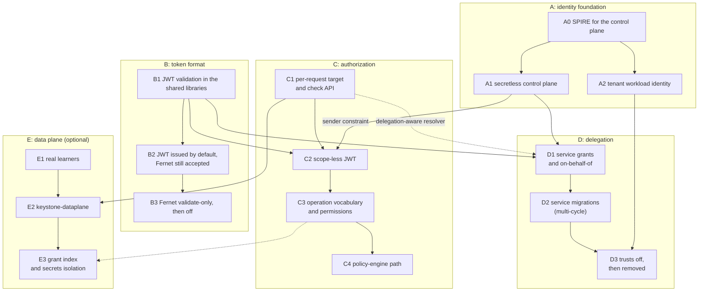
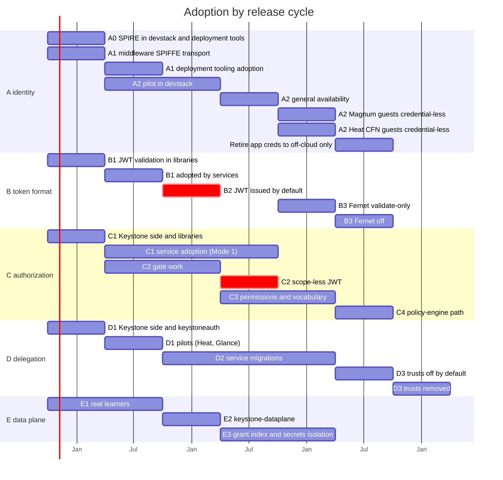

# Roadmap: adopting the authentication and authorization vision

**Status:** Draft for community discussion

**Date:** 2026-10-14

The [vision](vision.md) says what the target model is and why. This document
says how OpenStack gets there and in which order. It is a plan to argue about,
not a commitment by any project. Section numbers written as §N refer to the
vision, and ADRs are referenced by number.

The order is driven by dependencies, not by a single line of phases. Some work
is a hard prerequisite of other work, and a lot of it is independent. The graph
in §2 shows which is which, so that teams can start in parallel and so that a
slow item does not hold back work that never needed it.

## 1. Rules that hold throughout

Every step below must respect the additive rules of the vision (§9), and this
plan's rule that each release cycle carries one large, user-visible change (the
token-format change, stream B, is the largest and gets a cycle of its own).

- Python Keystone, Fernet tokens and unmodified services keep working.
- v3 scoped tokens and `OpenStack-Target` coexist. A conflicting header is
  rejected.
- No Python-owned table changes. New state lives in Raft-backed drivers.
- Every capability has an off switch that restores the previous behaviour for
  one service without redeploying Keystone.

## 2. Workstreams and dependencies

Five workstreams. Each milestone has an identifier used in the graph and in the
tables that follow.

| Stream | Concern                                  | Milestones     |
| ------ | ---------------------------------------- | -------------- |
| A      | Identity foundation (SPIFFE, workloads)  | A0, A1, A2     |
| B      | Token format (Fernet to JWT)             | B1, B2, B3     |
| C      | Authorization (scope, check API, policy) | C1, C2, C3, C4 |
| D      | Delegation (trusts replaced)             | D1, D2, D3     |
| E      | IAM data plane (optional availability)   | E1, E2, E3     |

Solid arrows are hard dependencies. Dotted arrows are requirements one side
places on the other without blocking its start.

### 2.1 What the arrows mean

| Dependency | Why                                                                                                                                                                                                                                                                                        |
| ---------- | ------------------------------------------------------------------------------------------------------------------------------------------------------------------------------------------------------------------------------------------------------------------------------------------ |
| A0 to A1   | A service can drop its password only once it has a SPIFFE identity to authenticate with.                                                                                                                                                                                                   |
| A0 to A2   | Tenant workload identity uses the same SPIRE deployment. It does not need A1.                                                                                                                                                                                                              |
| B1 to D1   | Grants and exchange mint JWTs. Services must be able to validate them first. The flip of the default issuance (B2) is not required.                                                                                                                                                        |
| A1 to D1   | Redeeming a grant needs an SVID-authenticated service client (ADR 0036 §3, §5).                                                                                                                                                                                                            |
| B1 to C2   | Scope-less tokens are JWTs.                                                                                                                                                                                                                                                                |
| A1 to C2   | The sender constraint for control-plane callers binds a token to a SPIFFE ID, verified where the SVID is the TLS peer (§5.4).                                                                                                                                                              |
| C1 to D1   | Not a start dependency, because ADR 0036 keeps a transitional project and role projection in the token. When C1 lands, its resolver must be delegation-aware (see below).                                                                                                                  |
| A2 to D3   | Trusts cannot be turned off while Magnum still writes a trustee password into guests. The guest side needs workload identity (ADR 0036 §10.3). Heat's in-guest EC2 keypairs do not gate D3 — in current configurations they do not depend on the trust — and retire on this same A2 track. |
| C1 to E2   | The data plane serves the check API.                                                                                                                                                                                                                                                       |

Two corrections to the intuitive ordering are worth stating.

- **Delegation does not wait for scope-less tokens.** D1 ships against scoped
  tokens. The reverse constraint is the one that matters: when the check API
  resolves roles at request time, it must compute live roles of the subject on
  the target, intersected with the grant's role ids, and require the target to
  equal the delegated project (ADR 0036 §7). A resolver that ignores the
  delegation would let the target a delegated caller names widen the delegation.
- **Workload identity does not wait for scope-less tokens.** The SPIRE plan maps
  an attested VM to a project-bound principal through the mapping engine, which
  needs no change to token scope.

### 2.2 Global view by release cycle

The same milestones laid over the OpenStack six-month cycle. Cycles are named
relative to the first planned one: x.1 is the first development cycle (released
in April), x.2 the one after it (October), then x+1.1, x+1.2 and so on. x-1.2 is
already released. The dates are indicative: they show order and size, not a
commitment by any project. A stream can slip without moving the others, except
along the arrows in §2. In the chart, a bar that ends at an April tick finishes
in a .1 release and one that ends at an October tick in a .2 release.

| Cycle (release month) | Stream A                                    | Stream B                                                    | Stream C                                         | Stream D                                         | Stream E                |
| --------------------- | ------------------------------------------- | ----------------------------------------------------------- | ------------------------------------------------ | ------------------------------------------------ | ----------------------- |
| x-1.2 (Oct)           | ADR 0036 accepted; A0 design                | Design only                                                 | Design only; settle check API request schema     | Design only                                      | ADR 0016-v2 amendment   |
| x.1 (Apr)             | A0 SPIRE delivered; A1 middleware transport | B1 library support, opt-in                                  | C1 check API, header, `oslo.policy` check type   | D1 grants and exchange in Keystone, keystoneauth | E1 begins               |
| x.2 (Oct)             | A1 tooling adoption; A2 devstack pilot      | B1 adopted by services                                      | C1 first services on Mode 1; C2 gate work begins | D1 pilots: Heat grants, Glance exchange          | E1 done                 |
| x+1.1 (Apr)           | A2 pilot continues                          | **B2 JWT by default (the cycle's one user-visible change)** | C1 adoption continues; C2 gate work done         | D2 migrations begin                              | E2 `keystone-dataplane` |
| x+1.2 (Oct)           | A2 general availability                     | B3 starts                                                   | **C2 scope-less JWT**; C3 begins                 | D2 continues                                     | E3 begins               |
| x+2.1 (Apr)           | Magnum and Heat CFN guests credential-less  | B3 Fernet validate-only                                     | C3 permissions; Mode 2 for early adopters        | D2 complete                                      | E3 done                 |
| x+2.2 (Oct)           | Application credentials limited off-cloud   | B3 Fernet off                                               | C4 policy-engine path                            | **D3 trusts off by default**                     |                         |
| x+3.1 (Apr)           |                                             |                                                             |                                                  | D3 trusts removed                                |                         |

#### What each release delivers

- **x-1.2 (Oct).** No change for operators or users; the design is agreed.
- **x.1 (Apr).** Operators can grant a service standing, bounded rights to act
  for a user, as a trust replacement for new setups. Libraries can validate JWT
  tokens and ask Keystone whether a request is allowed. SPIRE is delivered in
  devstack and the deployment tools (A0), and control-plane calls can use SPIFFE
  instead of passwords (A1 transport).
- **x.2 (Oct).** Heat and Glance run long operations without trusts. Services
  start enforcing authorization through the check API. Services stop holding
  Keystone passwords for token validation. VM workloads get credentials in a
  devstack pilot.
- **x+1.1 (Apr).** Users get JWT tokens by default. Services validate them
  locally, with less load on Keystone. Service migrations away from trusts
  proceed.
- **x+1.2 (Oct).** Scope-less tokens: one token works across projects and is
  narrowed per request. Tenant VM workloads get credentials without stored
  secrets (general availability). Fernet is deprecated.
- **x+2.1 (Apr).** All services have left trusts. Roles can be expressed as
  permissions on operations. Magnum and Heat CFN guests need no stored
  credentials (the per-VM EC2 keypairs leave the guest metadata). Fernet tokens
  validate only.
- **x+2.2 (Oct).** Trusts are off by default. Fernet is off. Authorization can
  run in the policy engine. Application credentials are meant for off-cloud
  clients only.
- **x+3.1 (Apr).** Trusts are removed from Keystone: no API, no table, no code
  path.

#### What shapes this schedule

- **Libraries lead services by one cycle.** `keystonemiddleware`,
  `keystoneauth1` and `oslo.policy` are cycle-released deliverables, and a
  service can only consume what a released library offers. Every service-side
  adoption therefore sits one cycle after the library change it needs: B1 in x.1
  and services in x.2, and C1 in x.1 with first services in x.2.
- **Stream B gets a cycle of its own.** B2 is the biggest visible change for end
  users. x+1.1 carries no other user-visible change. Service-side work that
  users do not see (D2 and C1 adoption) continues in the same cycle.
- **Breaking defaults land on skip-level boundaries.** Releases that allow
  skip-level upgrades (x.1, x+1.1, x+2.1) are where operators jump. The default
  flips (B2, the Fernet steps, trusts off) are placed so that each falls in a
  cycle with at least one full release of warning before it. The exact
  deprecation periods have to be checked against the current TC policy before
  this plan is adopted.
- **D2 is the long pole.** It touches Heat, Mistral, Senlin, Aodh, Sahara,
  Trove, Magnum and Glance, each on its own team's schedule. Three cycles is a
  guess, not an estimate, and D3 cannot start before it ends. Trusts stay
  available throughout, so a service that is late blocks only D3, not the
  services that finished.
- **C2 waits for its gate, not for the calendar.** Restrictions, audience
  narrowing as the default and sender constraint are all built in the two cycles
  before it. If any of them slips, C2 slips with it, and nothing else in the
  plan has to.
- **A2 depends on a decision, not just work.** The SPIRE node attestor is a Go
  plugin that needs a home in the community. If that is not settled by x.2, A2
  and with it D3 move.
- **Python Keystone.** Dates assume Rust Keystone as the reference
  implementation. A deployment that stays on Python Keystone can adopt the
  library and service changes but cannot redeem grants or serve the check API
  until Python Keystone gains them or is retired (ADR 0036).

## 3. Stream A: identity foundation

### A0. SPIRE for the control plane

SPIRE is the cornerstone. It is deployed for the OpenStack control plane only,
not for end users, and is configured to issue an identity to every control-plane
process and every compute host (SPIRE plan Phases 1 and 2).

Status: delivered in x.1, in devstack and in the deployment tools together. This
is the earliest an operator can run it.

### A1. A control plane without Keystone credentials

- `keystonemiddleware` gets a SPIFFE mTLS transport for validation (SPIRE plan
  Phase 4.1).
- Service-to-service calls authenticate at the TLS layer. Service users, service
  passwords and `X-Service-Token` stop being needed (§4.2).
- Legacy services that still ask Keystone for a token keep working.
- Secrets that services hardcode into provisioned VMs, such as Magnum's and
  Heat's, stay until A2 (and D3 for the trust-based ones).

The goal is "no Keystone credentials in the control plane". Database and message
queue credentials are out of scope.

A decision to make here: service-to-service calls can forward the user's token
or exchange it (D1). A1 does not need to choose, because forwarding works with
mTLS alone.

### A2. Tenant workload identity

Depends on A0. It does not depend on scope-less tokens.

1. Nova asks Keystone for vendor metadata (ADR 0032). The metadata contains a
   short-lived attestation token that Nova injects into the VM.
2. The SPIRE agent in the VM presents it to the SPIRE server, which issues a
   project-bound SVID. This happens on new VMs only.
3. The workload presents the JWT-SVID to Keystone, which maps it to a principal
   bound to `spiffe.project_id` (ADR 0020).

Open items:

- **How the mapping gets its authority.** Authority must come from what Nova
  attests on the server side. Metadata that the guest or user supplies must
  never decide roles. Narrow authority by default (the `compute-vm` role of the
  SPIRE plan) and wider authority by explicit mapping rules or permission sets
  (§6.4).
- **The SPIRE node attestor** is a Go plugin, and it lives outside OpenStack
  governance and release practice. Mirroring the repository solves hosting, not
  review, CI or releases. Ownership has to be decided before this milestone.
- **Magnum** is a separate migration with its own plan and the Magnum team (ADR
  0036 §10.3).
- **Heat's** in-guest CFN credentials — a per-server EC2 keypair delivered in
  the server's metadata, plus the stack-domain user's password for the heat and
  zaqar transports — retire on this track too, once the in-guest CFN client can
  present the JWT-SVID (ADR 0036 §10.2). They do not gate D3.

## 4. Stream B: token format

This is the longest stream and the most visible to end users. It runs in a
release cycle of its own.

- **B1. JWT validation in the shared libraries.** `keystonemiddleware` and
  `keystoneauth1` can validate Keystone JWTs: signature against the JWKS, the
  audience, the issuer allowlist. This is the only part of the stream that other
  work depends on.
- **B2. JWT issued by default.** Keystone becomes a full OAuth2 provider. Fernet
  and JWT are accepted side by side, and at some point the default issuance
  flips to JWT.
- **B3. Fernet validate-only, then off.** Last, after the deployments that need
  Fernet have moved.

Offline validation (A1 and B1 together) accepts that revocation takes effect at
token expiry unless the validator checks live (§8). The 15-minute access token
is the stated bound.

## 5. Stream C: authorization

### C1. Per-request target and the check API

Five deliverables. None changes a credential, and tokens stay scoped.

- The `OpenStack-Target` header, and middleware that exposes the requested
  target as a client assertion (§5.2).
- `/v4/authz/check`, served by the IAM control plane from the first release,
  with `version` on every response (§6.3).
- The `oslo.policy` `keystone` check type: request-scoped memo, replica list,
  fail-closed breaker, no cross-request cache.
- Per-service adoption of the resource-owner-wins invariant (§5.1), with opt-in
  to the compatibility mode (§5.3) and SDK header support.
- A delegation-aware resolver (see §2.1).

The operation vocabulary arrives with C3, and unknown operations fail closed
from the start (§6.1). What the check API answers in C1 is role resolution on a
target, plus any operations a deployment has registered.

The request schema of the check API freezes here, so the open question on
whether the API receives the credential or a signed chain assertion (§10,
question 10) has to be settled first.

### C2. Scope-less JWT (gated)

C2 may not start until all of these are shipped:

- the `restrictions` claim;
- service-type audience narrowing as the issuance default (§4.3, ADR 0036 §7.1);
- sender-constrained presentation: DPoP for public clients, SPIFFE-ID binding
  for SVID holders (§5.4).

Then: scope-less access tokens, the JWT offline filter, and scoped tokens
demoted to a compatibility option. The gate is the load-bearing part. Scope-less
tokens without it are a cloud-wide master key, weaker than the token they
replace.

### C3. Operation vocabulary and permissions

The operation registry, with versioning and fail-closed unknown operations
(§6.1). Roles become permission sets. Mapping bindings carry permissions. The
batch check API serves collection reads (§6.3).

This is a separate program from C1 and C2, and the one with the most open
governance questions: where the registry lives, who may write to it, and whether
services push their policies or a central plane distributes them (§10, question
2). It should not hold C1 and C2 back.

### C4. Policy-engine path

Services that want central authorization move from `oslo.policy` `http` checks
against `/v4/authz/check` to a full policy-engine input. The compatibility mode
of §5.3 is switched off for those services one at a time. Service passwords and
service `admin` grants are removed where no longer used. `X-Service-Token` is
retired once nothing depends on it.

### 5.1 Two ways to consume the check API

How much of the decision a service hands over is a spectrum. The first mode is a
valid place to stop.

- **Mode 1, role resolution.** The actor and the `OpenStack-Target` go to
  Keystone on every request, which returns the effective roles and permissions
  on that scope. The service evaluates its existing `oslo.policy` rules locally,
  as it does today with a scoped token. The swap happens inside
  `keystonemiddleware` and `oslo.policy`, not in the service. The service makes
  a one-time, reviewable compatibility-mode declaration that its policy checks
  compare the requested target to each resource's own owner (§5.3). A service
  whose `policy.yaml` tests only scope-level facts typically needs no code
  change to satisfy it. This is the drop-in state when tokens go scope-less in
  C2.
- **Mode 2, full delegation.** The service sends the actor, the operation and
  the resource and receives allow or deny. This is the end state of C4.

A deployment may stay on Mode 1 indefinitely. It gives up resource-level
decisions (§6.5), permission-set personas beyond what local rules encode, and
central policy change without redeploying a service. Everything each service
enforced before keeps working.

## 6. Stream D: delegation

Design: [ADR 0036](adr/0036-service-delegation.md).

- **D1. Service grants and on-behalf-of exchange.** The registry of delegatable
  services, the grant resource and API, the redemption grant, the exchange,
  lifecycle hooks and audit events. Pilots: Heat for grants, Glance for
  exchange. JWT-SVID client authentication on the public interface comes with
  its SPIRE preconditions (ADR 0036 §11, Phase 3).
- **D2. Service migrations.** Every service that uses trusts swaps one creation
  call and one authentication plugin: Heat, Mistral, Senlin, Aodh, Sahara,
  Trove, Magnum's conductor, Glance. This is not a large change per service. It
  is a multi-cycle effort across all of them, and it is the long pole of this
  stream.
- **D3. Trusts off, then removed.** A configuration switch turns trusts off by
  default, with EC2 credentials under a grant handled first. Removal follows
  once every deployment that shares a database with Python Keystone has moved
  trust creation off it.

Trusts can be turned off only when D2 is complete for every service in use and
A2 has removed the trustee password from Magnum guests (the dependency in §2.1).
Neither C2 nor C3 is required.

## 7. Stream E: the IAM data plane (optional)

Design: [IAM data plane and check API](iam-data-plane.md) and
`doc/plans/iam-control-data-plane-split.md`. A small cloud that tolerates the
availability of the Keystone nodes deploys none of this, and the API is the same
either way.

- **E1. Real learners.** Local reads with a version, lag metrics, a learner
  SPIFFE role, and restore-based seeding.
- **E2. `keystone-dataplane`.** The read-only binary over a database standby and
  a Raft learner, serving the check API from C1 and credential validation.
- **E3. Grant index and secrets isolation.** The in-memory grant index, batch
  checks at lookup cost, and tier-keyed encryption or a second Raft group so
  that replicas outside the control-plane trust zone become supportable.

The amendment to ADR 0016-v2 §3 for learner reads must be made before E1.

## 8. Changes per project

| Project                                                    | Change                                                                                                                                                                                                                                                                                                                                                                                                                                                  |
| ---------------------------------------------------------- | ------------------------------------------------------------------------------------------------------------------------------------------------------------------------------------------------------------------------------------------------------------------------------------------------------------------------------------------------------------------------------------------------------------------------------------------------------- |
| `python-keystonemiddleware`                                | SPIFFE transport (A1); JWT offline filter (B1); `OpenStack-Target` parsing; `/v4/authz/check` client; `X-Requested-Target` and `X-Actor-*` environment; per-service gate for the §5.3 compatibility mode (C1)                                                                                                                                                                                                                                           |
| `keystoneauth1`                                            | Device-flow, `v4servicegrant` and `v4onbehalfof` plugins (D1); per-request scope instead of per-session scope (C1)                                                                                                                                                                                                                                                                                                                                      |
| `oslo.policy`                                              | A failure-aware `keystone` check type wrapping `/v4/authz/check` (C1): no cross-request decision cache by default, a request-scoped memo keyed on `(subject, chain, target, operation)`, batch checks for the per-item re-check, a list of replicas tried in order with a fail-closed breaker per replica, and `version` logged with every decision. The existing `http` check is a stopgap that provides none of these. Operation registry export (C3) |
| `openstacksdk`, CLI, Terraform                             | Send `OpenStack-Target`; stop re-authenticating per project (C1)                                                                                                                                                                                                                                                                                                                                                                                        |
| Nova, Neutron, Cinder, Glance                              | Enforce resource-owner-wins (§5.1) on every resource operation before accepting per-request targets; pass the resource owner as `target.scope`; charge quota to the resolved target (§6.6); drop `is_admin` shortcuts and service-token fallbacks (C1)                                                                                                                                                                                                  |
| Heat, Mistral, Senlin, Aodh, Sahara, Trove, Magnum, Glance | Service grants and on-behalf-of exchange instead of trusts (D2, ADR 0036 §10)                                                                                                                                                                                                                                                                                                                                                                           |
| Nova (compute)                                             | `vendor_data_url` to Keystone; per-host SVID (A2, SPIRE plan Phases 1 and 2)                                                                                                                                                                                                                                                                                                                                                                            |
| Deployment tooling                                         | SPIRE server and agents (A0); OPA or the `oslo.policy` bridge; internal endpoints on SPIFFE mTLS (A1); optionally the data plane per failure domain with its database standby and learner state (E)                                                                                                                                                                                                                                                     |

## 9. Retirement

These happen last, and each is independent of the others.

- Fernet validate-only, then off (B3).
- `/v3/OS-TRUST` removed (D3).
- Application credentials limited to off-cloud automation, once workload
  federation covers off-cloud automation and SVIDs cover on-cloud automation
  (§10, question 6).

## 10. Where the earlier phase numbers went

Earlier drafts of the vision used one linear list of phases. Documents written
against it use these numbers.

| Earlier phase                     | Now                                          |
| --------------------------------- | -------------------------------------------- |
| Phase 0, shipped foundation       | Shipped. Not a milestone                     |
| Phase 1, control-plane identity   | A0 and A1                                    |
| Phase 2a, per-request target      | C1, plus E2 where the data plane is deployed |
| Phase 2b, scope-less JWT          | C2                                           |
| Phase 3, permissions              | C3                                           |
| Phase 4, delegation               | D1, D2, D3 (no longer behind C2 and C3)      |
| Phase 5, tenant workload identity | A2 (no longer behind C2)                     |
| Phase 6, policy-engine path       | C4                                           |
| Phase 7, sunset                   | Retirement (§9)                              |

## 11. Open ordering questions

- Who owns the Go SPIRE node attestor, and where is it released from (A2)?
- Does a service forward the user's token or exchange it for service-to-service
  calls (A1, D1)? Both work, and the answer can differ per service.
- Is the operation registry operator-curated, governance-reviewed or
  service-supplied (C3)? It decides who holds the privilege to widen what every
  reader may do.
- Which release cycle carries stream B, given that it should carry nothing else?
