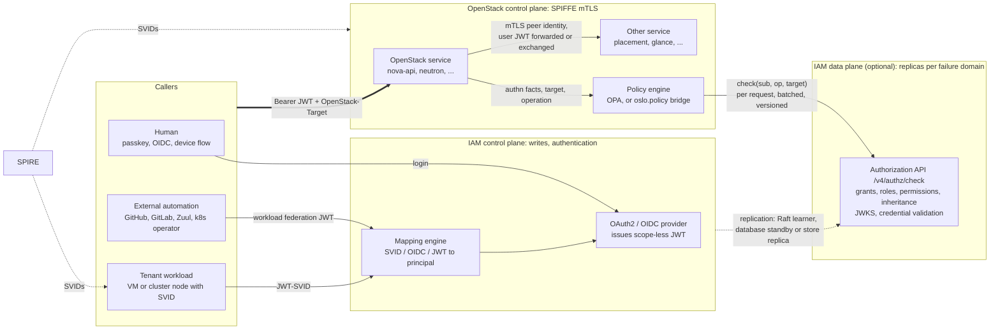
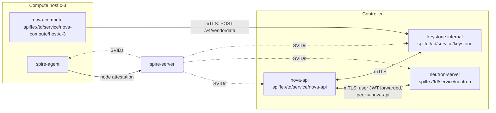
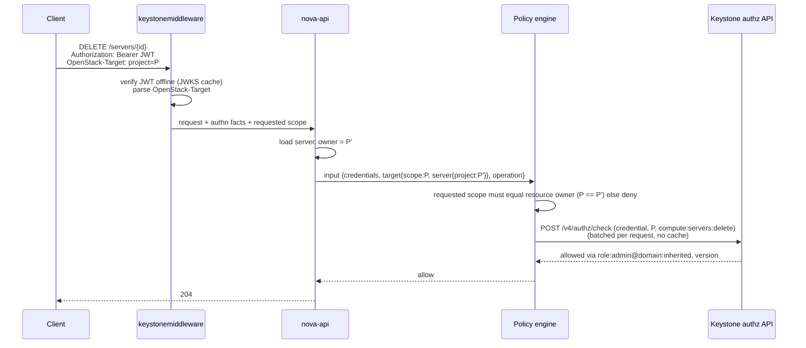
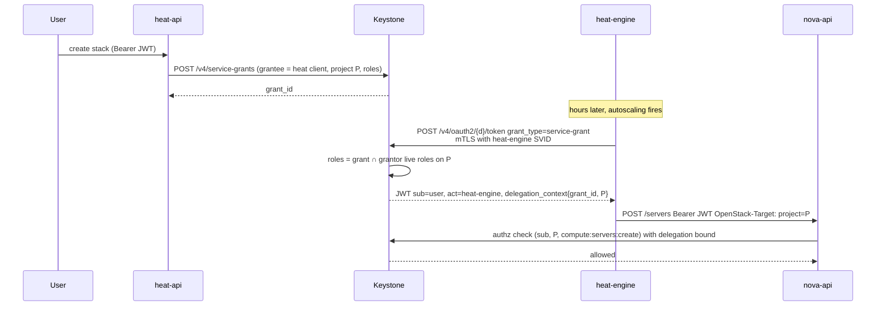
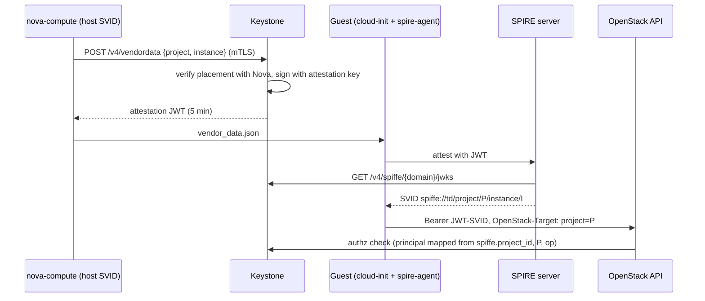

# OpenStack Authentication and Authorization: A Vision

**Status:** Draft for community discussion

**Date:** 2026-09-18

This document proposes a target model for authentication and authorization
across OpenStack. It is derived from the architecture decisions already taken in
the Rust Keystone implementation (the ADRs under `adr/`) and from the SPIRE
integration plan (`doc/plans/spire-integration.md`), and it extends them into
one coherent picture that other OpenStack projects can react to. It is
deliberately written for a wide audience: operators, service maintainers, SDK
authors, and the Technical Committee. It is not an ADR and it does not commit
any project to anything; its purpose is to give the community a concrete
proposal to argue about.

The model is described independently of any implementation. The Rust Keystone is
the reference implementation and the place where the building blocks already
exist, but nothing in the proposal requires it; Python Keystone,
`keystonemiddleware`, `oslo.policy` and every service can adopt the pieces that
concern them.

Each part states its own requirements and limits where it is described, and the
last section lists the questions the community, not this document, has to
answer.

This document says what the model is and why. The order in which it is adopted
is in the [roadmap](roadmap.md). The design detail of the check API and the data
plane is in [IAM data plane and check API](iam-data-plane.md).

## TL;DR {#tldr}

The problem: scope and roles are bound into the token at issuance, so one
artifact proves who the caller is, where it may act and what it may do. The
proposal separates the three.

- **Tokens say who, and nothing else.** Short-lived, scope-less JWTs from an
  OAuth2/OIDC provider. Public clients use DPoP (RFC 9449) and SVID holders use
  JWT-SVID client authentication (RFC 7523). Authentication is validated
  offline. Authorization is not: it is decided per request. During the
  transition scoped tokens remain available. A token still carries
  authentication facts such as `amr`, `act`, `delegation_context` and optional
  `restrictions`, and can be narrowed to the audience of one service type.
- **The request says where.** The target travels per request in the
  `OpenStack-Target` header, which generalizes the tokenless-auth headers of v3
  Keystone, or is derived from the addressed resource. For an operation on an
  existing resource the resource's owner wins over anything the caller names.
  For create and list the caller names the target, and Keystone checks the
  caller's authority there.
- **Keystone decides what.** The service's policy asks Keystone
  (`/v4/authz/check`) on every request, against a replica of live state, with no
  cross-request cache. An outage of the write path degrades the cloud rather
  than stopping it, to a bound the document states ([§8.5](#outage-cost)).
- **The control plane authenticates with SPIFFE mTLS.** Services are identified
  by their SVIDs, not by passwords. Service users, service passwords and
  `X-Service-Token` go away. Each service is still a principal in Keystone,
  mapped from its SPIFFE ID, and holds the `service` permission set on the
  system target. mTLS identifies the service, never the user, so a call made for
  a user still carries the user's JWT, forwarded or exchanged. A callee can also
  key a rule on the calling service's identity without reading roles.
- **Trusts are replaced.** Service grants are server-side, revocable records for
  authority that must work with no user present. RFC 8693 on-behalf-of exchange
  continues a user's operation. No secret is delegated, and the `act` and
  `delegation_context` claims record the chain
  ([ADR 0036](adr/0036-service-delegation.md)).
- **Tenant workloads get identity without credentials.** A VM or cluster node
  attests with a Keystone-signed proof of its placement and receives an SVID
  bound to its project. A mapping rule then grants it roles or permissions on
  that project. Application credentials and EC2 keys remain for off-cloud
  automation, as a legacy niche.
- **Global reader and admin isolation become expressible.** Because the target
  is named per request, a system-level grant such as `reader` can apply to
  project-owned resources without a project-less system-scoped token. Keystone
  resolves that projection in one place. Each service must still enforce that
  the requested target matches the resource's owner, and a service adopts the
  model only after it makes that declaration.
- **Separate interfaces.** A public API; an internal interface that accepts
  SPIFFE mTLS (the plaintext back-channel stays only until legacy services have
  moved); and a local admin interface over a Unix domain socket that carries the
  full API, is reachable only from the host and authenticates by SVID.
- **A secretless control plane.** No Keystone credentials in the control plane
  and no long-lived inter-service secrets. Database and message-queue
  credentials are outside this proposal.

The order of adoption is in the [roadmap](roadmap.md).

## 1. The vision in one page {#one-page}

OpenStack authentication and authorization today is built around one artifact:
the scoped bearer token. A token proves who the caller is _and_ carries the
project, domain or system the caller may act on _and_ the roles the caller holds
there, frozen at issuance. Every service validates that token against Keystone
(or a cache of Keystone) and applies a local policy file that reads the roles
and the scope out of it.

The proposal separates the three things the token conflates:

| Concern           | Today                                                  | Proposed                                                                                                                                                                                                                                                                                   |
| ----------------- | ------------------------------------------------------ | ------------------------------------------------------------------------------------------------------------------------------------------------------------------------------------------------------------------------------------------------------------------------------------------ |
| **Who** (authn)   | Fernet/JWS token, password, app-cred, trust            | Short-lived signed JWT for the public API (OIDC/OAuth2, passkeys, device flow, workload federation, JWT-SVID for tenant workloads); SPIFFE mTLS identity for everything inside the OpenStack control plane                                                                                 |
| **Where** (scope) | Baked into the token at issuance                       | Stated per request (a structured `OpenStack-Target` header, or derived from the addressed resource), generalizing the v3 tokenless auth headers to every call. The scope _types_ do not change: project, domain and system scope all survive, they stop being properties of the credential |
| **What** (authz)  | Roles frozen into the token; `oslo.policy` per service | Decided per request by a policy engine that receives the authentication facts, the target scope and the operation, and asks Keystone whether the caller holds the required role or permission on that target                                                                               |

The central move is the third row. Today a service asks "does the role list
inside this token contain `admin`, and does the scope inside this token match
the resource?". Under this proposal it asks Keystone "does this principal hold
the role or permission this operation requires, on this target?". The token
stops being the carrier of the answer and becomes only the proof of who is
asking.

Five further changes follow from this split:

- **The OpenStack control plane authenticates with mTLS and nothing else.**
  Every OpenStack service holds a SPIFFE identity issued by SPIRE.
  Service-to-service calls, the Keystone back-channel, and the Nova-to-Keystone
  attestation path all authenticate at the TLS layer. Service users, service
  passwords and `X-Service-Token` disappear.
- **Trusts are replaced by service grants and on-behalf-of exchange**
  ([ADR 0036](adr/0036-service-delegation.md)). The acting service is always
  recorded, no secret is ever delegated, and the delegation boundary is a fact
  of the authentication chain rather than of the token's scope.
- **Tenant workloads get platform identity without credentials.** A VM or a
  Kubernetes node boots, attests to SPIRE with a Keystone-signed proof of its
  placement, receives a project-bound SVID, and calls the OpenStack APIs with
  it. No password, application credential or EC2 key is ever written into a
  guest.
- **Humans authenticate with phishing-resistant methods.** WebAuthn passkeys and
  OIDC federation are first-class; the design intent is for a CLI to
  authenticate with WebAuthn directly, with the device authorization grant
  covering headless machines and CI ([§4.7](#human-authentication)).
- **Keystone's read path can be replicated, and an outage of its write path
  degrades the cloud rather than stopping it.** Authorization decisions and
  credential validation are served from replicas of Keystone's state — an
  optional data plane an operator deploys per failure domain
  ([§4.4](#authz-policy-asks-keystone), [§8](#availability)) — while writes and
  authentication stay on the **IAM control plane**. Existing credentials keep
  being validated and authorized throughout an outage of it; what stops is the
  issuing of new ones, which the access-token lifetime turns into a stated bound
  ([§8.5](#outage-cost)). A deployment that can live with the availability of
  the control-plane nodes queries them directly and deploys nothing more; the
  API is the same either way.

The payoff is a model in which a policy rule, an individual operation, or a set
of operations can be bound to a human, a service or a workload identity on any
target without inventing a new role for it, the way AWS STS session policies or
Azure role assignments work. That is what finally makes "system scope", "global
reader", "domain manager" and "service role" expressible without every service
re-implementing the semantics.

## 2. Where OpenStack is today and what hurts {#today}

### 2.1 Tokens carry scope {#tokens-carry-scope}

A Keystone token is `(user, scope, roles, expiry)` sealed together.
Consequences:

- A client that touches three projects holds three tokens, or re-authenticates
  on every switch. SDKs, Terraform providers and dashboards all carry code to
  manage this.
- Every service's policy reads `project_id` and `roles` out of the token. The
  policy therefore answers "does this token's scope match the resource" rather
  than "may this principal do this to that resource". The two questions diverge
  exactly in the cases the community has struggled with for a decade:
  cross-project operations, cloud-wide read, and services acting on behalf of
  users.
- Scope is attacker-influenceable through rescope. Two 2026 advisories
  (OSSA-2026-005, OSSA-2026-015; see the
  [security model](contributor/security-model.md)) are instances of a decision
  keyed on token scope instead of on the immutable authentication chain.

### 2.2 Every request is a Keystone round trip {#keystone-round-trip}

`keystonemiddleware` validates the token on each request, with a cache in front.
Keystone is on the data path of every OpenStack API call and its availability
bounds the availability of the whole cloud. Python Keystone is therefore already
the single point of failure of every OpenStack deployment: every authentication
and every token validation goes through it, and the validation cache in front of
it is what makes a short outage survivable. The Rust implementation already
addresses the validation half of this with offline JWT verification
([ADR 0026](adr/0026-oauth2-oidc-provider.md) §6), but as long as roles are
frozen into the token, offline validation also freezes authorization for the
token lifetime.

This proposal does **not** remove the dependency on a running authority. It
makes IAM more resistant than it is today, in three specific ways.
Authentication is verified offline from a signed credential, so no round trip is
needed to establish who is calling. Authorization is decided per request by a
component that can be replicated independently of the nodes that accept writes —
an optional data plane an operator deploys where the availability of the IAM
control plane is not enough ([§4.4](#authz-policy-asks-keystone),
[§8](#availability)). And the cost of an outage of it is stated exactly in
[§8.5](#outage-cost).

The round trip itself moves from token validation to an authorization decision,
and by default no cross-request cache stands in front of it. Python Keystone's
caching layer has produced the most bugs in its design; this proposal replaces
it with a replica of the grant state instead, not a smarter cache
([§6.3](#authz-api)). A caller that touches many projects therefore holds one
credential and asks one question per request, batched, against something in its
own failure domain.

### 2.3 System scope and the Secure RBAC goal {#system-scope-srbac}

The community goal "Consistent and Secure Default RBAC" introduced three
personas (`reader`, `member`, `admin`), later `manager` and `service`, on three
scopes (`project`, `domain`, `system`). The design placed the scope in the token
and asked every service to decide what a system-scoped token means for each of
its project-owned resources. Services could not answer that uniformly: a
system-scoped token has no project, so creating a server "as the system" had no
owner, listing servers "as the system" needed new query semantics, and existing
operator tooling broke. The goal was re-scoped; system scope is today avoided by
most services and `admin` on a project remains the practical cloud
administrator.

The root cause is not the persona model, and it is not system scope itself. It
is that the scope was a property of the credential, so the credential had to be
re-issued for each target, and a system-scoped credential arrived at a service
with no project in it at all. This proposal keeps system scope — it is the right
way to name cloud-level resources and cloud-wide authority — and removes it from
the credential. An operator holding a system-level grant names a project target
on the calls that need one and the system target on the calls that do not,
without re-authenticating between them.

### 2.4 Global reader and "admin is global" {#global-reader-admin-global}

Two of the oldest open problems in OpenStack authorization are the same problem
seen from both ends:

- **Global reader:** an auditor, a billing collector, or a monitoring system
  needs read access to every project. Today that requires either `admin`, a role
  on every project, or a system-scoped token that most services cannot
  interpret.
- **Admin is global:** `admin` on _any_ project historically meant `admin`
  everywhere, because policies checked `role:admin` and the token scope was not
  compared to the resource. Fixing this per service took years and is still
  incomplete.

Both need the same primitive: a decision that takes the principal, the operation
and the _resource's_ target, and a single authority that knows how a grant on
the system or on a domain projects onto a project. That authority is Keystone;
today it is not consulted at decision time.

### 2.5 Roles are the only unit of grant {#roles-only-unit-of-grant}

The only thing Keystone can grant is a role on a target. To let one workload
call one operation (rotate a secret, signal a Heat wait condition, read one
metric endpoint), an operator must create a role, wire the role into every
service's policy file, and assign it. Nobody does that; instead the workload
gets `member` or `admin`. Application-credential access rules were meant to
address this: a rule matches `(service, method, path)` and narrows what one
application credential may call. But narrowing is not granting — a credential
created with no access rules inherits its role's full permission set, so an
access rule can only cut down a credential that is already as privileged as its
role allows, never add a permission the role lacks. The rule also lives on the
credential, not on a principal: it cannot be assigned to a human or a workload
identity, held independently of the one credential it was created with, or
inherited by anything else. It is a self-imposed filter over one credential's
own tokens, not a unit of grant.

Every hyperscaler solved this with permissions as the unit of grant and roles as
named permission sets: AWS IAM actions and policies, GCP IAM permissions and
roles, Azure actions and role definitions. OpenStack already has a cloud-wide
operation vocabulary (the `oslo.policy` rule names such as
`os_compute_api:servers:create`); it has never been usable as a grant.

### 2.6 Secrets everywhere {#secrets-everywhere}

- Every service has a service user with a password in a config file and the
  `admin` (or `service`) role.
- Heat, Magnum, Mistral and others store trusts; Magnum ships a trustee password
  into every cluster VM, and Heat ships a per-instance EC2 keypair into the
  metadata of every VM that runs its CloudFormation client.
- Tenant automation gets application credentials or EC2 keys baked into images,
  Kubernetes secrets and CI variables, valid for months.
- Users authenticate with passwords in `clouds.yaml`.

Each of these is a long-lived bearer secret whose theft is indistinguishable
from legitimate use.

### 2.7 How the rest of the industry does it {#industry-comparison}

| Platform   | Credential                                      | Where the scope lives                                          | Unit of grant                         | Workload identity                        |
| ---------- | ----------------------------------------------- | -------------------------------------------------------------- | ------------------------------------- | ---------------------------------------- |
| AWS        | SigV4-signed requests with STS short-lived keys | In the request (resource ARN); evaluated per call              | Action on resource (IAM policy)       | Instance profile, IRSA, roles anywhere   |
| GCP        | OAuth2 access token                             | In the request (resource name); hierarchy inheritance          | Permission; roles are permission sets | Service account attached to the workload |
| Azure      | Entra ID JWT, audience-bound                    | In the role _assignment_, not in the token; evaluated per call | Action; role definitions              | Managed identity                         |
| Kubernetes | Projected service-account token, audience-bound | In the request (namespace/resource); `SubjectAccessReview`     | Verb on resource (RBAC rule)          | Service account, SPIFFE via SPIRE        |
| OpenStack  | Fernet token (JWT in keystone-rs, still scoped) | In the token                                                   | Role on project/domain/system         | Application credential in the guest      |

OpenStack is the outlier on every column. The proposal below moves each column
to the industry pattern while keeping the v3 API and Python services working
during the transition.

## 3. Principles {#principles}

1. **Authentication proves identity, nothing else.** A credential says who the
   caller is and how strongly that was established (`amr`). It does not say what
   the caller may do.
2. **Authorization is decided per request, against the target.** The target is
   the addressed resource's owner, or the scope the caller names for create/list
   operations. It is never taken from the credential.
3. **Security decisions key on the authentication chain, never on scope.** This
   is the overarching rule of the security model (of which invariant I1,
   "delegation facts come from the chain", is the delegation-specific case),
   generalized: delegation boundaries, restrictions and the acting party are
   chain facts; the target is a per-call input.
4. **Keystone is the authority for grants; services are the authority for
   resources.** A service knows which project a server belongs to; Keystone
   knows whether the caller holds `compute:servers:delete` there, including
   through domain or system inheritance. Neither should have to know the other's
   rules.
5. **Credential-less wherever possible.** Identity is bound to the runtime
   (SPIFFE SVID, attested VM, passkey), not to a secret in a file.
6. **Short-lived, sender-constrained, audience-bound.** Whatever bearer
   artifacts remain live for minutes, are bound to the presenting workload where
   the transport allows it, and can be narrowed to the services that may accept
   them.
7. **Every acting party is recorded.** Delegated calls carry `act`; audit never
   loses who did what on whose behalf.
8. **Compatibility is a design input, not an afterthought.** v3 tokens, Python
   services and existing SDKs keep working through every phase.
9. **Grants are roles and permissions; a relation store is an implementation
   choice.** The model works on the SQL assignment driver alone. Roles,
   inheritance and permission sets answer every problem in
   [§7](#what-this-solves); an OpenFGA-backed driver (ADR 0033) is valuable for
   deployments that already run a relation store and for resource-level grants
   ([§6.5](#resource-level-targets)), and it is a per-domain backend decision
   (ADR 0034), never a prerequisite for adopting anything here. The choice also
   decides where the data plane's replica comes from: on the SQL and Raft
   drivers the data plane holds its own copy; on an externally owned store it is
   a client of the store's replication ([§6.3](#authz-api),
   [§8.1](#control-data-plane-split)).
10. **Copies of authorization state are replicas, never caches.** A replica's
    freshness is maintained by the replication protocol, which observes every
    write, and is reported as a version with every answer. A cache's freshness
    depends on the writer remembering to invalidate it, and on a lifetime when
    it does not. Python Keystone's caching bugs were of the second kind, and
    this proposal admits only the first on the request path: a Raft learner, a
    database standby, or a store's own replica. The only memo the architecture
    itself contains is scoped to one request and dies with it; a client-side
    cache is an opt-in a deployment takes on with its constraints, never part of
    the path specified here ([§6.3](#authz-api)).

## 4. Target architecture {#target-architecture}



### 4.1 Identity tracks {#identity-tracks}

| Caller                                  | Authentication                                                                         | What the service sees                                                      |
| --------------------------------------- | -------------------------------------------------------------------------------------- | -------------------------------------------------------------------------- |
| Human at a browser                      | OIDC authorization code + PKCE at Keystone; passkey or federated IdP behind it         | Bearer JWT, `sub` = user, `amr` = `["webauthn"]` etc.                      |
| Human at a CLI                          | Device authorization grant (browser login with passkey/MFA on a headless machine)      | Same JWT                                                                   |
| External CI / operator                  | Workload federation: platform JWT exchanged through the mapping engine (ADR 0008/0020) | Bearer JWT, `sub` = mapped principal                                       |
| Tenant VM / cluster node                | SPIRE-issued project/instance SVID, presented as JWT-SVID `private_key_jwt`            | Bearer JWT, `sub` = ephemeral principal bound to `spiffe.project_id`       |
| Control-plane service acting as itself  | X.509 SVID at the TLS layer of the internal interface                                  | No token at all; peer identity from the TLS session, mapped to a principal |
| Control-plane service acting for a user | The user's JWT forwarded, or an on-behalf-of token with `act` (ADR 0036 §6)            | User JWT plus service SVID at the transport                                |
| Deferred automation (Heat, Magnum)      | Service grant redeemed with the service SVID (ADR 0036 §5)                             | JWT with `sub` = grantor, `act` = service                                  |

### 4.2 The OpenStack control plane: mTLS, no dedicated authentication {#control-plane-mtls}

> **Audience:** deployers and service maintainers. **Skip if** you only need the
> operator-level picture; the [TL;DR](#tldr) and [§1](#one-page) cover it.

Every OpenStack control-plane process holds a SPIFFE identity from a local SPIRE
agent (SPIRE plan Phase 1). Keystone's internal interface, and the internal
endpoints of every other service, terminate SPIFFE mTLS and identify the peer
from the SVID URI. A request from `spiffe://td/service/nova-api` to Neutron is
authenticated by the handshake; Neutron's policy input carries the peer as
`service_credentials` and the forwarded user context (if any) as `credentials`.

This removes:

- service **passwords** in configuration files, and the `admin` role assignments
  services hold today;
- `X-Service-Token` and `service_token_roles_required`, which exist only because
  the transport carried no service identity;
- the plaintext back-channel from `keystonemiddleware` to Keystone (SPIRE plan
  Phase 4.1, the middleware SPIFFE mTLS transport change).

It does not remove the service as a subject of authorization. Every service
still corresponds to a principal in Keystone — mapped from its SPIFFE ID through
the mapping engine rather than carrying a password — and still holds a grant,
namely the `service` permission set on the system target
([§7.4](#solves-service-admin)). "No dedicated authentication in the control
plane" means the transport authenticates the service; it does not mean the
service is unauthorized, and it does not mean the service inherits the user's
authority. mTLS identifies the _service_, never the user it serves: a
user-initiated call still carries the user's JWT, and a policy that needs the
user must read `credentials`, not `service_credentials`. Read the other way,
this would reintroduce the service-user-with-`admin` pattern under a new name.

Per-host identities (`.../nova-compute/host/{hostname}`) let Keystone bind an
attestation request to the compute host that actually runs the instance (ADR
0032), which a flat service identity cannot do.



### 4.3 Public API: a JWT that says who, and a request that says where {#public-api-jwt}

Keystone is an OAuth2/OIDC provider (ADR 0026). The access token it issues for
OpenStack APIs carries:

- `iss`, `sub`, `aud`, `exp` of about fifteen minutes, `jti`, `amr`. ADR 0036
  §7.1 defaults `aud` to the control-plane-wide `openstack-apis` (the domain is
  carried by `iss`, not `aud`), narrowed to specific service types
  (`openstack-apis:compute`, …) only when the client requests it. When no
  audience is requested every service may accept the token; narrowing is a way
  for a client to restrict a token to the services it names, never a
  precondition for getting one. This vision keeps that rule unchanged. It means
  a default token is only as confined as its sender constraint
  ([§5.4](#threat-model)), and that the [§4.8](#cross-service-calls) forwarding
  rule confines a token only when the client narrowed it;
- `act` when a service acts on behalf of the subject;
- `delegation_context` when the chain is delegated (service grant, application
  credential, on-behalf-of);
- `restrictions` when the holder asked for a narrower token than its full
  authority (a self-imposed ceiling, see [§5.4](#threat-model));
- **no** project, domain or system scope, and **no** roles.

The caller names the target on each request. The proposal generalizes the idea
behind the v3 X.509 tokenless authorization headers, which already let a client
say "I am this certificate, acting on this project", into one structured header
sent on every call:

```http
GET /v2.1/servers HTTP/1.1
Authorization: Bearer <JWT>
OpenStack-Target: project="8e3f..."
```

[Section 5](#scopeless-tokens) specifies the contract.
[Section 5.3](#compatibility) shows how `keystonemiddleware` can turn it into
the `X-Project-Id` / `X-Roles` context today's services expect, and why that
compatibility mode is a per-service opt-in rather than a free ride: a
client-supplied target is not a Keystone-attested one, and a service that treats
it as attested is exactly the bug class [§5.4](#threat-model) and the
[security model](contributor/security-model.md) exist to prevent.

### 4.4 Authorization: the policy engine asks Keystone {#authz-policy-asks-keystone}

Each service evaluates policy per request with an input of three parts:

```json
{
  "credentials": {
    "sub": "...",
    "amr": ["webauthn"],
    "act": null,
    "delegation_context": null,
    "restrictions": null
  },
  "service_credentials": { "spiffe_id": "spiffe://td/service/nova-api" },
  "target": {
    "scope": { "project_id": "8e3f..." },
    "server": { "id": "...", "project_id": "8e3f..." }
  },
  "operation": "compute:servers:delete"
}
```

The policy decides using local rules (ownership, resource state, `amr`
requirements, delegation tripwires) and one remote fact it cannot know itself:
whether `sub` holds the operation, or a role that implies it, on `target.scope`.
It asks Keystone:

```http
POST /v4/authz/check
{
  "subject": { "credential": "<the JWT exactly as presented>" },
  "target": { "project_id": "8e3f..." },
  "operations": ["compute:servers:delete"]
}
```

```json
{
  "results": {
    "compute:servers:delete": {
      "allowed": true,
      "via": ["role:admin@domain:inherited"]
    }
  },
  "roles": ["admin"],
  "version": { "assignment": "raft:184223", "identity": "pg:0/3A2F18C0" },
  "lag_ms": 12
}
```

Keystone resolves direct, group, inherited and system-level grants, intersects
with the delegation boundary and with any self-imposed restriction, and returns
a decision plus the classic role list for policies that still key on roles. The
boundary and the restriction are derived from the credential the request
carries, not from fields the calling service filled in — they are chain facts;
[§6.3](#authz-api) sets out why a data plane that takes the caller's word for
them would reproduce the [§2.1](#tokens-carry-scope) defect class.

Every answer carries the `version` of the state it was decided against and how
far that state was behind the write path when the answer was produced. There is
no lifetime in the response and no cache in front of it: an enforcement point
uses the answer for the request that asked and discards it. [§6.3](#authz-api)
sets out the freshness contract — the version, the `min_version` a caller may
demand, and the `max_staleness` an operator sets — and why it is the same on
every driver that lets Keystone hold a replica, and different on one that does
not.

**There is no cross-request decision cache, and that is the architecture rather
than a posture.** The live call happens on every request, batched per request,
against a replica in the caller's own failure domain (or against the Keystone
nodes themselves, where no data plane is deployed). What that costs is one round
trip per inbound request — the round trip today's deployments already pay to
memcached for a validation-cache hit, against a component whose answer is
microseconds of in-memory work — and a hard dependency on that replica set being
reachable, which [§8](#availability) turns into a replica-count requirement
rather than a grace window.

This is the Kubernetes `SubjectAccessReview` pattern, and the shape
`oslo.policy` already supports through its `http` check type, which gives Python
services a zero-code migration path (see the roadmap).



Where a decision is _evaluated_ and where the grant _facts_ come from are two
independent choices, and this proposal fixes only the second. The policy engine
may run as a sidecar beside each service or as an in-process `oslo.policy`
library; a per-service OPA sidecar calling the check API over SVID mTLS is a
shape an earlier proof of concept exercised (the commented `http.send` stanza in
`policy/identity/user/list.rego`). What the proposal does rule out is on the
other axis: replicating the grant graph itself to every evaluation point
([§6.3](#authz-api)).

#### The check API is served by the IAM data plane, and the data plane is optional {#data-plane-check-api}

> **Audience:** implementers and operators sizing availability. **Skip if** you
> only want the outage consequences; see [§8.5](#outage-cost).

`/v4/authz/check` carries at least one decision per API call across the whole
cloud, while grant writes and token issuance carry a load orders of magnitude
smaller. Those two have no reason to share a process, a release cadence or a
scaling unit, and above a certain size they must not share a failure domain
either. The check API is therefore served by a component in its own right: the
**IAM data plane**, a second binary built from the same crates as `keystone`
(`keystone-dataplane` in the Rust implementation), every driver of which is
pointed at a replica and whose write handlers are not built in.
[§8](#availability) specifies it, down to the storage work it needs first
([§8.3](#data-plane-components)).

It is optional. The same `/v4/authz/check`, JWKS and validation endpoints are
served by the IAM control plane itself — the Raft voters, over the primary
database — so a smaller cloud, or one whose operators accept that the
availability of the IAM control plane bounds the availability of authorization,
points its services there and deploys nothing further. That is the dependency
such a cloud already has on Python Keystone today, with offline credential
validation on top. The data plane is how an operator buys authorization
availability exceeding the write path's, per failure domain, when that is worth
a replica set and a standby database. Nothing in the API differs between the
two; only `version` and lag in the response tell a caller which it is talking
to.

What the data plane is _not_ matters as much: it never authenticates. Token
issuance, refresh, login, service-grant redemption, on-behalf-of exchange and
attestation are all writes, or need a signing key a replica must not hold
([§8.2](#data-plane-components)), and they stay on the IAM control plane. The
data plane decides authorization from state it already holds and validates
presented JWTs against that same state; [§8.5](#outage-cost) prices the outage
case.

This is the structural lesson from Zanzibar. Google did not add a check API to
its identity service; it built a separately scaled system, because deciding
every request is a different engineering problem from authenticating callers.
The split is also the containment boundary for everything [§6.3](#authz-api)
makes driver-dependent — batch expansion, the per-item short-circuit, the
version each driver reports, the limits an externally owned store imposes — so
`oslo.policy` and the services see one uniform contract whatever the assignment
driver underneath is. Without that boundary the per-driver differences leak into
every enforcement point in the cloud.

One data plane does not mean one cluster. The serving layer is federated — a
replica set per region or availability zone, each independently scalable and
independently failable — over a single authoritative write path, so there is
still exactly one place a grant is defined and revoked. Learners do not vote, so
a WAN between the IAM control plane and a regional replica set never touches
commit latency, and fan-out from the leader is bounded by the replica count,
tens rather than thousands — which is why replicas are per failure domain and
not per host. It is not uniform across drivers: a learner or a database standby
follows the SQL and Raft drivers anywhere, while a region serving a domain whose
assignments live in a relation store needs a replica of that store in the region
too, or pays a WAN round trip on every check ([§6.3](#authz-api)).

A partition then has a stated bound: a cut-off region keeps serving decisions
from local state and stops receiving revocations, and it knows by how much —
past the operator's `max_staleness` it refuses to allow rather than serve an
answer nobody can vouch for ([§6.3](#authz-api),
[§8.1](#control-data-plane-split)).

Three properties are requirements on the data plane rather than inherited
assumptions:

- It is a second trust boundary over assignment data. The rule that security
  decisions key on the authentication chain and never on scope, the delegation
  invariants (I2/I4), and the requirement that secrets be stripped from policy
  input all hold inside the data plane, and are tested there with the same
  suites the IAM control plane runs.
- It serves from state it holds locally for as long as the write path is
  unreachable, including cold-booting a replacement replica while the write path
  is down — the statically stable posture [§8.1](#control-data-plane-split)
  states as a requirement, [§8.3](#data-plane-components) lists the storage work
  for, and [§8.6](#other-platforms) names a test for.
- Keystone's own authorization stays in-process ([§6.3](#authz-api)). The data
  plane is how other services ask; it is not in the path of Keystone authorizing
  a call to itself, and it must not become a startup dependency of the IAM
  control plane.

### 4.5 Delegation without secrets {#delegation-without-secrets}

[ADR 0036](adr/0036-service-delegation.md) replaces trusts with two mechanisms
on the OAuth2 token endpoint:

- **Service grants** for deferred authority (Heat stacks, Magnum clusters,
  Mistral workflows): a user-visible, revocable record naming a registered
  service client as grantee; redeemed with the service's SVID; token `sub` is
  the grantor and `act` is the service.
- **On-behalf-of exchange** (RFC 8693) for continuing a user-initiated operation
  past token expiry (Glance import, long migrations): the service exchanges the
  user's token for one that carries `act`, bound to the root token's `jti` so
  revoking the user's token ends the chain.

No impersonation flag, no redelegation, no use counter, no trustee user, no
password in a cluster. Both mechanisms already place every delegation fact in
`delegation_context`, so they survive scope-less tokens unchanged (ADR 0036 §7).

A service and the guests it provisions are different identity tracks. The
conductor of a Magnum cluster holds a grant here; the cluster's nodes are
[§4.6](#tenant-workload-identity) workloads with their own SVIDs. The two halves
migrate independently of each other, and each has its own precondition: the
trustee password can leave a guest only once the
[§4.6](#tenant-workload-identity) SVID path works — the SVID is its replacement
— but it does not require the grant to exist, and replacing the conductor's
trust does not require the guest to be SPIRE-attested.



### 4.6 Tenant workload identity {#tenant-workload-identity}

The SPIRE plan gives every VM a platform identity without a secret in the guest:

1. Nova asks Keystone (over mTLS, with its per-host SVID) for a short-lived
   attestation JWT for `(project, instance)`; Keystone verifies placement with
   Nova before signing (ADR 0032).
2. The JWT is delivered through vendor data; the guest's SPIRE agent presents it
   to the SPIRE server, which mints `spiffe://td/project/{p}/instance/{i}`.
3. The workload calls Keystone's token endpoint with the JWT-SVID
   (`private_key_jwt`) or the OpenStack APIs directly with a JWT-SVID mapped by
   a rule on `spiffe.project_id`, and receives whatever the mapping rule grants:
   a role, or, with [§6](#authorization-model), a specific set of operations on
   its own project.

The same path serves Magnum cluster nodes, Trove database guests and any tenant
automation that runs on the cloud; Octavia amphorae are a candidate once their
certificate bootstrap is reconsidered (out of scope in ADR 0036). Where a
service provisions guests today with an impersonating trust — Magnum writes a
per-cluster trustee password and trust id into every node, and the components
inside redeem the trust _as the cluster owner_ — this path changes the actor:
the guest acts as itself, a project-bound workload principal, with whatever
authority the mapping rule grants. The narrowing from the owner's roles is
deliberate; a component that needs more gets a wider mapping rule or permission
set, never a secret in the guest. Resources the guest creates are owned by its
workload principal, not by the cluster owner. Application credentials and EC2
keys remain for automation that runs _outside_ the cloud and cannot attest, and
they shrink to a legacy niche.



### 4.7 Human authentication {#human-authentication}

- **Passkeys** (ADR 0005) are the default strong method. Keystone acts as the
  WebAuthn relying party; the OIDC provider records `amr: ["webauthn"]`, so a
  policy can require phishing-resistant authentication for sensitive operations
  (key rotation, role assignment, grant creation).
- **External IdPs** federate through the mapping engine (ADR 0020), including
  expiring group membership (ADR 0013) and SCIM provisioning (ADR 0024).
- **CLI login** is meant to reach passkeys: a CLI authenticating with WebAuthn
  directly, with the device authorization grant covering headless machines and
  CI by delegating to a passkey-capable browser login, is the target design — no
  such CLI exists in this workspace yet. This is where phishing-resistant
  authentication would earn its keep, because OpenStack users authenticate at
  the CLI and in CI far more than at Horizon. With that path in place the
  `clouds.yaml` password becomes optional; today it is not yet documented as
  deprecated.
- **Step-up** is expressed as `amr` requirements in policy rather than as
  separate credentials.

### 4.8 Cross-service calls on behalf of a user {#cross-service-calls}

When Nova calls Neutron for a user it either forwards the user's JWT or performs
an on-behalf-of exchange ([§4.5](#delegation-without-secrets)). Forwarding is
simpler and works with today's code, but a forwarded token is accepted by
whatever its audience allows, so a compromised service can act as the user
everywhere the token is accepted. The rule is therefore:

> **Forward only a token whose `aud` includes the callee; otherwise exchange.**

A token with the default audience includes every callee, so the rule confines
forwarding only for clients that requested a narrower audience
([§4.3](#public-api-jwt)) — which is what a client holding broad authority
should do. For unnarrowed tokens the exchange path is the confinement: a service
that does not want to hand its callee the user's full token exchanges it
instead. Both paths carry the caller's SVID as `service_credentials`, which is
the control-plane identity that replaces `X-Service-Token`.

## 5. Scope-less tokens and per-request target scope {#scopeless-tokens}

> **Audience:** service maintainers, `keystonemiddleware` and SDK authors.
> **Skip if** you only need the effect on callers; the [TL;DR](#tldr) covers it,
> and [§5.4](#threat-model) is the part reviewers should read.

### 5.1 Request contract {#request-contract}

A request to an OpenStack service names its target in one of three ways, in this
order of precedence:

1. **Resource-derived.** For any operation on an existing resource
   (`GET/PUT/PATCH/DELETE .../servers/{id}`), the target is the owner of that
   resource as recorded by the service. This is authoritative. A client-supplied
   scope that disagrees with it is a policy violation and the request fails
   closed (404 or 403 per the service's existing disclosure rules).
2. **Header.** For operations that have no existing resource (create, list,
   actions on collections), the client sends a structured header (RFC 8941
   dictionary syntax) naming the target:

   ```http
   OpenStack-Target: project="8e3f..."
   ```

   Exactly one target must be named, by id or by name, as `project`, `domain` or
   `system-scope`:

   | Member         | Value      | Target                                                                |
   | -------------- | ---------- | --------------------------------------------------------------------- |
   | `project`      | project id | that project                                                          |
   | `domain`       | domain id  | that domain                                                           |
   | `system-scope` | `all`      | the system: cloud-level resources, and cloud-wide reach over projects |

   `system-scope="all"` is deliberately the **same** system scope the v3 API
   already has, spelled the way `keystonemiddleware` already exposes it
   (`OpenStack-System-Scope: all`). This proposal introduces no new scope type:
   a service that understands system scope today understands this header, and a
   service that does not is in exactly the position it is in today. What changes
   is only that the scope arrives per request instead of frozen into the
   credential, so an operator no longer re-authenticates to move between system
   scope and a project.

   Name-based addressing mirrors the tokenless `X-Project-Name` /
   `X-Project-Domain-Name` pair as dictionary members the middleware resolves to
   ids:

   ```http
   OpenStack-Target: project-name="demo", domain-name="Default"
   ```

   The header may also carry the addressed resource, in the same
   `<service-type>:<resource>:<id>` form the operation vocabulary uses
   ([§6.1](#roles-and-permissions)):

   ```http
   OpenStack-Target: project="8e3f...", resource="compute:server:550e..."
   ```

   For an existing resource the `resource` member never overrides rule 1: it
   lets the middleware and the policy engine pre-check and audit the request
   before the service loads the resource, and it is the hook for resource-level
   grants ([§6.5](#resource-level-targets)). A `resource` member that disagrees
   with the URL, or a `project` that disagrees with the loaded resource's owner,
   fails closed.

3. **Default.** If neither is present, `keystonemiddleware` rejects the request
   unless the operator has enabled fallback to the subject's default project (an
   existing Keystone user attribute) for the migration period. Reject is the
   default; fallback is a documented, per-service opt-in, and it is time-boxed
   by a deprecation cycle so that it expires with the migration rather than
   becoming a permanent mode.

Unauthenticated endpoints are outside this contract: version discovery, JWKS,
`.well-known` documents and health checks carry neither a subject nor a target
and are never subject to rule 3's rejection. A service's list of unauthenticated
routes is the same list it maintains today.

Using a structured field rather than a family of `X-*` headers keeps the grammar
extensible (a later `region` or `resource-version` member is additive), gives
every SDK a standard parser, and avoids the `X-Project-Id` family that
`keystonemiddleware` overwrites on the WSGI environment.

**The resource-derived target always wins (invariant).** Rule 1 is not a
preference, it is the invariant that makes the whole design safe. If a service
trusted `OpenStack-Target` for `DELETE /servers/{id}`, a caller with rights on
project A could name A while deleting a server owned by B. Every service that
participates must therefore compare the requested target to the loaded
resource's owner and fail closed on a mismatch, with the same scope-drift
tripwire discipline the [security model](contributor/security-model.md) applies
to delegation (I2/I3). A service that has not implemented this comparison is not
ready to accept per-request targets, which is why [§5.3](#compatibility) makes
the compatibility mode an opt-in.

### 5.2 What `keystonemiddleware` does {#middleware-behavior}

1. Verifies the JWT offline (signature, `iss`, `aud`, `exp`, `nbf`), or
   validates a legacy Fernet token through the mTLS back-channel.
2. Parses `OpenStack-Target`; resolves names to ids; validates that the named
   project or domain exists and is enabled (a read against the same replica set
   the check goes to). The result is the **requested** target, and the
   middleware labels it as such: it is a client assertion, not a
   Keystone-attested fact.
3. Populates the WSGI environment with the authentication facts and the
   requested target: `X-User-Id`, `X-Requested-Target`, `X-Actor-*` for `act`,
   the delegation context and the restrictions.
4. Leaves the decision to the service's policy, which resolves the target of
   [§5.1](#request-contract) (resource owner first) and asks `/v4/authz/check`
   for the concrete operation on the resolved target. This is the model: the
   policy asks Keystone whether the actor holds the required role or permission
   on the target, instead of reading a role list out of the credential.

The middleware never fills `X-Project-Id` / `X-Roles` from the requested target
on its own initiative, because a role list computed for a client-asserted scope,
placed in the variable legacy policy treats as attested, is precisely the
confusion of [§2.1](#tokens-carry-scope). It fills them only in the
[§5.3](#compatibility) compatibility mode.

### 5.3 Compatibility {#compatibility}

- A v3 scoped token keeps working: the middleware treats its embedded scope as
  the requested scope and rejects a conflicting `OpenStack-Target` header. A
  scoped token's scope _is_ Keystone-attested, so nothing below applies to it.
- A client that never sends the header and holds a JWT gets the default
  behaviour of [§5.1](#request-contract) item 3, which an operator can set to
  "subject's default project" to keep unmodified tooling working.
- Keystone continues to issue scoped tokens on request; `audience` narrowing
  (ADR 0036 §7.1) and the `restrictions` claim ([§5.4](#threat-model)) let a
  client voluntarily pre-bind a token where a deployment wants that.
- **Compatibility mode is a per-service opt-in.** A service can ask the
  middleware to keep populating `X-Project-Id`, `X-Domain-Id`, `X-Roles` and
  `OpenStack-System-Scope` from the requested target plus a role-list lookup, so
  that unmodified `oslo.policy` rules keep evaluating. Enabling it is a
  declaration by that service that it enforces the [§5.1](#request-contract)
  invariant: every operation on an existing resource compares the requested
  target to the resource's own owner and fails closed on a mismatch. Until that
  declaration the middleware refuses the mode, and the service sees only the
  [§5.2](#middleware-behavior) environment.

  The declaration is the whole point of the opt-in. The environment variables
  are byte-identical to today's, but their provenance is not: under a scoped
  token `X-Project-Id` was attested by Keystone, under a per-request target it
  is chosen by the caller. A rule that reads `project_id` without comparing it
  to the resource — or code that stamps ownership, charges quota or shortcuts on
  `is_admin` from it — becomes caller-influenceable, which is the defect class
  of OSSA-2026-015. Adopting per-request targets is therefore a real, reviewable
  change in each service, and the roadmap budgets for it.

  The mode exists so a service can accept per-request targets before moving its
  policy to the check API, and is time-boxed on the same footing as the
  [§5.1](#request-contract) item 3 fallback: a per-service configuration flag
  Keystone can report as a capability, switched off service by service (roadmap,
  policy-engine path).

- SDKs add one header and drop per-project re-authentication.

### 5.4 Threat model changes {#threat-model}

A scope-less token represents the subject's full authority, as an AWS access key
or an Azure token does. The mitigations are the ones those platforms use, and
most already exist in the ADRs. The first three are **gates on shipping
scope-less tokens at all**, not later refinements. (Without them a scope-less
bearer token is a cloud-wide master key, weaker than the scoped Fernet token it
replaces.) The roadmap splits the migration at exactly this line.

- <span id="gate-sender"></span>**Sender constraint (gate).** JWTs issued to
  SVID holders are presented over mTLS and bound to the SPIFFE identity by
  verifying the TLS peer, not by the `sub` claim (which is the mapped principal,
  not the SPIFFE ID); JWTs issued to public clients use DPoP (ADR 0026 v1.5) so
  a stolen token is unusable without the client's key. ADR 0036 rules out RFC
  8705 because SPIRE rotates certificates, which is correct for a thumbprint
  binding — the workable substitute is to bind to the **SPIFFE ID** rather than
  to the certificate, verified at the internal interface where the SVID is the
  TLS peer, and that binding needs specifying before scope-less tokens ship.
- <span id="gate-audience"></span>**Audience narrowing (gate).** Available end
  to end, not the default ([§4.3](#public-api-jwt)): a client may request a
  per-service-type audience (ADR 0036 §7.1), and services know their own type
  and accept it, so a token captured at one service cannot be replayed at
  another. A client that omits the audience gets a token every service accepts;
  holders of broad authority (CI, automation) are expected to narrow, and sender
  constraint is what protects the default token.
- <span id="gate-restrictions"></span>**Self-imposed restrictions (gate).** A
  client may request a token whose `restrictions` claim limits it to named
  targets and operations (the AWS STS session-policy shape). Restrictions only
  ever narrow, are chain facts, and are intersected by `/v4/authz/check`. Token
  restrictions already exist in the Rust implementation (`TokenRestriction`,
  designed into ADR 0015's role-mapping schema for the Kubernetes authentication
  method, though the k8s-auth drivers don't wire it in yet); this generalizes
  them. They are also the feature application-credential access rules only ever
  promised for one credential type ([§2.5](#roles-only-unit-of-grant)): a CI job
  or a script can hold a token that can do exactly one thing. Scope-less must be
  the default, never the only option; without restrictions the proposal trades
  one problem (too many tokens) for another (every token is a master key).
- **Short lifetime** (fifteen minutes) with refresh-token rotation and family
  breach detection (ADR 0026 §9).
- **Fail-closed scope agreement.** The resource-derived target always wins over
  the header; a mismatch is an error, never a silent widening
  ([§5.1](#request-contract)).
- **Audit.** Every decision logs subject, `act`, requested scope, resolved
  target, operation, outcome and the state `version` it was decided against (ADR
  0023), which is what makes anomaly detection on a stolen token possible at
  all. Because no decision is answered from a cache, every one reaches the data
  plane (or the Keystone node serving in its place), whose decision log is
  therefore complete; the enforcement point records the same facts for
  correlation with the request it served ([§6.3](#authz-api)).

## 6. Authorization model {#authorization-model}

### 6.1 Roles stay; permissions are added {#roles-and-permissions}

Keystone keeps roles, role assignments, implied roles and inheritance. It adds
**permissions**: operation identifiers drawn from the cloud-wide policy
vocabulary that every service already publishes through `oslo.policy`
(`os_compute_api:servers:create`, `get_image`, `create_port`). A role becomes,
in addition to its name, a named set of permissions; the SRBAC personas are
shipped as such sets:

| Persona   | Meaning as a permission set                                                                                           |
| --------- | --------------------------------------------------------------------------------------------------------------------- |
| `reader`  | every `*:list`, `*:show`, `*:get` operation of every service                                                          |
| `member`  | `reader` plus lifecycle operations on tenant-owned resources                                                          |
| `manager` | `member` plus administration of the target short of `admin`: project manager on a project, domain manager on a domain |
| `admin`   | everything on the target                                                                                              |
| `service` | the operations a control-plane service needs when acting as itself                                                    |

A grant is `(principal, role | permission set | permission, target)`. Targets
are `system`, `domain:<id>`, `project:<id>` and, later, individual resources.
Inheritance is what it is today: a grant on a domain or on the system can be
marked inherited and projects onto every project below it.

Which operations belong to `member` rather than `manager` in each service stays
a per-project decision, and it is the same decision the SRBAC goal already
requires; this proposal changes how the answer is stored, not what it is.

#### The operation vocabulary is a prerequisite {#operation-vocabulary}

Per-operation grants need stable, cloud-wide operation identifiers. The
`oslo.policy` rule names are close but inconsistent across projects
(`os_compute_api:servers:create` versus `create_port` versus `add_image`), so
the deliverable is a registry with a normalized form
(`<service-type>:<resource>:<verb>`) and a per-project alias table. This is the
largest cross-project ask in this document; authoring it is documentation and a
generator rather than code.

Operating it needs more. Because `/v4/authz/check` expands roles and permission
sets into operations at decision time ([§6.3](#authz-api)), Keystone holds a
live catalog spanning every deployed service, out-of-tree ones included, that
changes on every service upgrade. Four rules make that tractable:

- **The catalog is deployment state with a version.** Services register their
  operations (or an operator imports the generated registry). A vocabulary
  change is a change to a decision input like any other, so a replica evaluates
  against a stale vocabulary for no longer than its replication lag, and the
  registry version is part of the `version` it reports ([§6.3](#authz-api)).
- **Unknown operations fail closed.** A check for an operation the catalog does
  not know is denied, never allowed. A service that ships a new operation before
  the registry knows it is therefore broken loudly for that operation only,
  rather than quietly permissive.
- **Persona sets are expressed as patterns, not enumerations.** `reader` is
  "every `*:list`, `*:show`, `*:get`" evaluated against the catalog, not a
  frozen list of operation names, so a new read operation is covered on the day
  it is registered. This is what keeps a service upgrade from silently demoting
  existing readers, and it is why the verb half of the normalized form has to be
  a closed set.
- **Registering an operation is a privileged, audited write.** Because personas
  are patterns over the catalog, a registration is a grant change: an operation
  registered under a read verb is granted to every `reader` in the cloud, global
  readers on the system target included, without any grant being written
  anywhere. The closed verb set constrains the name, not the behaviour, so the
  registry needs what a policy rollout needs — a named owner, an audited write
  path, and review that the verb matches what the operation does. A service that
  registers a mutating or secret-disclosing operation as `*:show` has granted it
  to every auditor in the deployment. [§10](#open-questions), question 2 asks
  where the registry lives; who may write to it is the other half of that
  question.

### 6.2 The authorization input contract {#authz-input-contract}

The community-facing deliverable is a schema, not a tool. Any policy engine (OPA
is the reference; `oslo.policy` with an `http` check is the bridge) must
receive:

- `credentials`: the authentication facts from the JWT or SVID, exactly as
  projected by `Credentials` in the Rust implementation, without roles;
- `service_credentials`: the mTLS peer, when a service is calling;
- `target.scope`: the resolved target of [§5.1](#request-contract);
- `target.<resource>` and `existing.<resource>` per ADR 0002;
- `operation`: the permission identifier;
- `context`: extra resource facts the calling service attaches for a single
  decision — Neutron's `rbac_policy` sharing rows, an image's member list, a
  secret's ACL, a network's address-scope — passed straight through to the
  engine in its native shape (OPA `input`, OpenFGA contextual tuples plus a
  `context` object, Cedar `context`). This is how a service moves a complex,
  service-specific condition into the check call instead of keeping a local
  enforcement path for it. `context` feeds the decision only; it never feeds the
  delegation boundary, the `restrictions` filter or the role set, all of which
  stay bound to the authentication chain (I1/I2) and are not caller-supplied.

Rules that today read `input.credentials.roles` keep working in the
compatibility mode of [§5.3](#compatibility), where the middleware pre-fetches
the role list for the requested target; that mode carries the
[§5.1](#request-contract) obligation with it. Rules that need finer control, and
every rule in a service that has moved off the compatibility mode, call the
check API for the specific operation on the resolved target.

### 6.3 The Keystone authorization API {#authz-api}

> **Audience:** core maintainers and implementers (the API contract). **Skip
> if** you only need what it solves; see [§7](#what-this-solves).

`POST /v4/authz/check` (batchable) answers, for a subject and a target, which of
the listed operations are allowed and through which grant. It applies:

1. direct, group-derived and inherited grants on the target;
2. system-level grants marked as applying to every project (this is how a global
   reader is expressed);
3. the delegation boundary from `delegation_context` (I2/I4 of the security
   model): a delegated subject can only be allowed on its delegated project and
   only for the delegated roles or permissions;
4. `restrictions` from the token;
5. implied-role expansion and role-to-permission expansion.

It is served by the IAM data plane of [§4.4](#authz-policy-asks-keystone) where
one is deployed, and by the IAM control plane itself where one is not; no caller
holds a cross-request copy of the answer. The OpenFGA assignment driver
(ADR 0033) and per-domain drivers (ADR 0034) mean a deployment can back this API
with a Zanzibar-style relation store for tenants that already run one, with
relation sync (ADR 0035) keeping group membership consistent, at the cost of a
freshness guarantee the store defines rather than Keystone, which the rest of
this section works through.

The design detail of this API is in
[IAM data plane and check API: design detail](iam-data-plane.md). Its
conclusions are these:

- **The chain is verified, not asserted.** The check request carries the
  subject's credential as presented, and the data plane derives `act`,
  `delegation_context` and `restrictions` from the verified claims. A check
  whose chain cannot be verified is denied. Parsed fields are advisory only.
- **The API is not an oracle.** A caller asks about a subject presenting to it,
  within a target range bounded by its own reach. Enumeration is measured.
- **It is the new hot path.** It is batchable, versioned, admission-controlled
  per calling SVID, internal-only, and answered from a replica without a round
  trip to the write path.
- **Replicas, not caches (principle 10).** Freshness comes from replication,
  reported as a `version` with every answer, with `min_version` and
  `max_staleness` as the caller's controls. The replica comes from a Raft
  learner, a database standby or an external store's own replication, per
  assignment driver.
- **Capacity is per caller class,** and the only memo in the architecture is
  scoped to one request.

### 6.4 Binding operations to workload identities {#workload-bindings}

> **Audience:** mapping-engine implementers and operators writing rules. **Skip
> if** you do not write mapping rules; [§4.6](#tenant-workload-identity) covers
> the flow.

With permissions as a unit of grant, a mapping rule (ADR 0020) can bind an
identity to exactly what it needs. ADR 0020's normative rule shape is
`match.all_of` / `{type, claim, value}`, an `identity` block (with
`identity_mode`) and an `authorizations` list; the SPIRE integration plan uses
the same shape. This example follows it, with two extensions the mapping engine
does not have yet: a `permissions` authorization type for the permission-set
future of [§6.1](#roles-and-permissions), and `${claims.*}` interpolation in a
project authorization, which the engine copies verbatim today:

```json
{
  "name": "cluster-autoscaler",
  "match": {
    "all_of": [
      {
        "type": "prefix",
        "claim": "spiffe.id",
        "value": "spiffe://td/project/"
      }
    ]
  },
  "identity": {
    "identity_mode": "ephemeral",
    "user_name": "${claims.spiffe.id}"
  },
  "authorizations": [
    {
      "type": "permissions",
      "project_id": "${claims.spiffe.project_id}",
      "permissions": [
        "compute:servers:create",
        "compute:servers:delete",
        "compute:servers:list"
      ]
    }
  ]
}
```

No role is created, no policy file is edited in Nova, and the grant is visible
and revocable in Keystone. This is the AWS STS pattern, with one difference: the
permission set assumed at authentication time is an upper _bound_ on what the
call may do, not the decision itself. The decision also needs the target, which
this proposal binds per request ([§5.1](#request-contract)), and the grants the
subject holds on that target, which stay in Keystone. There is deliberately no
mint-time document that answers the question by itself — which is why the check
API exists, and why attaching a small precomputed policy to the credential is
not an alternative to it. Human users get the same through service grants with a
role-id ceiling (ADR 0036 §4, `ServiceGrant.role_ids`) — extended to carry
permission sets once permission sets exist — or through self-imposed
`restrictions`.

### 6.5 Resource-level targets {#resource-level-targets}

Once services pass `target.<resource>` with a stable id, a grant can name a
resource (`server:<id>`) rather than a project. This is how sharing a single
image, a single network or a single secret with another principal becomes a
Keystone grant instead of a per-service sharing API. It comes after permission
sets and depends on services registering their resource types, but the check API
shape does not change.

This is where a relation store earns its keep: resource-level grants are the
shape OpenFGA (ADR 0033) models well, and a deployment that runs one can back
this phase with it. Per principle 9 that stays a backend choice — the same
grants are expressible on the SQL assignment driver, and no part of this
proposal requires a relation store to be deployed.

Sharing rules that a service computes today from its own tables — Neutron's
`rbac_policy` entries being the largest example — do not have to become Keystone
grants to move under the check API. A service can keep owning that data and pass
it per call as `context` ([§6.2](#authz-input-contract)): the engine evaluates
the sharing condition, the service keeps no enforcement branch. Turning those
rows into first-class resource-level grants is then an optional later step,
taken if and when the service wants them managed and audited centrally.

### 6.6 Quota and unified limits {#quota-and-limits}

Quota is the one place outside policy where services read the token's scope as
an authoritative project id: it decides which project a new resource is charged
to, and which project's limit is enforced. Moving the scope into the request
does not change what quota means, but it changes where the project id may come
from. The rule follows [§5.1](#request-contract): quota is charged to the
**resolved** target, which for a create is the requested target after the
service has accepted it, and never to a value read out of the credential. Two
consequences deserve stating in the unified-limits work rather than being left
to each service:

- A create under `system-scope="all"` has no project to charge and must be
  rejected; a cloud administrator creating a resource for a tenant names that
  tenant's project as the target ([§7.1](#solves-srbac-personas)), and quota is
  charged there, to the tenant — which is also what makes the operation
  auditable.
- A delegated call is charged to the delegated project, the same project the
  delegation boundary pins the decision to (I2), so a service grant cannot be
  used to charge one tenant's resources to another's quota.

## 7. What this solves {#what-this-solves}

### 7.1 System scope and the SRBAC personas {#solves-srbac-personas}

The personas survive, system scope survives, and the scope moves out of the
credential. An operator who holds `admin` on `system` sends
`OpenStack-Target: project="P"` when creating a server for a tenant, and Nova
asks Keystone whether that subject may `compute:servers:create` on P. Keystone
says yes because the system grant is inherited. The created server has an owner
(P), quota is charged to P ([§6.6](#quota-and-limits)), and listing works with
`project="P"`.

Per-request targets remove the [§2.3](#system-scope-srbac) situation — a
system-scoped _token_ arriving at a service with no project in it — so "create a
server as the system" now has an owner: Nova needs no new semantics for
system-scoped creates, because a create always names a project. Every service
gets consistent persona semantics from one authority instead of implementing
them in its own policy file.

### 7.2 Global reader {#solves-global-reader}

A `reader` grant on `system`, inherited, allows every `*:list`/`*:show`
operation on every project. An auditor lists servers with
`OpenStack-Target: system-scope="all"`; Nova checks `compute:servers:list` on
the system target, receives allow, and runs its all-projects query — the same
all-projects query it already runs for a system-scoped token today. No token per
project, no `admin`, no new role, no new scope type ([§5.1](#request-contract)).
The per-item obligations of I8 apply as in [§6.3](#authz-api).

### 7.3 Admin is global {#solves-admin-is-global}

`admin` on project A now yields `allowed: false` for any target other than A,
because the check is always against the resource's own target. A cloud
administrator is an explicit `admin` grant on `system`. There is no
`is_admin_project`, no `admin` special-casing in policy files, and the
distinction between project administrator and cloud administrator is a Keystone
fact rather than a per-service convention.

### 7.4 Service users with `admin` {#solves-service-admin}

A control-plane service acting as itself is identified by its SVID, is mapped to
a principal, and holds the `service` permission set on `system`; nothing else,
and in particular no password and no `admin`. When it acts for a user it
forwards the user's JWT or performs an on-behalf-of exchange, and the policy
sees both the user (`credentials`) and the service (`service_credentials`), so
"only `nova-api` may call `create_port` with `device_owner=compute:*`" is a
plain rule.

### 7.5 Trusts {#solves-trusts}

Replaced as described in [§4.5](#delegation-without-secrets). The remaining
trust-shaped use cases in Heat, Magnum, Mistral, Glance, Nova and Cinder each
have a documented migration in ADR 0036 §10.

### 7.6 Cross-project operations {#solves-cross-project}

Live migration, image sharing, network RBAC, volume transfer and quota
management all involve a caller acting across targets. With per-request targets,
a single token and a single check per touched target express them without
rescope. Services that today keep a `service_token` fallback to bypass scope can
drop it.

### 7.7 Domain manager {#solves-domain-manager}

`manager` on `domain:D` is a grant like any other; Keystone resolves it for
`OpenStack-Target: domain="D"` and, when inherited, for every project in D. The
domain-manager persona that has taken several cycles to plumb through Keystone
policies is a permission set plus inheritance, and other services get it for
free.

## 8. Revocation, availability and the IAM data plane {#availability}

> **Audience:** operators (outage cost, [§8.5](#outage-cost)) and implementers
> (storage and replication, [§8.1](#control-data-plane-split) to
> [§8.4](#data-plane-components)). **Skip if** you only need the adoption order;
> see the [roadmap](roadmap.md).

Offline JWT validation removes Keystone from the data path but freezes
authorization for the token lifetime (ADR 0026 §11, SPIRE plan "Mode C"). The
SPIRE plan names three `keystonemiddleware` postures: **Mode A** legacy
(plaintext back-channel), **Mode B** SPIFFE mTLS with a per-request back-channel
call (keeps instant revocation), and **Mode C** JWT offline validation (no
back-channel, trades instant revocation for zero round trips). The proposal
changes the trade-off:

- **Authentication** is validated offline: signature and expiry.
- **Authorization** is checked on every request against a replica of Keystone's
  state. Disabling a user, removing a role, revoking a grant or narrowing a
  delegation takes effect when the replica applies the write, which is
  replication lag — milliseconds inside a failure domain, seconds across a WAN —
  and never a lifetime an operator configured. The replica reports the lag, and
  past `max_staleness` it refuses rather than allows ([§6.3](#authz-api)).
- An optional signed revocation feed (`/v4/oauth2/{domain}/revocations`, SPIRE
  plan "Mode C") bounds credential revocation for offline validators without a
  per-request round trip. Where credential validation is served from the data
  plane, the revocation events are part of the replicated state and need no
  separate feed.

Keystone therefore remains a runtime dependency, as [§2.2](#keystone-round-trip)
states: this proposal makes IAM more resistant in a stated way rather than
pretending to remove the dependency. Which component the request path depends on
is the operator's choice, between the IAM control plane serving everything
([§4.4](#authz-policy-asks-keystone)) and a data plane per failure domain.

In either case a check that cannot reach any serving replica fails closed:
denied, with no grace window, because there is no cached allow to replay.
Availability is bought with replica count and a client that tries them all,
never with a stale window — a simpler posture than `keystonemiddleware`'s token
cache and a stricter one than the Kubernetes webhook authorizer's, and what
makes the audit record complete ([§6.3](#authz-api)). A deployment wanting
stale-if-error for read-only integrations enables the client-side cache opt-in
of [§6.3](#authz-api) for those services and accepts its constraints; it is not
the default.

That posture is an operational requirement, so it belongs in deployment guides:
fail-closed behaviour stated explicitly; at least three replicas per failure
domain on separate hosts, each holding its own copy of the state; a replica set
per region, because a cross-region round trip on every check puts a WAN in the
middle of every API call; and capacity stated in decisions per second and
per-caller-class terms ([§6.3](#authz-api)), with lag and refusal rate as
alerting signals rather than dashboards.

### 8.1 Splitting the IAM control plane from the data plane {#control-data-plane-split}

The split of [§4.4](#authz-policy-asks-keystone) — an IAM control plane that
mutates state and authenticates, replicas that evaluate — is the industry's
answer to this section's problem. On its own it buys nothing on availability —
one replica is the same single point of failure with a different process name —
but it buys independent scaling, an independent release cadence and a
containment boundary. Availability comes from three further properties, each of
which has to be a requirement rather than a deployment habit.

**Static stability.** Every replica holds a durable local copy of the inputs it
serves and keeps serving from that copy while the write path is unreachable —
for the length of the outage, bounded only by `max_staleness`. The corollary is
the one implementations lose: no startup dependency on the control plane. A
replacement replica must cold-boot and begin serving with the write path down,
because a replica that can only warm its state by calling the component it
exists to survive is coupled to it, whatever the deployment diagram says.

The requirement binds whoever owns the inputs, which is not always the replica.
Where Keystone owns them — the SQL and Raft drivers — the local copy is the
replica's own, and static stability is Keystone's to hold and to test. Where a
domain's assignments live in an externally owned store (ADR 0033), the replica
is a client rather than a holder: it has no copy to cold-boot from, and static
stability becomes a property of that store's own replication (an OpenFGA
instance per failure domain over a standby of its database gives the same
posture). An operator choosing that driver is choosing this alongside the
freshness ceiling of principle 9, and a data plane serving both kinds of domain
is statically stable for part of its traffic and not for the rest — a
deployment-guide fact, not a footnote.

**One failure domain per replica set.** The federated serving layer of
[§4.4](#authz-policy-asks-keystone) is the definition of a supported
high-availability topology, not one option among several: a replica set per
region, no cross-domain call on the read path, and a partitioned region degrades
alone, to the bound it declared.

**One lag, operator-visible.** With no lifetime at the enforcement point, the
only staleness term is replication lag, and every replica measures and exports
it. What an operator can promise is that number, and `max_staleness` is what
they promise it will never exceed while an allow is served.

### 8.2 to 8.4 What the data plane is made of {#data-plane-components}

The data plane is a second binary built from the same crates,
`keystone-dataplane`. It is read-only by construction, serves the check API,
JWKS and credential validation, and never authenticates. It needs five things
from the storage and SQL layers before it can serve (local reads on learners
with a version, lag metrics, seeding without the leader, a learner SPIFFE role,
and a version on the SQL path). Secrets are kept away from replicas by
tier-keyed encryption and, for replicas outside the control-plane trust zone, a
second Raft group. The detail is in
[IAM data plane and check API: design detail](iam-data-plane.md).

### 8.5 What an outage of the IAM control plane costs {#outage-cost}

This is the actual answer to "Keystone must not be a single point of failure".
With a data plane deployed, a total outage of the IAM control plane costs
exactly this:

- no new or changed grants, role definitions or implied-role edits;
- no operation-vocabulary changes ([§6.1](#roles-and-permissions));
- no authentication of any kind: no login, no token issuance, no refresh, no
  JWT-SVID exchange, no service-grant redemption, no on-behalf-of exchange
  ([§4.5](#delegation-without-secrets), ADR 0036), no attestation for new
  instances ([§4.6](#tenant-workload-identity));
- no project, domain or user lifecycle operations.

Existing credentials keep validating and keep being authorized throughout, from
the replicas, until they expire — and that last clause is the cost the token
lifetime sets. With fifteen-minute access tokens ([§4.3](#public-api-jwt)), a
client whose token expires during the outage cannot obtain another until the IAM
control plane returns, and a workload whose refresh rotation fails is in the
same position. The data plane does not change this, by design: authentication
includes writes, and a replica that issued tokens would be a signing oracle in
every failure domain. What an operator can tune is the access-token and
refresh-token lifetimes, which are availability parameters as well — a longer
access-token lifetime buys tolerance of a longer outage at the price
[§5.4](#threat-model) states. The list above belongs in the deployment guide
beside the replica-count numbers: it is what an operator is buying. Read against
[§2.2](#keystone-round-trip), where a Keystone outage stops every request the
moment the validation cache expires, it is still the largest availability change
in this proposal.

One further lever is already in the repository and unremarked: per-domain
drivers (ADR 0034) make the write path shardable by domain, so a cloud-wide
control-plane failure domain is a deployment default rather than something this
architecture requires.

### 8.6 How other platforms answer the same problem {#other-platforms}

Every large platform that decides authorization centrally has converged on the
same two answers:

| Platform            | Where evaluation happens                                                   | Grant propagation                                                | Freshness mechanism                                                                                                  |
| ------------------- | -------------------------------------------------------------------------- | ---------------------------------------------------------------- | -------------------------------------------------------------------------------------------------------------------- |
| AWS IAM             | in-region, per-service data plane over asynchronously replicated policy    | eventually consistent, documented as such                        | replication only; statically stable by design                                                                        |
| GCP (Zanzibar)      | replicated ACL servers per cluster over Spanner                            | snapshot-consistent per request                                  | consistency tokens, plus a materialized closure index fed from a changelog                                           |
| Azure (Entra + ARM) | ARM's authorization provider, regionally, over replicated role assignments | role-assignment changes propagate in minutes, documented as such | replication plus a short assignment cache; directory- and app-role claims in the token are a separate, narrower path |
| Kubernetes          | in-process RBAC over a watch-fed cache, or a webhook authorizer            | watch-fed: seconds; webhook: the cache lifetime                  | the watch, or authorizer cache lifetimes                                                                             |

Nobody keeps grant propagation synchronous, and everybody buys availability by
replicating the evaluator rather than the enforcement point. None answers the
availability problem by handing the enforcement point the grants: where
entitlements do ride in a token, as Entra's directory- and app-role claims do,
they cover a narrow, slow-moving class of authority and carry the frozen-scope
problem [§2.1](#tokens-carry-scope) exists to remove; nothing on the resource
path uses that shape. Kubernetes is the one place the evaluator and the
enforcement point coincide, and its in-process RBAC is therefore the grant-graph
replication [§6.3](#authz-api) refuses; the reasons it works there do not
transfer, because the graph is small, a cluster is a scope boundary, and there
is one enforcement point rather than one per service.

Four shapes could reduce the coupling further — two taken up, two refused:

- **Replica sets per failure domain, statically stable, with lag published.**
  The three requirements above: no new protocol, a hardening of
  [§4.4](#authz-policy-asks-keystone) plus the storage work of
  [§8.3](#data-plane-components).
- **A materialized closure index inside the replica.** Group and hierarchy
  expansion precomputed and incrementally maintained from the replication stream
  ([§6.3](#authz-api)). A scaling lever rather than an availability one,
  invisible to services, available where Keystone owns the inputs and
  unnecessary on a store that maintains its own. Worth reaching for when fan-out
  shows up in a profile.
- **A node-local decision agent.** Refused: a per-host daemon holding decisions
  is a cache in the sense of [§6.3](#authz-api), and a replica per host puts the
  whole grant graph on every compute node and makes the leader replicate to
  thousands of learners. Replicas are per failure domain, not per host
  ([§10](#open-questions), question 11).
- **Entitlements carried in the token.** Refused, though it has the best
  availability properties on this list — no runtime dependency on anything — for
  the reason [§2.1](#tokens-carry-scope) gives: this proposal knowingly trades
  the strongest availability story available for per-request authorization.

Local evaluation in every enforcement point is not on that list:
[§6.3](#authz-api) refuses it, and on an externally owned store it is
unavailable at any price ([§10](#open-questions), question 8).

Static stability decays silently when it is not exercised, so it ships with a
test rather than a paragraph. The deployment guide names three game-day
exercises: stop the IAM control plane and verify that the cloud still validates
and still authorizes existing credentials from the replicas, and that lag climbs
on every dashboard; partition one region's replica set and verify that only that
region degrades, and that it refuses at `max_staleness`; and cold-boot a
replacement replica with the IAM control plane still down.

### 8.7 What a central authority costs {#central-authority-cost}

None of the above removes the trade this architecture makes. A single authority
for mutually independent trust domains means its outage is everyone's outage at
once, and a bad grant write or policy rollout has cloud-wide and cross-tenant
reach. The mechanisms here shrink the blast radius (per-class capacity, refusal
past `max_staleness`, secrets kept away from replicas) and lengthen how long an
outage is absorbed before it is felt (region-local replicas, static stability,
bulkheaded pools). They do not decouple anything.

This is the bet AWS made with IAM, and it is defensible. IAM's mitigation set is
the one above, regional isolation included, _plus_ accepting and documenting
eventual consistency in grant propagation. The industry answer converges on
replication lag as a normal, documented property rather than a defect. For
OpenStack that is an expectation change as much as an architectural one:
revocation today is nominally immediate, and this proposal trades nominal
immediacy for a lag an operator can measure, read and bound.

Two consequences follow for how the work is delivered. The data plane and the
policy bundle both need staged rollout and canarying, because correctness blast
radius is now as cloud-wide as availability blast radius — and the policy bundle
is already a named trust boundary with a half-closed supply-chain gap
(`doc/src/contributor/security-review.md` §V4: the publish side signs and
verifies its own signature in CI, while the consuming side still pulls a mutable
`:latest` tag with no verification wired into the load path). And the bet
belongs in front of operators at adoption time.

## 9. Adoption and coexistence {#adoption}

How this is adopted, in which order, and what each project has to change is in
the [roadmap](roadmap.md). This section states only what must hold however the
order is chosen.

Every step is additive. Python Keystone, Fernet tokens and unmodified services
keep working throughout, and four rules are what "additive" means:

- v3 scoped tokens and `OpenStack-Target` coexist. A scoped token's own scope is
  the requested scope, and a conflicting header is rejected
  ([§5.3](#compatibility)).
- Python Keystone keeps validating the tokens Rust Keystone issues (ADR 0026)
  until it is retired.
- No Python-owned table changes; new state lives in Raft-backed drivers.
- Every capability has an off switch that restores the previous behaviour for
  one service without redeploying Keystone.

Two properties are not negotiable, because without them the proposal is weaker
than the status quo. Scope-less tokens do not ship without `restrictions`,
audience narrowing and sender constraint ([§5.4](#threat-model)). Per-request
targets are not accepted by a service until it enforces the resource-owner-wins
invariant ([§5.1](#request-contract)). Everything else may be adopted per
service, on the service's own schedule, or not at all. A deployment may stop at
role resolution (the roadmap's Mode 1) indefinitely: it loses resource-level
decisions and central policy change, and keeps everything it enforced before.

Held to those rules, every step delivers a system strictly stronger than the
status quo. It removes long-lived secrets from the control plane and from
guests, makes every delegation visible and revocable, gives every service the
same persona semantics from one authority, and makes the scope and role
decisions behind the last decade of authorization advisories impossible to key
on the wrong input.

## 10. What the community still decides {#open-questions}

1. **Header grammar details.** `OpenStack-Target` as an RFC 8941 dictionary is
   proposed; open are the exact member names, whether `resource` is mandatory
   for single-resource operations once services support it, and how multi-target
   operations (server migration between projects, image sharing) name a second
   target.
2. **Where does the operation registry live, and who may write to it?** In
   `oslo.policy` as generated documentation, in Keystone as a resource services
   register at startup, or in a separate governance-owned document? The second
   half is the sharper one: a registration is a grant change
   ([§6.1](#roles-and-permissions)), so an open self-registration endpoint lets
   any deployed service widen what every reader may do. Whether the write is
   operator-curated, governance-reviewed, or service-supplied with an audit
   trail is a decision about who holds a privilege, not where a file lives.
3. **Cross-project listing for non-admins.** `system-scope="all"` reuses the
   existing system scope and therefore keys on a system-level grant, exactly as
   today. It leaves untouched the case of a user with roles on many projects who
   wants one listing across them; resolving that to "the set of projects the
   subject can read, with the service filtering" is friendlier to those users
   and considerably more expensive. Is it worth a separate target, or is it a
   client-side concern?
4. **DPoP versus mTLS-bound tokens for public clients.** DPoP is the OAuth
   standard; OpenStack clients have no established key-management story for it
   yet.
5. **Resource-level grants.** Whether and when to let Keystone hold grants on
   individual resources, replacing per-service sharing APIs.
6. **Retirement timeline for application credentials and EC2 keys** once
   off-cloud automation can use workload federation and on-cloud automation has
   SVIDs.
7. **Should driver-dependent freshness be an operator-facing capability
   matrix?** Whether each assignment driver declares what it reports as
   `version`, whether it honours `min_version`, and what revocation latency it
   can be held to — a contract operators can hold the project to — or whether
   that stays an implementation note in ADR 0034, is a governance question as
   much as a technical one. Operators pick drivers on it, and an LDAP-backed or
   externally stored input is the row that reports no version at all.
8. **Is anything owed to deployments that want local evaluation?** This proposal
   leaves a live check against a replica as the only shape, rejecting both
   pushed entitlement snapshots and grant-graph replication ([§6.3](#authz-api))
   — and on a domain backed by an external store, no other shape is available in
   any case. For a SQL-only deployment willing to accept that every enforcement
   point holds every tenant's grants, local evaluation is technically reachable,
   so the question is whether that is documented as a supported option or named
   and refused. This proposal names and refuses it; a single-tenant deployment
   may reasonably disagree, and should say so here rather than build it quietly.
   What is _not_ open is whether the coupling exists:
   [§8.7](#central-authority-cost) states it as an accepted cost.
9. **Should the client-side cache opt-in exist at all, and who administers it?**
   [§6.3](#authz-api) admits it for deployments that accept a stale window and
   [§8](#availability) keeps it out of the architecture. Whether it ships in
   `oslo.policy`, whether an operator sets it per service or a domain
   administrator may set it for integrations in their own domain, and what
   maximum lifetime a cloud can impose over that choice are governance questions
   with an API surface, and they should be answered before anything ships that
   can serve a stale allow.
10. **Does the check API receive the credential, or a signed chain assertion?**
    [§6.3](#authz-api) requires the data plane to verify the chain facts itself
    and recommends the direct route, forwarding the credential as presented:
    simpler, strictly stronger, and disclosing nothing the callee does not
    already hold. It also means every enforcement point hands the user's
    credential to a second component, which some deployments will read as
    widening its reach even though the data plane is internal-only. A
    Keystone-minted chain assertion avoids that and gives up liveness. Which is
    the default, and whether the trusted-asserter posture is offered at all,
    should be settled before the check API request schema freezes.
11. **Is the node-local decision agent part of the target architecture?**
    [§8.6](#other-platforms) answers no; the question is recorded so a
    deployment measuring a case for one argues here.
12. **When does a domain move its assignments to the Raft driver?**
    [§6.3](#authz-api) compares the two Keystone-owned drivers. Whether a
    greenfield deployment starts on Raft, whether a domain migrates at Python
    Keystone's retirement or earlier under ADR 0034, and whether group
    membership and hierarchy are mirrored into the driver or joined across
    providers, are decisions for that driver's ADR.
13. **Which mechanism keeps secrets away from replicas, and which secrets?**
    [§8](#availability) names tier-keyed encryption and a second Raft group and
    orders them. The tier of each keyspace — which of sessions, API keys,
    signing keys and credentials a learner may hold as ciphertext it cannot
    open, and which it may not hold at all — is the storage ADR's to decide
    before the first replica runs outside the control-plane trust zone.

## 11. References {#references}

Most ADRs below are **Accepted** and describe the system as it stands. ADRs
0024, 0030, 0031, 0032, 0034, 0035 and 0036 are still **Proposed**; this vision
describes them in the same present tense as the rest for readability. ADR 0024's
SCIM endpoints and ADR 0032's vendordata endpoint already ship; the rest are not
implemented yet. ADR 0036 carries the most weight here —
[§4.5](#delegation-without-secrets) and [§7.5](#solves-trusts) build directly on
it — so its proposed status is the one to track.

- [ADR 0002 — Open Policy Agent](adr/0002-open-policy-agent.md)
- [ADR 0005 — Passkey authentication](adr/0005-auth-passkey.md)
- [ADR 0008 — Workload federation](adr/0008-federation-workload.md)
- [ADR 0013 — Expiring group membership](adr/0013-federation-oidc-expiring-group-membership.md)
- [ADR 0014 — Application credentials](adr/0014-application-credentials.md)
- [ADR 0017 — Security context](adr/0017-security-context.md)
- [ADR 0020 — Mapping engine](adr/0020-mapping-engine.md)
- [ADR 0021 — API-key ingress](adr/0021-api-key-scim.md)
- [ADR 0022 — Rate limiting](adr/0022-rate-limiting.md)
- [ADR 0023 — Auditing](adr/0023-audit.md)
- [ADR 0024 — SCIM v2 provisioning](adr/0024-scim-v2-provisioning.md)
- [ADR 0025 — Dynamic authentication plugins](adr/0025-dynamic-auth-plugins.md)
- [ADR 0026 — OAuth2 / OIDC provider](adr/0026-oauth2-oidc-provider.md)
- [ADR 0030 — Per-request cache](adr/0030-per-request-cache.md)
- [ADR 0031 — Prometheus metrics](adr/0031-prometheus-metrics.md)
- [ADR 0032 — Vendor data JWT attestation](adr/0032-vendor-data-jwt.md)
- [ADR 0033 — OpenFGA assignment driver](adr/0033-openfga-assignment-driver.md)
- [ADR 0034 — Per-domain assignment drivers](adr/0034-per-domain-assignment-drivers.md)
- [ADR 0035 — Relation sync provider](adr/0035-relation-sync-provider.md)
- [ADR 0036 — Service delegation](adr/0036-service-delegation.md)
- [ADR 0037 — Access-rule enforcement](adr/0037-access-rule-enforcement.md)
- [Security model](contributor/security-model.md)
- [Roadmap](roadmap.md)
- [IAM data plane and check API: design detail](iam-data-plane.md)
- SPIRE integration plan (`doc/plans/spire-integration.md`)
- Control plane and data plane split, review and proposal
  (`doc/plans/iam-control-data-plane-split.md`)
- OpenStack community goal: Consistent and Secure Default RBAC
- Keystone X.509 tokenless authorization (Python Keystone feature, not present
  in this repo — see the
  [OpenStack Keystone tokenless authentication docs](https://docs.openstack.org/keystone/latest/admin/configure_tokenless_x509.html))
- RFC 8693 (token exchange), RFC 9449 (DPoP), RFC 8705 (mTLS-bound tokens), RFC
  7523 (JWT client authentication), SPIFFE/SPIRE specifications
